# 02. 프로세스 정의서 (v1.1)

> 2026-10-28 · 사용자 답변 50문항 반영. 요구사항(01)·기능(03)과 ID 로 연결. 다이어그램은 Mermaid.
> 용어: 업체, 출연자, 반장(`FIELD_LEADER`), 팀장(`MANAGER`), 스케줄러(`SCHEDULER`, 업체당 1~4명), 시스템=서버/배치.

## 목차
1. 가입·업체 승인 / 2. 공고 등록·게시 / 3. 탐색·지원(현재 사진·서명) / 4. 선발: 합격 통보 → 출연자 확정 / 5. 복수 확정 충돌 / 6. 마감 자동 불합격 · 마감 후 추가 합격 / 7. 합격 이후: 메시지·인원표·정보표 / 8. 참석 확인 → QR 출퇴근 / 9. 확정 후 취소와 패널티 판정 / 10. 일정 취소·연기 / 11. 정산 / 12. 알림 파이프라인 / 13. 증빙 보관·파기 / 14. 구독 게이트

---

## 1. 가입 · 업체 승인 (REQ-A01~A08, C01, M01)
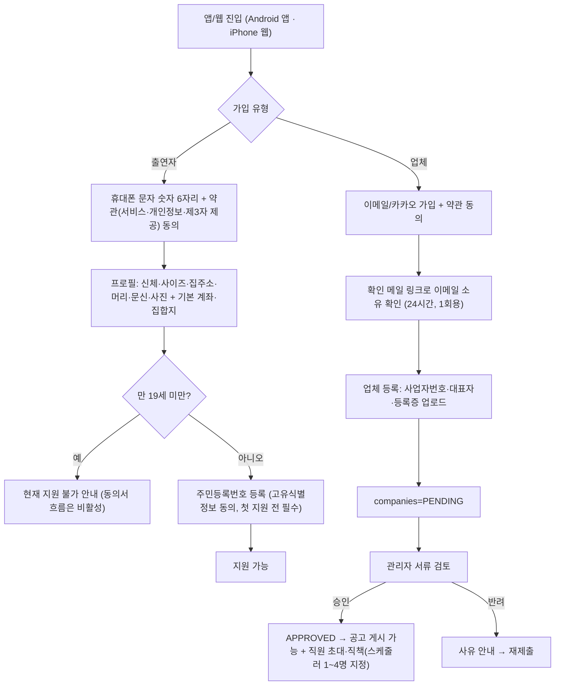
| 단계 | 담당 | 입력 → 출력 | 예외/규칙 |
|---|---|---|---|
| 가입·로그인(출연자) | 출연자 | 휴대폰 번호 → 문자 숫자 6자리 → `users`(이메일 없이 가능), `otp_challenges`, 약관 → `user_consents`. 로그인은 90일 유지 | 중복 번호 409, 시도 10회·재전송 제한 |
| 가입·로그인(업체·관리자) | 업체·관리자 | 이메일·비밀번호·약관 → 확인 메일 발송(아웃박스) → 링크로 이메일 확인 → 확인 후에만 업체 등록·직원 초대 수락 → 관리자 승인 | 중복 이메일 409, 5회 실패 시 그 IP 만 15분 잠금+주인에게 알림 메일, 확인 메일 재발송 1분 1회·하루 5회 |
| 비밀번호 재설정 | 업체·관리자 | 이메일 입력 → 임시 비밀번호 메일(30분) → 임시 비밀번호로 로그인(제한 토큰) → 새 비밀번호 설정(SCR-AU13) → 전 기기 로그아웃·알림 메일 | 계정 유무와 무관하게 항상 202, 한도 초과는 조용히 미발송 |
| 번호 인증 | 출연자 | 가입 시 문자 인증이 곧 `phone_verified_at` (카카오 전화번호 동의항목은 심사 통과 시 병행) | 번호 유일 |
| 주민번호 등록 | 출연자 | 번호 입력 → 형식·생년월일·성별 일치 검증 → 암호화 저장 + HMAC 해시 | 이미 활성인 동일 번호가 있으면 **중복 가입 의심**(409), 화면에는 항상 마스킹 |
| 업체 등록·승인 | 업체·관리자 | 등록증 → `companies`, `company_verifications` | 미승인 업체는 공고 게시 403 |

## 2. 공고 등록 · 게시 (REQ-J01~J10)
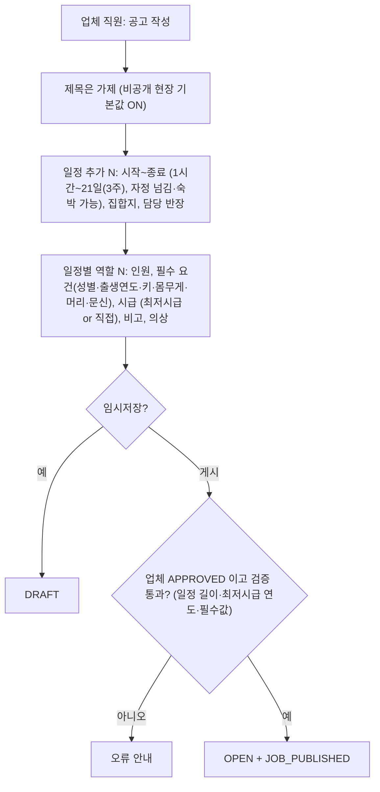
- 시급에서 **'최저시급' 선택 시** `minimum_wages` 에서 해당 연도 값을 자동 채우고 공고에 스냅샷(`hourly_wage_krw`, `min_wage_year`). 안내 문구: "9시간 이내 근무는 최저시급×8시간 고정".
- 식대(아침·점심·저녁)·교통 등은 **비고에 자유 기재**(필터 대상 아님).
- **공고 복사**: 일정·역할 구조를 새 DRAFT 로 복사(지원자·확정자 제외).
- **수정 제한**: 지원자가 있는 역할의 정원 감소/삭제 거부(409), 조건 변경 시 합격 통보를 받은 사람에게 변경 알림.

## 3. 탐색 · 지원 (REQ-S01~S05, AP01~AP06)
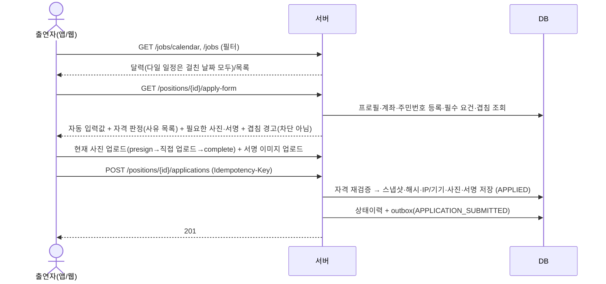
- 지원 시 **프로필에서 자동 입력**: 이름·번호·성별·출생연도·키·몸무게·사이즈·집주소·집합지·계좌. 계좌는 "내 정보에서 가져오기" 또는 "다른 계좌 입력(은행·계좌번호·예금주)". 주민번호는 화면에 입력하지 않고 등록된 최신 버전을 **참조**한다.
- **현재 사진 필수**, **전자서명 필수**. 서명은 서명 이미지·시각·IP·기기·약관 버전·무결성 해시(`snapshot_hash`)로 증빙.
- **같은 날/겹치는 일정에도 지원 가능**(경고만). 미성년자(만 19세 미만)는 현재 지원 불가.
- 자격 판정 순서·사유 코드: 03 부록 D.

## 4. 선발 — 합격 통보 → 출연자 확정 (REQ-SEL01~SEL06, SEL09, PC01~PC02)
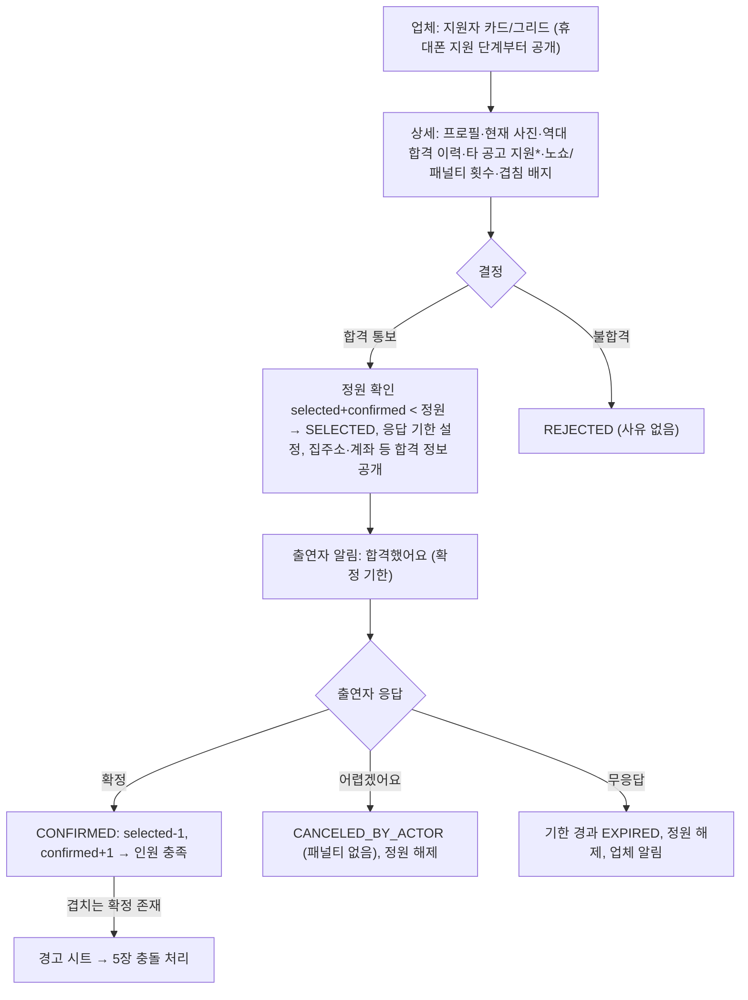
\* 타 공고 지원 열람은 `subscription_enforcement=false` 이거나 `free_open_application_history=true` 일 때 무료, 아니면 구독 기능 필요. 타 업체 공고는 제목 대신 시간대·상태만 보인다.
- **예비합격·선착순·불합격 사유는 없다.** 업체가 보고 뽑는다.
- 합격 통보 시점에 같은 사람의 다른 SELECTED/CONFIRMED 와 시간이 겹치면 업체 화면에 **겹침 경고 배지**(차단 아님). 최종 충돌 처리는 출연자 확정 단계.
- 일괄 처리는 건별 성공/실패를 가려 **207**.

## 5. 복수 확정 충돌 (REQ-SEL10, N07)
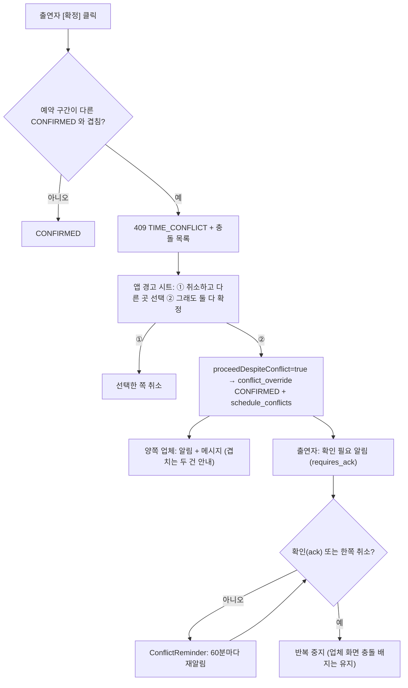
- 의도 없는 동시 확정(경쟁 조건)은 DB `EXCLUDE` 가 막고, **경고를 확인하고 진행한 확정만** `conflict_override` 로 허용한다.

## 6. 마감 · 자동 불합격 · 마감 후 추가 합격 (REQ-SEL05, SEL11, J08)
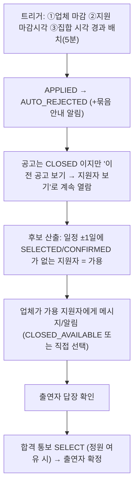
- 정원에 여유가 없으면 `FULL`. 마감 해제(`reopen`)도 가능.
- 가용 판단은 **자동 확정이 아니라 후보 제시**이며 최종 선택은 업체가 한다.

## 7. 합격 이후 — 메시지 · 인원표 · 인원 정보표 (REQ-PC03~PC05, PC13)
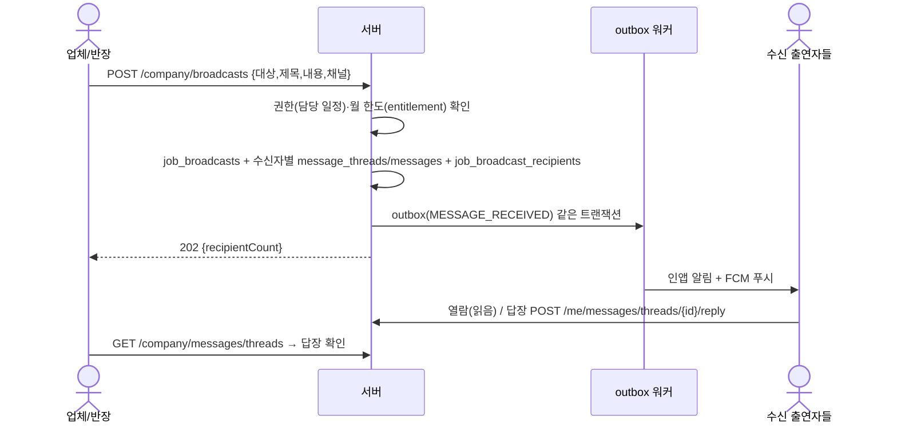
- 대상: 확정자 전체 / 통보자 포함 / 참석 미확인 / 마감 후 가용 지원자 / 직접 선택. **출연자는 먼저 보낼 수 없고 답장만** 가능.
- **인원표**: 일정·역할별 정원/지원/통보/확정/참석확인/출석/노쇼. **인원 정보표**: 이름·번호·성별·출생연도·키·몸무게·사이즈·집주소·집합지·계좌·주민번호(마스킹) — 직책별 공개 범위(03 부록 B), 엑셀은 암호화, 모든 열람·다운로드 감사.
- 합격 이후 출연자는 업체/반장 번호를, 업체는 출연자 번호를 확인해 전화·문자할 수 있다.

## 8. 참석 확인 → QR 출퇴근 (REQ-PC06, PC07, PC08)
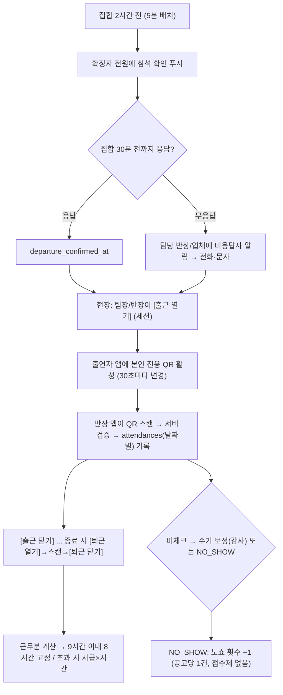
- 세션이 닫혀 있으면 QR 이 없고, 스크린샷은 30초 후 무효 → **대리 출석 방지**.
- 숙박 등 다일 일정은 날짜별 세션·출결.

## 9. 확정 후 취소와 패널티 판정 (REQ-PC09, C06)
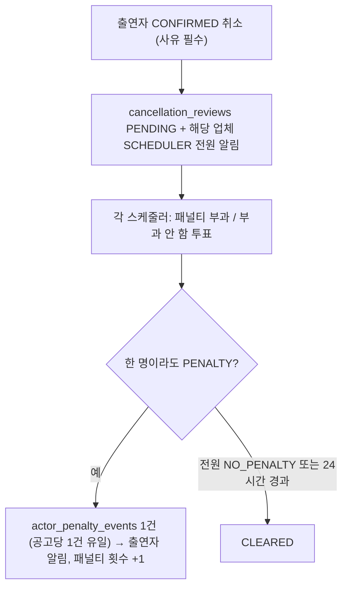
- 연기·업체 사정 취소(`penalty_exempt`)는 판정 없이 면제.

## 10. 일정 취소 · 연기 (REQ-J06)
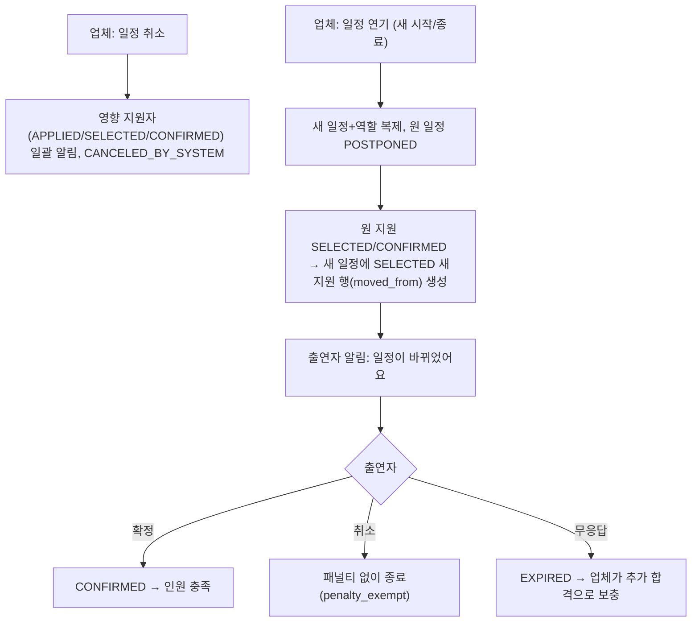

## 11. 정산 (REQ-PC10) — P2
촬영 종료 → 출퇴근 기록으로 근무분 확정 → 기본급(규칙: 9시간 이내 시급×8, 초과 시 시급×시간) + 식대·교통·연장·공제를 `settlement_items` 로 입력 → 세금 유형 선택·세액 기록 → **은행 대량이체 엑셀** / **원천징수 자료 엑셀(암호화, 주민번호 포함)** 생성 → 업체가 계좌로 직접 이체 후 `PAID` 표시. **플랫폼은 송금하지 않는다.** 은행별 양식은 실제 양식을 받은 뒤 `export_templates` 에 추가한다.

## 12. 알림 파이프라인 (REQ-N01~N07)
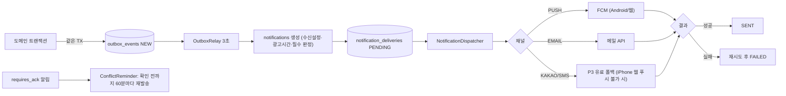

## 13. 증빙 보관 · 파기 (REQ-PC15, A06)
지원서(스냅샷·서명·현재 사진·해시)·출결·정산·메시지·주민번호(버전)·상태 이력을 **분쟁 대비 증빙으로 보관**한다. 보존기간은 `evidence_retention_years`(기본 5년, 법정 보존기간 확인 후 확정), 분쟁/조사 중이면 법적 보류. 경과분은 `EvidenceRetentionPurger` 가 파기(주민번호·계좌 먼저, 지원서·사진은 비식별화 후 통계만). 탈퇴한 출연자의 데이터도 같은 기준으로 보관·파기한다.

## 14. 구독 게이트 판정 (REQ-MON01, MON02)
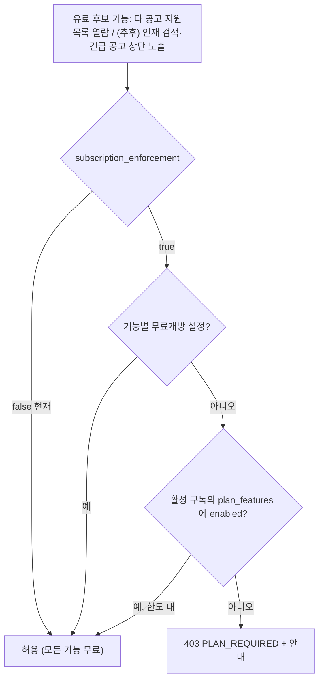
판정은 `EntitlementService.check(company, featureCode)` **한 곳**. 사용량(`usage_counters`)은 무료 기간에도 집계한다.
