# 02. 프로세스 정의서

> v1.0 · 2026-10-28 · 요구사항(01)·기능(03)과 ID 로 연결. 다이어그램은 Mermaid.
> 용어: 업체=보출 업체, 출연자, 반장=`FIELD_LEADER`, 시스템=서버/배치.

## 목차
1. 가입·업체 승인 / 2. 공고 등록·게시 / 3. 탐색·지원 / 4. 선발·합격 통보 / 5. 마감 자동 불합격 / 6. 합격 이후(단체 메시지·인원표·정보표) / 7. 전날 참석 확인 → 당일 출석 / 8. 일자 취소·연기 / 9. 정산 기록 / 10. 미성년자 동의서 / 11. 알림 파이프라인 / 12. 탈퇴·파기 / 13. 구독 게이트 판정

---

## 1. 가입 · 업체 승인 (REQ-A01~A07, C01, M01)
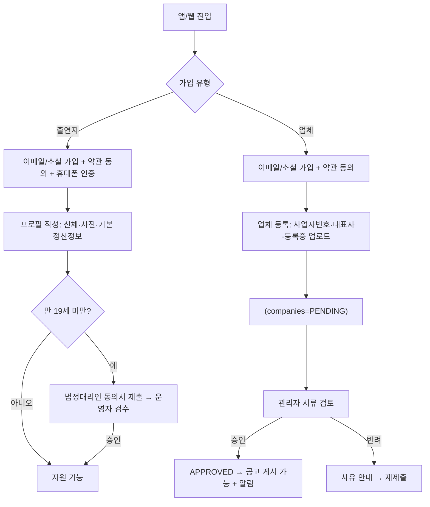
| 단계 | 담당 | 입력 → 출력 | 예외/규칙 |
|---|---|---|---|
| 가입 | 사용자 | 이메일·비밀번호·약관 → `users`, `user_roles`, `user_consents` | 중복 이메일/휴대폰 409, 필수 약관 미동의 422 |
| 휴대폰 인증 | 출연자 | 번호·코드 → `phone_verified_at` | 번호 유일, 5회 실패 시 제한 |
| 업체 등록 | 업체 | 사업자 정보+파일 → `companies`(PENDING), `company_members`(OWNER), `company_verifications` | 사업자번호 유일 |
| 승인 | 관리자 | 승인/반려+사유 → 상태 변경, `audit_logs`, `COMPANY_APPROVED` 이벤트 | **미승인 업체는 공고 게시 불가(403 `COMPANY_NOT_APPROVED`)** |

## 2. 공고 등록 · 게시 (REQ-J01~J10)
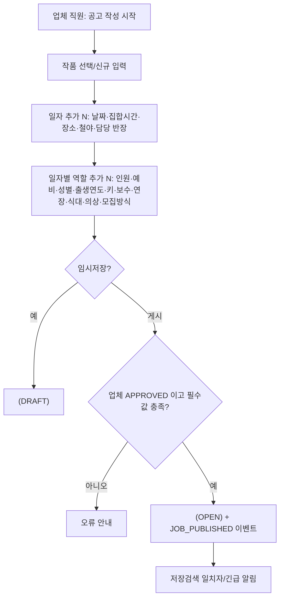
- **복사**: 이전 공고의 일자·역할 구조를 날짜만 옮겨 새 DRAFT 로 만든다. 지원자·확정자·출결은 복사하지 않는다.
- **수정 제한**: 지원자가 있는 역할의 정원 감소/삭제는 거부(409), 보수·의상·집결 변경은 허용하되 이미 합격한 사람에게 변경 알림 발송.
- 역할의 집합 시간·장소는 비어 있으면 **일자 값을 상속**한다.

## 3. 탐색 · 지원 (REQ-S01~S05, AP01~AP05, A08)
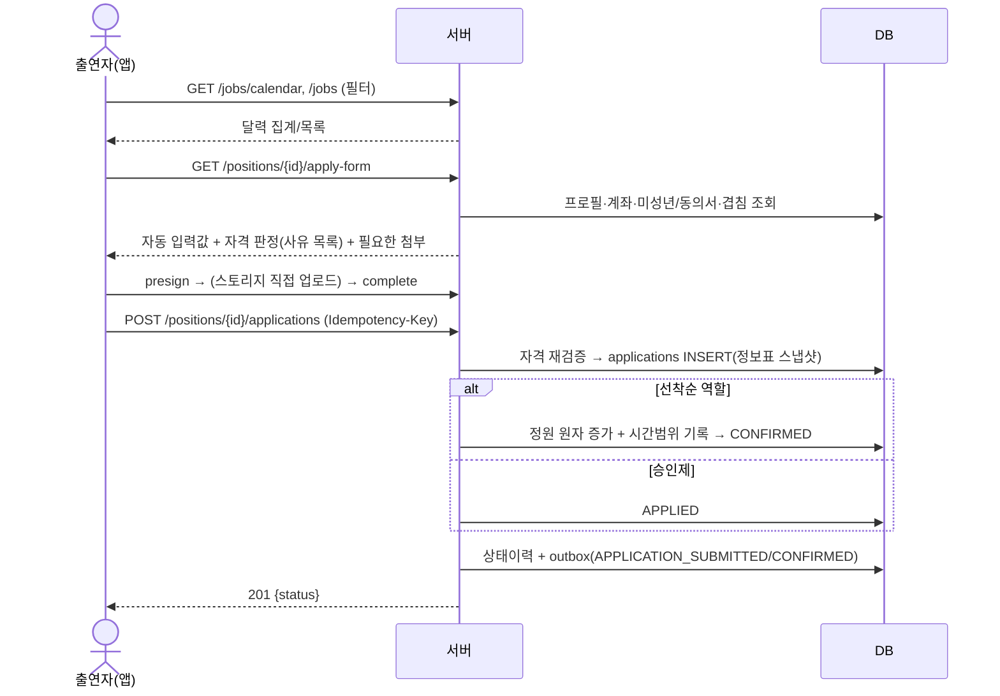
- 자격 판정 순서와 사유 코드는 03번 문서 **부록 D**.
- **같은 날 복수 지원 허용**: 겹침은 경고만 하고 지원은 막지 않는다. 확정 단계에서 DB 가 겹침을 차단한다.
- 지원 시 입력한 이름·번호·출발위치·계좌는 프로필을 변경하지 않고 **그 지원에만** 저장된다(스냅샷). "기본 정보로 저장" 체크 시에만 프로필 갱신.

## 4. 선발 · 합격 통보 (REQ-SEL01~SEL07, PC01, PC02, PC12, PC13)
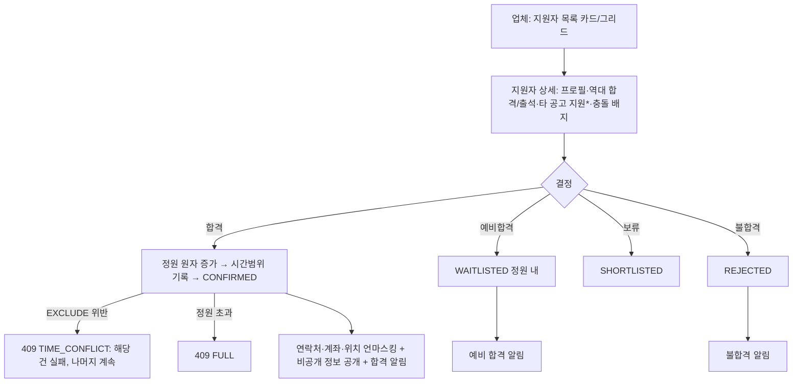
\* 타 공고 지원 열람은 `subscription_enforcement=false` 이거나 `free_open_application_history=true` 일 때 무료, 아니면 `VIEW_ACTOR_APPLICATIONS` 기능 필요. 타 업체 공고는 제목 대신 시간대·상태만 보인다.
- 일괄 처리는 건별로 성공/실패를 가려 **207 부분 성공**으로 응답한다.
- 합격 후 취소(업체)는 사유 필수 + 출연자 알림 + 정원 감소 + 예비 승격 후보 제시.

## 5. 마감 · 자동 불합격 (REQ-SEL05)
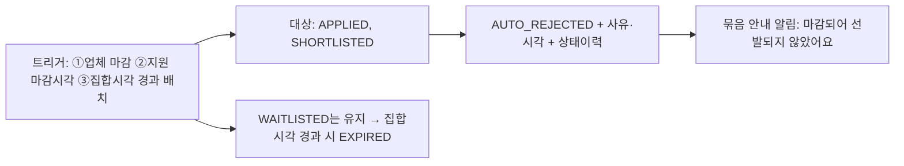
한 트랜잭션에서 처리하고 건수를 응답(`autoRejected: n`)과 감사로그에 남긴다. 설정 `auto_reject_on_close=false` 이면 건너뛴다(예비합격은 어떤 경우에도 자동 불합격하지 않음).

## 6. 합격 이후 — 단체 메시지 · 인원표 · 인원 정보표 (REQ-PC03~PC05, PC13)
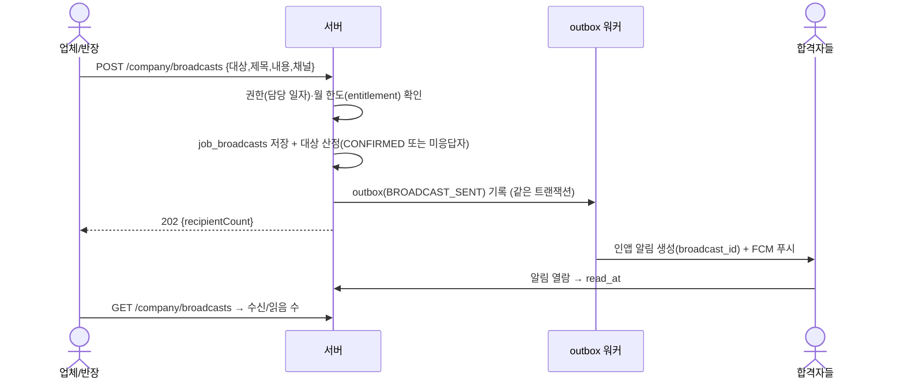
- **인원표**: `v_schedule_headcount_summary` — 일자·역할별 정원/지원/합격/참석확인/출석/노쇼.
- **인원 정보표**: `v_schedule_confirmed_roster` — 합격자 전원의 이름·번호·위치·사이즈·계좌·출석·정산. 직책별 마스킹(03 부록 B), 열람·엑셀 다운로드는 `audit_logs`.
- 합격자끼리가 아니라 **업체↔합격자** 간에만 연락처가 공개된다(출연자는 업체/반장 번호, 업체는 출연자 번호).

## 7. 전날 참석 확인 → 당일 출석 (REQ-PC06, PC07, PC08, PC09)
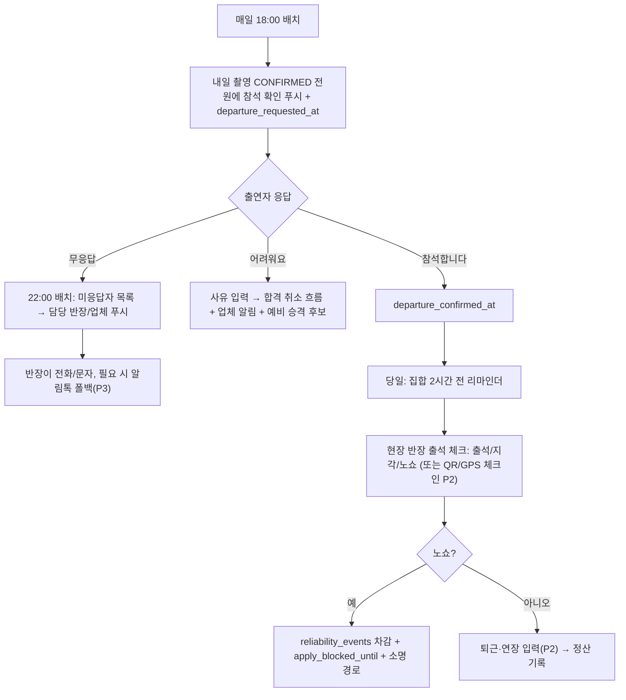
- 출석 기록은 **담당 반장 또는 OWNER/MANAGER 만** 가능(`NOT_ASSIGNED_FIELD_LEADER`). 같은 요청 재전송은 멱등.
- 노쇼 정정(오기록)은 감사로그와 함께 가능하며 성실도 원장에 `APPEAL_RESTORE` 로 복구한다.

## 8. 일자 취소 · 연기 (REQ-J06)
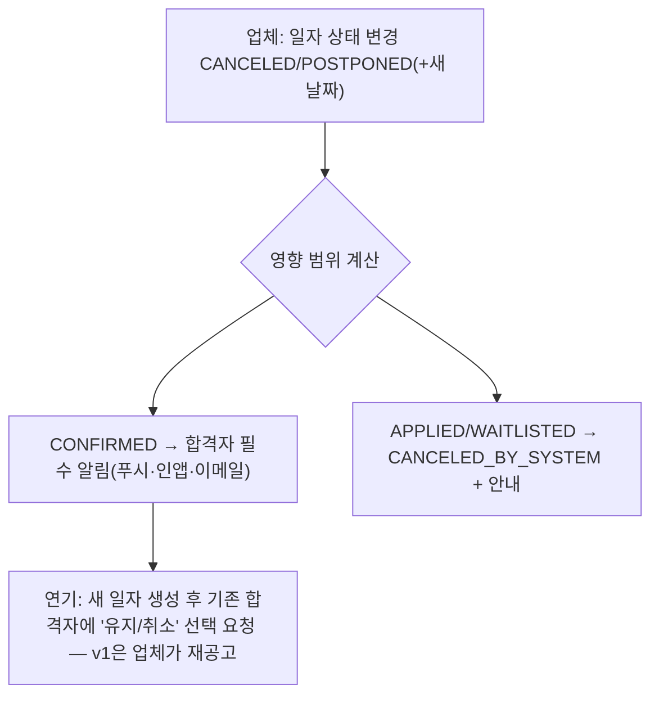
v1 에서는 연기 시 새 일자를 만들고 합격자가 **자동 이전되지 않는다**(업체가 단체 메시지로 안내하고 필요 시 재확정). 자동 이전은 P3 검토.

## 9. 정산 기록 (REQ-PC10) — P2
촬영 종료 → 반장/업체가 출석·퇴근 확정 → 업체가 항목(기본/연장/야간/식대/교통/보너스/공제) 입력 → `settlements`·`settlement_items` 합계 → 정산 엑셀(주민번호 제외) → 업체가 직접 이체 후 `PAID` 표시 → `sensitive_purge_days` 후 지원서 계좌 스냅샷 파기(`PGM-J07`). **플랫폼은 송금하지 않는다.**

## 10. 미성년자 동의서 (REQ-A08, AP04, M09)
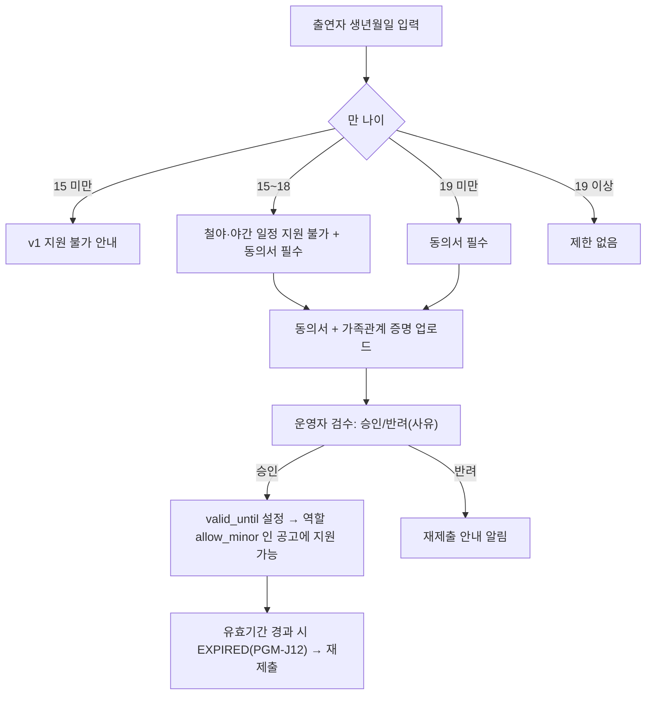
임계값(15/18/19)은 `app_settings` 로 조정한다. 법령 해석은 13번 문서의 법무 확인 항목을 따른다.

## 11. 알림 파이프라인 (REQ-N01~N06, NFR10)
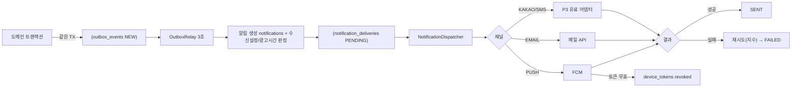
인앱 알림은 항상 생성되고, 푸시/메일은 수신 설정과 필수 여부로 결정한다. 광고성은 21~08시에 보류했다가 08시에 발송한다.

## 12. 회원 탈퇴 · 파기 (REQ-A06)
탈퇴 요청 → 진행 중 확정 건(미래 일자 CONFIRMED)이 있으면 거부 → 계정 `WITHDRAWN`, 토큰·기기 폐기, 공개 프로필 비노출 → 보관기간(법정 보존 의무 확인 후 설정) 경과 시 `PGM-J09` 가 개인정보 컬럼을 비식별화/삭제(출석·정산 통계는 비식별 유지) → 파기 로그.

## 13. 구독 게이트 판정 (REQ-MON01, MON02)
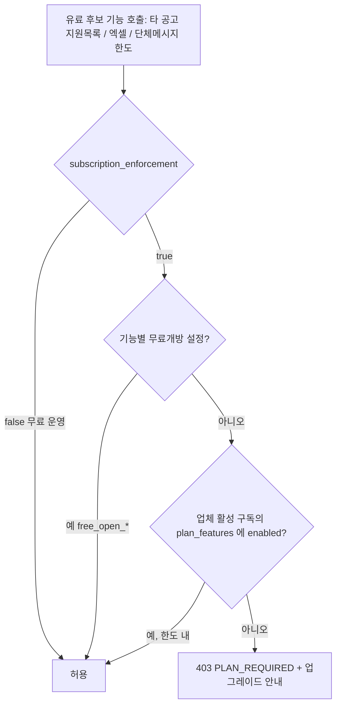
판정 로직은 `EntitlementService.check(company, featureCode)` **한 곳**에만 둔다. 새 유료 기능은 `plan_features` 에 `feature_code` 행을 추가하고 호출 지점에서 check 를 호출하면 된다(스키마 변경 없음).
