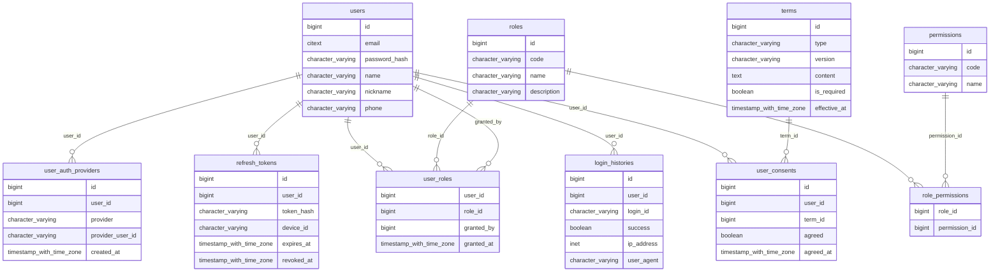
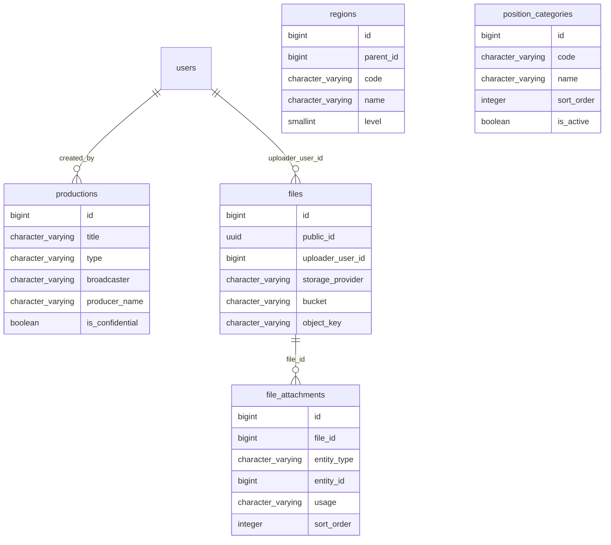
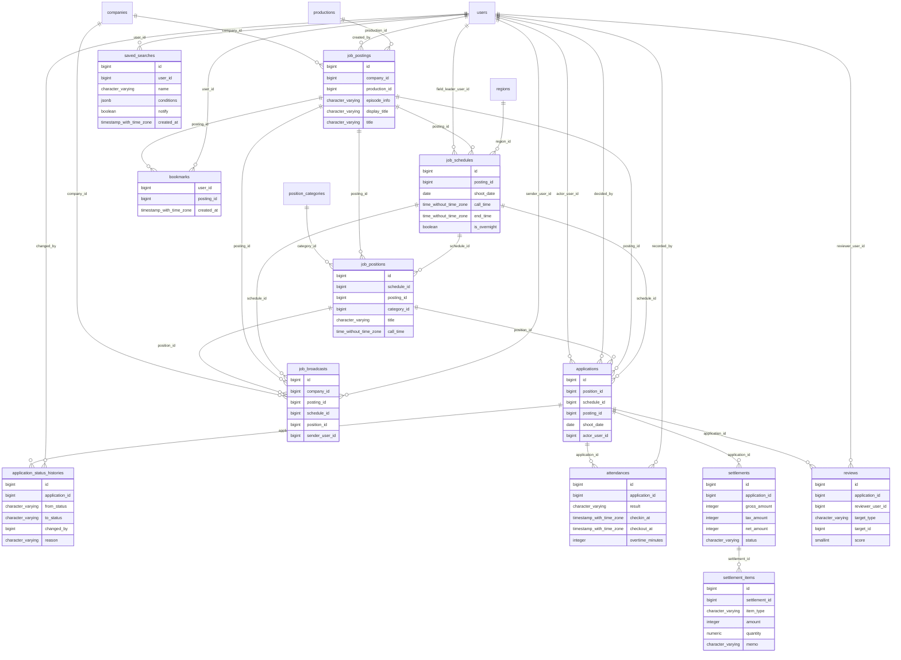
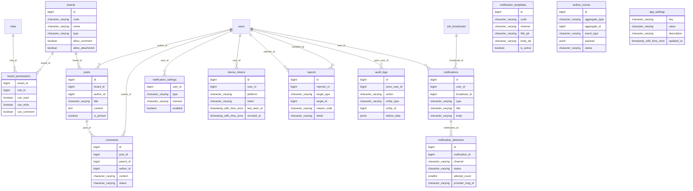

```mermaid
erDiagram
  regions ||--o{ actor_profiles : "region_id"
  users ||--o{ actor_profiles : "user_id"
  actor_profiles ||--o{ actor_payout_accounts : "user_id"
  actor_profiles ||--o{ actor_tax_identities : "user_id"
  applications ||--o{ reliability_events : "application_id"
  users ||--o{ reliability_events : "created_by"
  actor_profiles ||--o{ reliability_events : "user_id"
  applications ||--o{ guardian_consents : "application_id"
  actor_profiles ||--o{ guardian_consents : "actor_user_id"
  users ||--o{ guardian_consents : "verified_by"
  users ||--o{ companies : "approved_by"
  regions ||--o{ companies : "region_id"
  companies ||--o{ company_members : "company_id"
  users ||--o{ company_members : "user_id"
  companies ||--o{ company_verifications : "company_id"
  users ||--o{ company_verifications : "reviewed_by"
  users ||--o{ company_actor_blocks : "actor_user_id"
  companies ||--o{ company_actor_blocks : "company_id"
  users ||--o{ company_actor_blocks : "created_by"
  subscription_plans ||--o{ plan_features : "plan_id"
  companies ||--o{ company_subscriptions : "company_id"
  subscription_plans ||--o{ company_subscriptions : "plan_id"
  companies ||--o{ usage_counters : "company_id"
  actor_profiles {
    bigint user_id
    date birth_date
    character_varying gender
    smallint height_cm
    smallint weight_kg
    character_varying top_size
  }
  actor_payout_accounts {
    bigint user_id
    character_varying bank_code
    character_varying bank_name
    character_varying account_number_enc
    character_varying account_holder
    smallint key_version
  }
  actor_tax_identities {
    bigint user_id
    character_varying rrn_enc
    smallint key_version
    timestamp_with_time_zone consented_at
    date purge_after
    timestamp_with_time_zone updated_at
  }
  reliability_events {
    bigint id
    bigint user_id
    bigint application_id
    integer delta
    character_varying reason_code
    character_varying note
  }
  guardian_consents {
    bigint id
    bigint actor_user_id
    character_varying guardian_name
    character_varying guardian_phone
    character_varying relationship
    character_varying scope
  }
  companies {
    bigint id
    character_varying name
    character_varying biz_reg_no
    character_varying representative
    character_varying phone
    character_varying address
  }
  company_members {
    bigint company_id
    bigint user_id
    character_varying member_role
    character_varying department_name
    character_varying status
    timestamp_with_time_zone joined_at
  }
  company_verifications {
    bigint id
    bigint company_id
    character_varying status
    character_varying reject_reason
    bigint reviewed_by
    timestamp_with_time_zone submitted_at
  }
  company_actor_blocks {
    bigint company_id
    bigint actor_user_id
    character_varying reason
    bigint created_by
    timestamp_with_time_zone created_at
  }
  subscription_plans {
    bigint id
    character_varying code
    character_varying name
    integer monthly_price_krw
    boolean is_active
    timestamp_with_time_zone created_at
  }
  plan_features {
    bigint plan_id
    character_varying feature_code
    boolean enabled
    integer limit_value
  }
  company_subscriptions {
    bigint id
    bigint company_id
    bigint plan_id
    character_varying status
    timestamp_with_time_zone started_at
    timestamp_with_time_zone expires_at
  }
  usage_counters {
    bigint company_id
    character_varying feature_code
    character period_month
    integer used_count
    timestamp_with_time_zone updated_at
  }
```

# 07. ERD · 테이블 정의서
> 이 문서는 `tools/spec/*.py` 와 `db/schema.sql` 에서 `python3 tools/build_docs.py` 로 **자동 생성**된다. 직접 수정하지 말고 원천 데이터를 고칠 것.
> 버전 v1.0 · 기준일 2026-10-28

원천: `db/schema.sql` (PostgreSQL 16+). 테이블 **53**개, 뷰 **2**개 (`v_schedule_confirmed_roster`, `v_schedule_headcount_summary`).

## 0. 설계 원칙 · 명명 규칙
- 테이블: 복수형 snake_case, PK는 `id BIGINT IDENTITY`, 외부 노출용은 `public_id UUID`(파일).
- 상태값: `VARCHAR + CHECK`(DB enum 미사용). 시간: `TIMESTAMPTZ`, 촬영일·집합시간만 `DATE`/`TIME`(KST 업무값).
- **삭제**: 업무 테이블은 hard delete 금지(FK 는 기본 RESTRICT). 사용자·공고·게시글 등은 `deleted_at` soft delete, 순수 하위 상세(`settlement_items`, `plan_features` 등)만 `ON DELETE CASCADE`.
- **캐시 컬럼**(`applied_count`, `confirmed_count`, `standby_count`, `reliability_score`, `*_count`)은 원천(applications/원장)과 `PGM-J10` 배치로 대조한다.
- **민감 컬럼**(`account_number_enc`, `rrn_enc`)은 앱 계층 AES-256-GCM, `key_version` 으로 회전. 응답 시 마스킹은 `F-OP13` 정책 클래스가 담당.
- **첨부**: 모든 파일은 `files`(메타) + `file_attachments`(엔티티·용도 연결). 연결 쓰기는 `AttachmentService` 단일 경로, 정합성은 `PGM-J13` 점검.
- **DB가 지키는 업무 규칙**(애플리케이션 버그가 있어도 깨지지 않게):
  - 정원 초과 금지: `job_positions` CHECK
  - 활성 중복 지원 금지·취소 후 재지원 허용: `uq_applications_active`
  - **같은 사람의 시간 겹침 확정 금지**: `applications` `ex_applications_no_overlap` (EXCLUDE, `btree_gist`)
  - 확정에는 시간범위 필수: `ck_confirmed_has_range`
  - 업체 단일 활성 구독: `uq_company_subscription_active`

## 1. 그룹별 ERD

### 계정·권한

### 마스터·파일

### 프로필·업체·구독

### 공고·지원·현장

### 게시판·알림·운영

## 2. 테이블 정의서

### 계정·권한
#### `users`

| # | 컬럼 | 타입 | NULL | 기본값 | 키 | 설명 |
|---|---|---|---|---|---|---|
| 1 | id | bigint | N | IDENTITY | PK |  |
| 2 | email | citext | N |  |  |  |
| 3 | password_hash | varchar(100) | Y |  |  | 소셜 전용 계정이면 NULL |
| 4 | name | varchar(50) | N |  |  |  |
| 5 | nickname | varchar(50) | Y |  |  |  |
| 6 | phone | varchar(20) | Y |  |  |  |
| 7 | status | varchar(20) | N | 'ACTIVE'::character varying |  |  |
| 8 | email_verified_at | timestamptz | Y |  |  |  |
| 9 | phone_verified_at | timestamptz | Y |  |  |  |
| 10 | last_login_at | timestamptz | Y |  |  |  |
| 11 | created_at | timestamptz | N | now() |  |  |
| 12 | updated_at | timestamptz | N | now() |  |  |
| 13 | deleted_at | timestamptz | Y |  |  |  |

제약(CHECK/EXCLUDE):
- `users_status_check`: CHECK (((status)::text = ANY ((ARRAY['PENDING'::character varying, 'ACTIVE'::character varying, 'SUSPENDED'::character varying, 'WITHDRAWN'::character varying])::text[])))

인덱스:
- `uq_users_email`: btree (email) WHERE (deleted_at IS NULL)
- `uq_users_phone`: btree (phone) WHERE ((deleted_at IS NULL) AND (phone IS NOT NULL))

#### `user_auth_providers` — 소셜 로그인 (카카오/구글/네이버/애플)

| # | 컬럼 | 타입 | NULL | 기본값 | 키 | 설명 |
|---|---|---|---|---|---|---|
| 1 | id | bigint | N | IDENTITY | PK |  |
| 2 | user_id | bigint | N |  | FK→users |  |
| 3 | provider | varchar(20) | N |  |  |  |
| 4 | provider_user_id | varchar(100) | N |  |  |  |
| 5 | created_at | timestamptz | N | now() |  |  |

제약(CHECK/EXCLUDE):
- `user_auth_providers_provider_check`: CHECK (((provider)::text = ANY ((ARRAY['KAKAO'::character varying, 'GOOGLE'::character varying, 'NAVER'::character varying, 'APPLE'::character varying])::text[])))

인덱스:
- `user_auth_providers_provider_provider_user_id_key`: btree (provider, provider_user_id)

#### `roles`

| # | 컬럼 | 타입 | NULL | 기본값 | 키 | 설명 |
|---|---|---|---|---|---|---|
| 1 | id | bigint | N | IDENTITY | PK |  |
| 2 | code | varchar(30) | N |  | UQ | SUPER_ADMIN, ADMIN, OPERATOR, COMPANY, ACTOR |
| 3 | name | varchar(50) | N |  |  |  |
| 4 | description | varchar(200) | Y |  |  |  |

인덱스:
- `roles_code_key`: btree (code)

#### `permissions`

| # | 컬럼 | 타입 | NULL | 기본값 | 키 | 설명 |
|---|---|---|---|---|---|---|
| 1 | id | bigint | N | IDENTITY | PK |  |
| 2 | code | varchar(60) | N |  | UQ | 예: JOB_POST_CREATE, COMPANY_APPROVE |
| 3 | name | varchar(100) | N |  |  |  |

인덱스:
- `permissions_code_key`: btree (code)

#### `role_permissions`

| # | 컬럼 | 타입 | NULL | 기본값 | 키 | 설명 |
|---|---|---|---|---|---|---|
| 1 | role_id | bigint | N |  | PK FK→roles |  |
| 2 | permission_id | bigint | N |  | PK FK→permissions |  |

#### `user_roles` — 한 사람이 ACTOR + COMPANY 동시 보유 가능

| # | 컬럼 | 타입 | NULL | 기본값 | 키 | 설명 |
|---|---|---|---|---|---|---|
| 1 | user_id | bigint | N |  | PK FK→users |  |
| 2 | role_id | bigint | N |  | PK FK→roles |  |
| 3 | granted_by | bigint | Y |  | FK→users |  |
| 4 | granted_at | timestamptz | N | now() |  |  |

#### `refresh_tokens`

| # | 컬럼 | 타입 | NULL | 기본값 | 키 | 설명 |
|---|---|---|---|---|---|---|
| 1 | id | bigint | N | IDENTITY | PK |  |
| 2 | user_id | bigint | N |  | FK→users |  |
| 3 | token_hash | varchar(100) | N |  | UQ | 원문 저장 금지, 해시만 |
| 4 | device_id | varchar(100) | Y |  |  |  |
| 5 | expires_at | timestamptz | N |  |  |  |
| 6 | revoked_at | timestamptz | Y |  |  |  |
| 7 | created_at | timestamptz | N | now() |  |  |

인덱스:
- `ix_refresh_tokens_user`: btree (user_id)
- `refresh_tokens_token_hash_key`: btree (token_hash)

#### `login_histories`

| # | 컬럼 | 타입 | NULL | 기본값 | 키 | 설명 |
|---|---|---|---|---|---|---|
| 1 | id | bigint | N | IDENTITY | PK |  |
| 2 | user_id | bigint | Y |  | FK→users |  |
| 3 | login_id | varchar(100) | Y |  |  | 실패 시 입력값 |
| 4 | success | boolean | N |  |  |  |
| 5 | ip_address | inet | Y |  |  |  |
| 6 | user_agent | varchar(300) | Y |  |  |  |
| 7 | created_at | timestamptz | N | now() |  |  |

인덱스:
- `ix_login_histories_user`: btree (user_id, created_at DESC)

#### `terms` — 약관 버전 관리

| # | 컬럼 | 타입 | NULL | 기본값 | 키 | 설명 |
|---|---|---|---|---|---|---|
| 1 | id | bigint | N | IDENTITY | PK |  |
| 2 | type | varchar(30) | N |  |  |  |
| 3 | version | varchar(20) | N |  |  |  |
| 4 | content | text | N |  |  |  |
| 5 | is_required | boolean | N |  |  |  |
| 6 | effective_at | timestamptz | N |  |  |  |

제약(CHECK/EXCLUDE):
- `terms_type_check`: CHECK (((type)::text = ANY ((ARRAY['SERVICE'::character varying, 'PRIVACY'::character varying, 'MARKETING'::character varying, 'LOCATION'::character varying, 'YOUTH'::character varying, 'THIRD_PARTY_PROVISION'::charac…

인덱스:
- `terms_type_version_key`: btree (type, version)

#### `user_consents`

| # | 컬럼 | 타입 | NULL | 기본값 | 키 | 설명 |
|---|---|---|---|---|---|---|
| 1 | id | bigint | N | IDENTITY | PK |  |
| 2 | user_id | bigint | N |  | FK→users |  |
| 3 | term_id | bigint | N |  | FK→terms |  |
| 4 | agreed | boolean | N |  |  |  |
| 5 | agreed_at | timestamptz | N | now() |  |  |

인덱스:
- `user_consents_user_id_term_id_key`: btree (user_id, term_id)

### 마스터·파일
#### `regions` — 시/도 → 시/군/구 (2단계)

| # | 컬럼 | 타입 | NULL | 기본값 | 키 | 설명 |
|---|---|---|---|---|---|---|
| 1 | id | bigint | N | IDENTITY | PK |  |
| 2 | parent_id | bigint | Y |  | FK→regions |  |
| 3 | code | varchar(10) | N |  | UQ |  |
| 4 | name | varchar(50) | N |  |  |  |
| 5 | level | smallint | N |  |  |  |

제약(CHECK/EXCLUDE):
- `regions_level_check`: CHECK ((level = ANY (ARRAY[1, 2])))

인덱스:
- `regions_code_key`: btree (code)

#### `position_categories` — 일반/교복/군인/경찰/환자/외국인/차량지참 …

| # | 컬럼 | 타입 | NULL | 기본값 | 키 | 설명 |
|---|---|---|---|---|---|---|
| 1 | id | bigint | N | IDENTITY | PK |  |
| 2 | code | varchar(30) | N |  | UQ |  |
| 3 | name | varchar(50) | N |  |  |  |
| 4 | sort_order | integer | N | 0 |  |  |
| 5 | is_active | boolean | N | true |  |  |

인덱스:
- `position_categories_code_key`: btree (code)

#### `productions` — 작품(드라마/영화/광고…) 공용 마스터

| # | 컬럼 | 타입 | NULL | 기본값 | 키 | 설명 |
|---|---|---|---|---|---|---|
| 1 | id | bigint | N | IDENTITY | PK |  |
| 2 | title | varchar(200) | N |  |  |  |
| 3 | type | varchar(20) | N | 'DRAMA'::character varying |  |  |
| 4 | broadcaster | varchar(100) | Y |  |  | 방송사/OTT/배급사 |
| 5 | producer_name | varchar(100) | Y |  |  | 제작사 |
| 6 | is_confidential | boolean | N | false |  | 작품명 비공개 현장 대응 |
| 7 | status | varchar(20) | N | 'ACTIVE'::character varying |  |  |
| 8 | merged_into_id | bigint | Y |  | FK→productions |  |
| 9 | created_by | bigint | Y |  | FK→users |  |
| 10 | created_at | timestamptz | N | now() |  |  |
| 11 | updated_at | timestamptz | N | now() |  |  |

제약(CHECK/EXCLUDE):
- `productions_status_check`: CHECK (((status)::text = ANY ((ARRAY['ACTIVE'::character varying, 'HIDDEN'::character varying, 'MERGED'::character varying])::text[])))
- `productions_type_check`: CHECK (((type)::text = ANY ((ARRAY['DRAMA'::character varying, 'MOVIE'::character varying, 'AD'::character varying, 'MV'::character varying, 'OTT'::character varying, 'VARIETY'::character varying, 'ETC'::character var…

인덱스:
- `ix_productions_title_trgm`: gin (title gin_trgm_ops)

#### `files`

| # | 컬럼 | 타입 | NULL | 기본값 | 키 | 설명 |
|---|---|---|---|---|---|---|
| 1 | id | bigint | N | IDENTITY | PK |  |
| 2 | public_id | uuid | N | gen_random_uuid() | UQ | 외부 노출용 |
| 3 | uploader_user_id | bigint | Y |  | FK→users |  |
| 4 | storage_provider | varchar(20) | N | 'R2'::character varying |  |  |
| 5 | bucket | varchar(100) | N |  |  |  |
| 6 | object_key | varchar(500) | N |  |  |  |
| 7 | original_name | varchar(255) | N |  |  |  |
| 8 | content_type | varchar(100) | N |  |  |  |
| 9 | size_bytes | bigint | N |  |  |  |
| 10 | checksum_sha256 | varchar(64) | Y |  |  |  |
| 11 | width | integer | Y |  |  | 이미지일 때 |
| 12 | height | integer | Y |  |  |  |
| 13 | variants | jsonb | Y |  |  | {"thumb":"key","medium":"key"} 리사이즈본 (public_url 은 저장하지 않고 키+CDN 도메인으로 조합) |
| 14 | status | varchar(20) | N | 'PENDING'::character varying |  |  |
| 15 | is_private | boolean | N | true |  | TRUE → 서명 URL로만 접근 |
| 16 | created_at | timestamptz | N | now() |  |  |
| 17 | deleted_at | timestamptz | Y |  |  |  |

제약(CHECK/EXCLUDE):
- `files_size_bytes_check`: CHECK ((size_bytes >= 0))
- `files_status_check`: CHECK (((status)::text = ANY ((ARRAY['PENDING'::character varying, 'ACTIVE'::character varying, 'DELETED'::character varying])::text[])))
- `files_storage_provider_check`: CHECK (((storage_provider)::text = ANY ((ARRAY['R2'::character varying, 'GCS'::character varying, 'S3'::character varying, 'LOCAL'::character varying])::text[])))

인덱스:
- `files_bucket_object_key_key`: btree (bucket, object_key)
- `files_public_id_key`: btree (public_id)
- `ix_files_pending`: btree (created_at) WHERE ((status)::text = 'PENDING'::text)

#### `file_attachments` — “어떤 엔티티의 어떤 용도 파일인가”

| # | 컬럼 | 타입 | NULL | 기본값 | 키 | 설명 |
|---|---|---|---|---|---|---|
| 1 | id | bigint | N | IDENTITY | PK |  |
| 2 | file_id | bigint | N |  | FK→files |  |
| 3 | entity_type | varchar(30) | N |  |  |  |
| 4 | entity_id | bigint | N |  |  |  |
| 5 | usage | varchar(30) | N |  |  |  |
| 6 | sort_order | integer | N | 0 |  |  |
| 7 | created_at | timestamptz | N | now() |  |  |

제약(CHECK/EXCLUDE):
- `file_attachments_entity_type_check`: CHECK (((entity_type)::text = ANY ((ARRAY['ACTOR_PROFILE'::character varying, 'COMPANY'::character varying, 'COMPANY_VERIFICATION'::character varying, 'JOB_POSTING'::character varying, 'APPLICATION'::character varying…
- `file_attachments_usage_check`: CHECK (((usage)::text = ANY ((ARRAY['PROFILE_PHOTO'::character varying, 'FULL_BODY_PHOTO'::character varying, 'RESUME'::character varying, 'BIZ_LICENSE'::character varying, 'LOGO'::character varying, 'JOB_IMAGE'::char…

인덱스:
- `file_attachments_file_id_entity_type_entity_id_usage_key`: btree (file_id, entity_type, entity_id, usage)
- `ix_file_attachments_entity`: btree (entity_type, entity_id, usage, sort_order)

### 프로필·업체·구독
#### `actor_profiles` — 1:1 users, ACTOR 역할 사용자만

| # | 컬럼 | 타입 | NULL | 기본값 | 키 | 설명 |
|---|---|---|---|---|---|---|
| 1 | user_id | bigint | N |  | PK FK→users |  |
| 2 | birth_date | date | N |  |  | 출생연도 범위 매칭 + 미성년 판정 |
| 3 | gender | varchar(10) | N |  |  |  |
| 4 | height_cm | smallint | Y |  |  |  |
| 5 | weight_kg | smallint | Y |  |  |  |
| 6 | top_size | varchar(10) | Y |  |  | 95, 100, 55, 66 … |
| 7 | bottom_size | varchar(10) | Y |  |  |  |
| 8 | shoe_size | smallint | Y |  |  | mm |
| 9 | hair_style | varchar(100) | Y |  |  | 머리 기장/염색 (사극·현대극 구분) |
| 10 | has_tattoo | boolean | N | false |  |  |
| 11 | can_drive | boolean | N | false |  | 운전 가능 |
| 12 | has_vehicle | boolean | N | false |  | 차량 지참 가능 |
| 13 | region_id | bigint | Y |  | FK→regions |  |
| 14 | default_departure_location | varchar(200) | Y |  |  | 지원 시 자동 입력되는 기본 출발지/탑승 희망지 |
| 15 | introduction | varchar(1000) | Y |  |  |  |
| 16 | experience_note | varchar(1000) | Y |  |  |  |
| 17 | tags | jsonb | N | '[]'::jsonb |  | 개방형 특기/보유의상: ["수영","영어회화","정장보유","경찰복보유"] |
| 18 | is_searchable | boolean | N | true |  | 업체 인재검색 노출 동의 |
| 19 | reliability_score | integer | N | 100 |  |  |
| 20 | apply_blocked_until | timestamptz | Y |  |  | 노쇼 패널티 지원 제한 |
| 21 | confirmed_count | integer | N | 0 |  |  |
| 22 | attended_count | integer | N | 0 |  |  |
| 23 | noshow_count | integer | N | 0 |  |  |
| 24 | rating_avg | numeric(3,2) | Y |  |  |  |
| 25 | rating_count | integer | N | 0 |  |  |
| 26 | history_disclosure_consented_at | timestamptz | Y |  |  | 역대 합격/지원 이력을 업체에 공개하는 데 동의한 시각 (제3자 제공 동의) |
| 27 | created_at | timestamptz | N | now() |  |  |
| 28 | updated_at | timestamptz | N | now() |  |  |

제약(CHECK/EXCLUDE):
- `actor_profiles_gender_check`: CHECK (((gender)::text = ANY ((ARRAY['MALE'::character varying, 'FEMALE'::character varying, 'OTHER'::character varying])::text[])))
- `actor_profiles_height_cm_check`: CHECK (((height_cm >= 50) AND (height_cm <= 250)))
- `actor_profiles_weight_kg_check`: CHECK (((weight_kg >= 20) AND (weight_kg <= 300)))

인덱스:
- `ix_actor_spec`: btree (gender, birth_date, height_cm, weight_kg)
- `ix_actor_tags`: gin (tags jsonb_path_ops)

#### `actor_payout_accounts` — 정산용 계좌 (선택 수집)

| # | 컬럼 | 타입 | NULL | 기본값 | 키 | 설명 |
|---|---|---|---|---|---|---|
| 1 | user_id | bigint | N |  | PK FK→actor_profiles |  |
| 2 | bank_code | varchar(10) | N |  |  |  |
| 3 | bank_name | varchar(50) | N |  |  |  |
| 4 | account_number_enc | varchar(300) | N |  |  |  |
| 5 | account_holder | varchar(50) | N |  |  |  |
| 6 | key_version | smallint | N | 1 |  |  |
| 7 | consented_at | timestamptz | N |  |  |  |
| 8 | updated_at | timestamptz | N | now() |  |  |

#### `actor_tax_identities` — 원천징수 신고용 식별번호 (법무 검토 전에는 테이블만 두고 수집 기능 OFF)

| # | 컬럼 | 타입 | NULL | 기본값 | 키 | 설명 |
|---|---|---|---|---|---|---|
| 1 | user_id | bigint | N |  | PK FK→actor_profiles |  |
| 2 | rrn_enc | varchar(300) | N |  |  |  |
| 3 | key_version | smallint | N | 1 |  |  |
| 4 | consented_at | timestamptz | N |  |  |  |
| 5 | purge_after | date | Y |  |  | 보관기한 후 파기 배치 대상 |
| 6 | updated_at | timestamptz | N | now() |  |  |

#### `reliability_events` — 성실도 점수 원장 (이의제기·소명 근거)

| # | 컬럼 | 타입 | NULL | 기본값 | 키 | 설명 |
|---|---|---|---|---|---|---|
| 1 | id | bigint | N | IDENTITY | PK |  |
| 2 | user_id | bigint | N |  | FK→actor_profiles |  |
| 3 | application_id | bigint | Y |  | FK→applications | applications FK 는 아래 순서 문제로 앱 레벨 + 후행 ALTER |
| 4 | delta | integer | N |  |  |  |
| 5 | reason_code | varchar(30) | N |  |  | NO_SHOW, LATE, LATE_CANCEL, ATTEND_BONUS, APPEAL_RESTORE … |
| 6 | note | varchar(300) | Y |  |  |  |
| 7 | created_by | bigint | Y |  | FK→users |  |
| 8 | created_at | timestamptz | N | now() |  |  |

인덱스:
- `ix_reliability_user`: btree (user_id, created_at DESC)

#### `guardian_consents` — 미성년 출연자 법정대리인 동의 (파일은 file_attachments: PARENTAL_CONSENT / FAMILY_RELATION_PROOF)

| # | 컬럼 | 타입 | NULL | 기본값 | 키 | 설명 |
|---|---|---|---|---|---|---|
| 1 | id | bigint | N | IDENTITY | PK |  |
| 2 | actor_user_id | bigint | N |  | FK→actor_profiles |  |
| 3 | guardian_name | varchar(50) | N |  |  |  |
| 4 | guardian_phone | varchar(20) | N |  |  |  |
| 5 | relationship | varchar(20) | N | 'PARENT'::character varying |  |  |
| 6 | scope | varchar(20) | N | 'GENERAL'::character varying |  |  |
| 7 | application_id | bigint | Y |  | FK→applications | scope=PER_APPLICATION 일 때 (FK 는 아래 ALTER) |
| 8 | status | varchar(20) | N | 'SUBMITTED'::character varying |  |  |
| 9 | valid_until | date | Y |  |  | 일반 동의의 유효기간 (app_settings.guardian_consent_valid_days) |
| 10 | verified_by | bigint | Y |  | FK→users |  |
| 11 | verified_at | timestamptz | Y |  |  |  |
| 12 | reject_reason | varchar(300) | Y |  |  |  |
| 13 | created_at | timestamptz | N | now() |  |  |
| 14 | updated_at | timestamptz | N | now() |  |  |

제약(CHECK/EXCLUDE):
- `guardian_consents_relationship_check`: CHECK (((relationship)::text = ANY ((ARRAY['PARENT'::character varying, 'GUARDIAN'::character varying])::text[])))
- `guardian_consents_scope_check`: CHECK (((scope)::text = ANY ((ARRAY['GENERAL'::character varying, 'PER_APPLICATION'::character varying])::text[])))
- `guardian_consents_status_check`: CHECK (((status)::text = ANY ((ARRAY['SUBMITTED'::character varying, 'VERIFIED'::character varying, 'REJECTED'::character varying, 'EXPIRED'::character varying])::text[])))

인덱스:
- `ix_guardian_consents_actor`: btree (actor_user_id, status)

#### `companies` — 보출 업체

| # | 컬럼 | 타입 | NULL | 기본값 | 키 | 설명 |
|---|---|---|---|---|---|---|
| 1 | id | bigint | N | IDENTITY | PK |  |
| 2 | name | varchar(100) | N |  |  |  |
| 3 | biz_reg_no | varchar(12) | N |  |  | 사업자등록번호 |
| 4 | representative | varchar(50) | N |  |  |  |
| 5 | phone | varchar(20) | Y |  |  |  |
| 6 | address | varchar(200) | Y |  |  |  |
| 7 | region_id | bigint | Y |  | FK→regions |  |
| 8 | introduction | varchar(2000) | Y |  |  |  |
| 9 | status | varchar(20) | N | 'PENDING'::character varying |  |  |
| 10 | approved_by | bigint | Y |  | FK→users |  |
| 11 | approved_at | timestamptz | Y |  |  |  |
| 12 | rating_avg | numeric(3,2) | Y |  |  |  |
| 13 | rating_count | integer | N | 0 |  |  |
| 14 | created_at | timestamptz | N | now() |  |  |
| 15 | updated_at | timestamptz | N | now() |  |  |
| 16 | deleted_at | timestamptz | Y |  |  |  |

제약(CHECK/EXCLUDE):
- `companies_status_check`: CHECK (((status)::text = ANY ((ARRAY['PENDING'::character varying, 'APPROVED'::character varying, 'REJECTED'::character varying, 'SUSPENDED'::character varying])::text[])))

인덱스:
- `uq_companies_biz`: btree (biz_reg_no) WHERE (deleted_at IS NULL)

#### `company_members` — 업체 내부 직원/담당자 (다대다)

| # | 컬럼 | 타입 | NULL | 기본값 | 키 | 설명 |
|---|---|---|---|---|---|---|
| 1 | company_id | bigint | N |  | PK FK→companies |  |
| 2 | user_id | bigint | N |  | PK FK→users |  |
| 3 | member_role | varchar(20) | N | 'STAFF'::character varying |  |  |
| 4 | department_name | varchar(50) | Y |  |  |  |
| 5 | status | varchar(20) | N | 'ACTIVE'::character varying |  |  |
| 6 | joined_at | timestamptz | N | now() |  |  |

제약(CHECK/EXCLUDE):
- `company_members_member_role_check`: CHECK (((member_role)::text = ANY ((ARRAY['OWNER'::character varying, 'MANAGER'::character varying, 'FIELD_LEADER'::character varying, 'STAFF'::character varying])::text[])))
- `company_members_status_check`: CHECK (((status)::text = ANY ((ARRAY['INVITED'::character varying, 'ACTIVE'::character varying, 'REMOVED'::character varying])::text[])))

인덱스:
- `ix_company_members_user`: btree (user_id)

#### `company_verifications` — 업체 승인 심사 이력 (사업자등록증은 file_attachments)

| # | 컬럼 | 타입 | NULL | 기본값 | 키 | 설명 |
|---|---|---|---|---|---|---|
| 1 | id | bigint | N | IDENTITY | PK |  |
| 2 | company_id | bigint | N |  | FK→companies |  |
| 3 | status | varchar(20) | N | 'SUBMITTED'::character varying |  |  |
| 4 | reject_reason | varchar(500) | Y |  |  |  |
| 5 | reviewed_by | bigint | Y |  | FK→users |  |
| 6 | submitted_at | timestamptz | N | now() |  |  |
| 7 | reviewed_at | timestamptz | Y |  |  |  |

제약(CHECK/EXCLUDE):
- `company_verifications_status_check`: CHECK (((status)::text = ANY ((ARRAY['SUBMITTED'::character varying, 'APPROVED'::character varying, 'REJECTED'::character varying])::text[])))

#### `company_actor_blocks` — 업체 → 출연자 블랙리스트 (반대 방향 차단이 필요하면 actor_company_blocks 를 별도 추가)

| # | 컬럼 | 타입 | NULL | 기본값 | 키 | 설명 |
|---|---|---|---|---|---|---|
| 1 | company_id | bigint | N |  | PK FK→companies |  |
| 2 | actor_user_id | bigint | N |  | PK FK→users |  |
| 3 | reason | varchar(300) | Y |  |  |  |
| 4 | created_by | bigint | Y |  | FK→users |  |
| 5 | created_at | timestamptz | N | now() |  |  |

#### `subscription_plans`

| # | 컬럼 | 타입 | NULL | 기본값 | 키 | 설명 |
|---|---|---|---|---|---|---|
| 1 | id | bigint | N | IDENTITY | PK |  |
| 2 | code | varchar(30) | N |  | UQ | FREE, PRO, ENTERPRISE |
| 3 | name | varchar(50) | N |  |  |  |
| 4 | monthly_price_krw | integer | N | 0 |  |  |
| 5 | is_active | boolean | N | true |  |  |
| 6 | created_at | timestamptz | N | now() |  |  |

인덱스:
- `subscription_plans_code_key`: btree (code)

#### `plan_features` — 새 유료 기능 = 행 추가 (컬럼 추가 없음)

| # | 컬럼 | 타입 | NULL | 기본값 | 키 | 설명 |
|---|---|---|---|---|---|---|
| 1 | plan_id | bigint | N |  | PK FK→subscription_plans |  |
| 2 | feature_code | varchar(50) | N |  | PK | VIEW_ACTOR_APPLICATIONS, ROSTER_EXCEL_EXPORT, BROADCAST_MONTHLY, ... |
| 3 | enabled | boolean | N | true |  |  |
| 4 | limit_value | integer | Y |  |  | 월 한도 등 (NULL=무제한) |

#### `company_subscriptions`

| # | 컬럼 | 타입 | NULL | 기본값 | 키 | 설명 |
|---|---|---|---|---|---|---|
| 1 | id | bigint | N | IDENTITY | PK |  |
| 2 | company_id | bigint | N |  | FK→companies |  |
| 3 | plan_id | bigint | N |  | FK→subscription_plans |  |
| 4 | status | varchar(20) | N | 'ACTIVE'::character varying |  |  |
| 5 | started_at | timestamptz | N | now() |  |  |
| 6 | expires_at | timestamptz | Y |  |  |  |
| 7 | created_at | timestamptz | N | now() |  |  |
| 8 | updated_at | timestamptz | N | now() |  |  |

제약(CHECK/EXCLUDE):
- `company_subscriptions_status_check`: CHECK (((status)::text = ANY ((ARRAY['ACTIVE'::character varying, 'EXPIRED'::character varying, 'CANCELED'::character varying])::text[])))

인덱스:
- `uq_company_subscription_active`: btree (company_id) WHERE ((status)::text = 'ACTIVE'::text)

#### `usage_counters` — 월 한도형 기능 사용량 (단체 메시지 건수 등). enforcement=false 여도 집계는 쌓아 둔다

| # | 컬럼 | 타입 | NULL | 기본값 | 키 | 설명 |
|---|---|---|---|---|---|---|
| 1 | company_id | bigint | N |  | PK FK→companies |  |
| 2 | feature_code | varchar(50) | N |  | PK |  |
| 3 | period_month | character(7) | N |  | PK | 'YYYY-MM' (KST) |
| 4 | used_count | integer | N | 0 |  |  |
| 5 | updated_at | timestamptz | N | now() |  |  |

제약(CHECK/EXCLUDE):
- `usage_counters_used_count_check`: CHECK ((used_count >= 0))

### 공고·지원·현장
#### `job_postings`

| # | 컬럼 | 타입 | NULL | 기본값 | 키 | 설명 |
|---|---|---|---|---|---|---|
| 1 | id | bigint | N | IDENTITY | PK |  |
| 2 | company_id | bigint | N |  | FK→companies |  |
| 3 | production_id | bigint | Y |  | FK→productions |  |
| 4 | episode_info | varchar(50) | Y |  |  | 회차 (예: 4화) |
| 5 | display_title | varchar(200) | Y |  |  | 작품명 비공개 시 노출용 별칭 ("사극 A현장") |
| 6 | title | varchar(200) | N |  |  |  |
| 7 | description | text | Y |  |  |  |
| 8 | status | varchar(20) | N | 'DRAFT'::character varying |  |  |
| 9 | is_urgent | boolean | N | false |  | 당일/긴급 충원 |
| 10 | conceal_details | boolean | N | false |  | TRUE → 확정자에게만 상세 장소/작품명 공개 |
| 11 | contact_phone | varchar(20) | Y |  |  |  |
| 12 | apply_deadline_at | timestamptz | Y |  |  |  |
| 13 | first_shoot_date | date | Y |  |  | 일정 중 최소일 (목록/정렬용 비정규화) |
| 14 | last_shoot_date | date | Y |  |  |  |
| 15 | view_count | integer | N | 0 |  |  |
| 16 | published_at | timestamptz | Y |  |  |  |
| 17 | created_by | bigint | N |  | FK→users |  |
| 18 | created_at | timestamptz | N | now() |  |  |
| 19 | updated_at | timestamptz | N | now() |  |  |
| 20 | deleted_at | timestamptz | Y |  |  |  |

제약(CHECK/EXCLUDE):
- `job_postings_status_check`: CHECK (((status)::text = ANY ((ARRAY['DRAFT'::character varying, 'OPEN'::character varying, 'CLOSED'::character varying, 'CANCELED'::character varying, 'COMPLETED'::character varying])::text[])))

인덱스:
- `ix_job_postings_company`: btree (company_id, status)
- `ix_job_postings_open_date`: btree (first_shoot_date) WHERE (((status)::text = 'OPEN'::text) AND (deleted_at IS NULL))
- `ix_job_postings_title_trgm`: gin (title gin_trgm_ops)

#### `job_schedules` — 촬영 “일자” 단위. 달력의 최소 단위

| # | 컬럼 | 타입 | NULL | 기본값 | 키 | 설명 |
|---|---|---|---|---|---|---|
| 1 | id | bigint | N | IDENTITY | PK |  |
| 2 | posting_id | bigint | N |  | FK→job_postings |  |
| 3 | shoot_date | date | N |  |  |  |
| 4 | call_time | time without time zone | N |  |  | 집합 시간 |
| 5 | end_time | time without time zone | Y |  |  | 예상 종료 (익일 종료는 is_overnight) |
| 6 | is_overnight | boolean | N | false |  |  |
| 7 | region_id | bigint | Y |  | FK→regions |  |
| 8 | gathering_type | varchar(20) | N | 'ON_SITE'::character varying |  |  |
| 9 | shooting_location | varchar(255) | Y |  |  | 실제 촬영 지역 (비공개 현장이면 확정자에게만) |
| 10 | meeting_place | varchar(200) | Y |  |  | 집합 장소명 (역할별 override 가능: job_positions) |
| 11 | meeting_address | varchar(300) | Y |  |  |  |
| 12 | latitude | numeric(9,6) | Y |  |  |  |
| 13 | longitude | numeric(9,6) | Y |  |  |  |
| 14 | field_leader_user_id | bigint | Y |  | FK→users | 당일 담당 현장반장 |
| 15 | note | varchar(1000) | Y |  |  |  |
| 16 | status | varchar(20) | N | 'OPEN'::character varying |  |  |
| 17 | created_at | timestamptz | N | now() |  |  |
| 18 | updated_at | timestamptz | N | now() |  |  |

제약(CHECK/EXCLUDE):
- `job_schedules_gathering_type_check`: CHECK (((gathering_type)::text = ANY ((ARRAY['BUS_SHUTTLE'::character varying, 'ON_SITE'::character varying, 'BOTH'::character varying])::text[])))
- `job_schedules_status_check`: CHECK (((status)::text = ANY ((ARRAY['OPEN'::character varying, 'CLOSED'::character varying, 'CANCELED'::character varying, 'POSTPONED'::character varying, 'COMPLETED'::character varying])::text[])))

인덱스:
- `ix_job_schedules_date`: btree (shoot_date, status)
- `ix_job_schedules_posting`: btree (posting_id)

#### `job_positions` — 일자 내 모집 단위(역할). 같은 촬영에 역할 N개를 한 공고로

| # | 컬럼 | 타입 | NULL | 기본값 | 키 | 설명 |
|---|---|---|---|---|---|---|
| 1 | id | bigint | N | IDENTITY | PK |  |
| 2 | schedule_id | bigint | N |  | FK→job_schedules |  |
| 3 | posting_id | bigint | N |  | FK→job_postings | 조회 편의 비정규화 |
| 4 | category_id | bigint | Y |  | FK→position_categories |  |
| 5 | title | varchar(100) | N |  |  | "클럽 20대 남녀", "정장 형사", "행인" |
| 6 | call_time | time without time zone | Y |  |  |  |
| 7 | end_time | time without time zone | Y |  |  |  |
| 8 | meeting_place | varchar(200) | Y |  |  |  |
| 9 | meeting_address | varchar(300) | Y |  |  |  |
| 10 | headcount | integer | N |  |  |  |
| 11 | standby_headcount | integer | N | 0 |  | 예비 합격 정원 |
| 12 | gender_req | varchar(10) | N | 'ANY'::character varying |  |  |
| 13 | birth_year_min | smallint | Y |  |  | 출생연도 범위 (현장 관행, 해가 바뀌어도 불변) |
| 14 | birth_year_max | smallint | Y |  |  |  |
| 15 | height_min | smallint | Y |  |  |  |
| 16 | height_max | smallint | Y |  |  |  |
| 17 | allow_minor | boolean | N | false |  | 미성년 지원 허용 (TRUE 여도 법정대리인 동의 필수) |
| 18 | min_reliability_score | smallint | Y |  |  | 업체가 거는 최소 성실도 (NULL=제한 없음) |
| 19 | pay_type | varchar(10) | N | 'DAILY'::character varying |  |  |
| 20 | pay_amount | integer | Y |  |  |  |
| 21 | overtime_rule | varchar(255) | Y |  |  | 연장/야간 안내 텍스트 |
| 22 | overtime_hourly_amount | integer | Y |  |  |  |
| 23 | meal_provided | boolean | N | false |  |  |
| 24 | meal_allowance_amount | integer | Y |  |  |  |
| 25 | transport_provided | boolean | N | false |  |  |
| 26 | dress_code | varchar(300) | Y |  |  | 의상 준비 조건 (예: 개인 검정 정장·구두 지참) |
| 27 | requirements | varchar(1000) | Y |  |  |  |
| 28 | requires_costume_photo | boolean | N | false |  | 지원 시 의상 착장 사진 필수 |
| 29 | requires_document | boolean | N | false |  |  |
| 30 | apply_mode | varchar(20) | N | 'APPROVAL'::character varying |  |  |
| 31 | applied_count | integer | N | 0 |  | 캐시 (지원 트랜잭션에서 갱신) |
| 32 | confirmed_count | integer | N | 0 |  |  |
| 33 | standby_count | integer | N | 0 |  |  |
| 34 | status | varchar(20) | N | 'OPEN'::character varying |  |  |
| 35 | version | bigint | N | 0 |  | JPA @Version (낙관적 락) |
| 36 | created_at | timestamptz | N | now() |  |  |
| 37 | updated_at | timestamptz | N | now() |  |  |

제약(CHECK/EXCLUDE):
- `job_positions_apply_mode_check`: CHECK (((apply_mode)::text = ANY ((ARRAY['APPROVAL'::character varying, 'FIRST_COME'::character varying])::text[])))
- `job_positions_check`: CHECK ((confirmed_count <= headcount))
- `job_positions_check1`: CHECK ((standby_count <= standby_headcount))
- `job_positions_check2`: CHECK (((birth_year_min IS NULL) OR (birth_year_max IS NULL) OR (birth_year_min <= birth_year_max)))
- `job_positions_check3`: CHECK (((height_min IS NULL) OR (height_max IS NULL) OR (height_min <= height_max)))
- `job_positions_gender_req_check`: CHECK (((gender_req)::text = ANY ((ARRAY['ANY'::character varying, 'MALE'::character varying, 'FEMALE'::character varying])::text[])))
- `job_positions_headcount_check`: CHECK ((headcount > 0))
- `job_positions_meal_allowance_amount_check`: CHECK ((meal_allowance_amount >= 0))
- `job_positions_overtime_hourly_amount_check`: CHECK ((overtime_hourly_amount >= 0))
- `job_positions_pay_amount_check`: CHECK ((pay_amount >= 0))
- `job_positions_pay_type_check`: CHECK (((pay_type)::text = ANY ((ARRAY['DAILY'::character varying, 'HOURLY'::character varying, 'FIXED'::character varying, 'NEGOTIABLE'::character varying])::text[])))
- `job_positions_standby_headcount_check`: CHECK ((standby_headcount >= 0))
- `job_positions_status_check`: CHECK (((status)::text = ANY ((ARRAY['OPEN'::character varying, 'FULL'::character varying, 'CLOSED'::character varying, 'CANCELED'::character varying])::text[])))

인덱스:
- `ix_job_positions_posting`: btree (posting_id)
- `ix_job_positions_schedule`: btree (schedule_id)

#### `applications`

| # | 컬럼 | 타입 | NULL | 기본값 | 키 | 설명 |
|---|---|---|---|---|---|---|
| 1 | id | bigint | N | IDENTITY | PK |  |
| 2 | position_id | bigint | N |  | FK→job_positions |  |
| 3 | schedule_id | bigint | N |  | FK→job_schedules | 비정규화(조회/충돌검사) |
| 4 | posting_id | bigint | N |  | FK→job_postings |  |
| 5 | shoot_date | date | N |  |  | 비정규화 |
| 6 | actor_user_id | bigint | N |  | FK→users |  |
| 7 | status | varchar(20) | N | 'APPLIED'::character varying |  | WAITLISTED = 업체가 선택한 '예비 합격'(통보됨). AUTO_REJECTED = 마감 시 미통보 지원자 자동 불합격. |
| 8 | applicant_name | varchar(50) | N |  |  |  |
| 9 | applicant_phone | varchar(20) | N |  |  |  |
| 10 | departure_location | varchar(200) | Y |  |  | 출발지/탑승 희망지 |
| 11 | bank_code | varchar(10) | Y |  |  |  |
| 12 | bank_name | varchar(50) | Y |  |  |  |
| 13 | account_number_enc | varchar(300) | Y |  |  | 앱 레벨 AES-256-GCM. 정산 완료 후 sensitive_purge_days 경과 시 NULL 처리(파기 배치) |
| 14 | account_holder | varchar(50) | Y |  |  |  |
| 15 | sensitive_purged_at | timestamptz | Y |  |  |  |
| 16 | message | varchar(1000) | Y |  |  |  |
| 17 | decided_by | bigint | Y |  | FK→users |  |
| 18 | decided_at | timestamptz | Y |  |  |  |
| 19 | decision_reason | varchar(500) | Y |  |  |  |
| 20 | condition_snapshot | jsonb | Y |  |  | 확정 시점 조건(일당·집결·의상) 스냅샷 → 분쟁 대비 |
| 21 | confirmed_time_range | tstzrange | Y |  |  | 확정 시 [집합시각, 종료시각+버퍼) → 시간 겹침 확정을 DB가 차단 |
| 22 | departure_requested_at | timestamptz | Y |  |  | 전일 '참석 확인' 요청 발송 시각 |
| 23 | departure_confirmed_at | timestamptz | Y |  |  | 출연자가 참석 확인을 누른 시각 |
| 24 | canceled_at | timestamptz | Y |  |  |  |
| 25 | applied_at | timestamptz | N | now() |  |  |
| 26 | updated_at | timestamptz | N | now() |  |  |

제약(CHECK/EXCLUDE):
- `applications_status_check`: CHECK (((status)::text = ANY ((ARRAY['APPLIED'::character varying, 'SHORTLISTED'::character varying, 'WAITLISTED'::character varying, 'CONFIRMED'::character varying, 'REJECTED'::character varying, 'AUTO_REJECTED'::cha…
- `ck_confirmed_has_range`: CHECK ((((status)::text <> 'CONFIRMED'::text) OR (confirmed_time_range IS NOT NULL)))
- `ex_applications_no_overlap`: EXCLUDE USING gist (actor_user_id WITH =, confirmed_time_range WITH &&) WHERE (((status)::text = 'CONFIRMED'::text))

인덱스:
- `ex_applications_no_overlap`: gist (actor_user_id, confirmed_time_range) WHERE ((status)::text = 'CONFIRMED'::text)
- `ix_applications_actor_date`: btree (actor_user_id, shoot_date DESC)
- `ix_applications_actor_history`: btree (actor_user_id, status, shoot_date DESC)
- `ix_applications_departure`: btree (shoot_date) WHERE (((status)::text = 'CONFIRMED'::text) AND (departure_confirmed_at IS NULL))
- `ix_applications_position`: btree (position_id, status)
- `ix_applications_posting`: btree (posting_id, status)
- `ix_applications_purge`: btree (updated_at) WHERE ((account_number_enc IS NOT NULL) AND (sensitive_purged_at IS NULL))
- `uq_applications_active`: btree (position_id, actor_user_id) WHERE ((status)::text = ANY ((ARRAY['APPLIED'::character varying, 'SHORTLISTED'::character varying, 'WAITLISTED'::character varying, 'CONFIRMED'::character varying])::text[]))

#### `application_status_histories` — 상태 변경 감사

| # | 컬럼 | 타입 | NULL | 기본값 | 키 | 설명 |
|---|---|---|---|---|---|---|
| 1 | id | bigint | N | IDENTITY | PK |  |
| 2 | application_id | bigint | N |  | FK→applications |  |
| 3 | from_status | varchar(20) | Y |  |  |  |
| 4 | to_status | varchar(20) | N |  |  |  |
| 5 | changed_by | bigint | Y |  | FK→users |  |
| 6 | reason | varchar(500) | Y |  |  |  |
| 7 | created_at | timestamptz | N | now() |  |  |

인덱스:
- `ix_app_hist_app`: btree (application_id, created_at)

#### `job_broadcasts` — 합격자 단체 알림/메시지 발송 원장 (수신 현황은 notifications.broadcast_id 로 집계)

| # | 컬럼 | 타입 | NULL | 기본값 | 키 | 설명 |
|---|---|---|---|---|---|---|
| 1 | id | bigint | N | IDENTITY | PK |  |
| 2 | company_id | bigint | N |  | FK→companies |  |
| 3 | posting_id | bigint | N |  | FK→job_postings |  |
| 4 | schedule_id | bigint | Y |  | FK→job_schedules | NULL = 공고 전체 |
| 5 | position_id | bigint | Y |  | FK→job_positions | NULL = 일자 전체 |
| 6 | sender_user_id | bigint | N |  | FK→users |  |
| 7 | target_filter | varchar(30) | N | 'ALL_CONFIRMED'::character varying |  |  |
| 8 | title | varchar(200) | N |  |  |  |
| 9 | message_body | varchar(2000) | N |  |  |  |
| 10 | channels | jsonb | N | '["INAPP", "PUSH"]'::jsonb |  | INAPP, PUSH, KAKAO, SMS |
| 11 | recipient_count | integer | N | 0 |  |  |
| 12 | created_at | timestamptz | N | now() |  |  |

제약(CHECK/EXCLUDE):
- `job_broadcasts_target_filter_check`: CHECK (((target_filter)::text = ANY ((ARRAY['ALL_CONFIRMED'::character varying, 'UNCONFIRMED_DEPARTURE'::character varying, 'WAITLISTED'::character varying])::text[])))

인덱스:
- `ix_job_broadcasts_schedule`: btree (schedule_id, created_at DESC)

#### `attendances` — 출석 (확정 지원 1건당 1행)

| # | 컬럼 | 타입 | NULL | 기본값 | 키 | 설명 |
|---|---|---|---|---|---|---|
| 1 | id | bigint | N | IDENTITY | PK |  |
| 2 | application_id | bigint | N |  | FK→applications UQ |  |
| 3 | result | varchar(20) | N | 'PENDING'::character varying |  |  |
| 4 | checkin_at | timestamptz | Y |  |  |  |
| 5 | checkout_at | timestamptz | Y |  |  |  |
| 6 | overtime_minutes | integer | N | 0 |  |  |
| 7 | method | varchar(20) | Y |  |  |  |
| 8 | latitude | numeric(9,6) | Y |  |  |  |
| 9 | longitude | numeric(9,6) | Y |  |  |  |
| 10 | recorded_by | bigint | Y |  | FK→users |  |
| 11 | note | varchar(500) | Y |  |  |  |
| 12 | created_at | timestamptz | N | now() |  |  |
| 13 | updated_at | timestamptz | N | now() |  |  |

제약(CHECK/EXCLUDE):
- `attendances_method_check`: CHECK (((method)::text = ANY ((ARRAY['QR'::character varying, 'GPS'::character varying, 'MANUAL'::character varying])::text[])))
- `attendances_result_check`: CHECK (((result)::text = ANY ((ARRAY['PENDING'::character varying, 'ATTENDED'::character varying, 'LATE'::character varying, 'EARLY_LEAVE'::character varying, 'NO_SHOW'::character varying, 'EXCUSED'::character varying…

인덱스:
- `attendances_application_id_key`: btree (application_id)

#### `settlements` — 정산 “기록” (실제 송금은 범위 밖, 추후 확장)

| # | 컬럼 | 타입 | NULL | 기본값 | 키 | 설명 |
|---|---|---|---|---|---|---|
| 1 | id | bigint | N | IDENTITY | PK |  |
| 2 | application_id | bigint | N |  | FK→applications UQ |  |
| 3 | gross_amount | integer | N |  |  |  |
| 4 | tax_amount | integer | N | 0 |  |  |
| 5 | net_amount | integer | N |  |  |  |
| 6 | status | varchar(20) | N | 'PENDING'::character varying |  |  |
| 7 | due_date | date | Y |  |  |  |
| 8 | paid_at | timestamptz | Y |  |  |  |
| 9 | memo | varchar(500) | Y |  |  |  |
| 10 | created_at | timestamptz | N | now() |  |  |
| 11 | updated_at | timestamptz | N | now() |  |  |

제약(CHECK/EXCLUDE):
- `settlements_gross_amount_check`: CHECK ((gross_amount >= 0))
- `settlements_net_amount_check`: CHECK ((net_amount >= 0))
- `settlements_status_check`: CHECK (((status)::text = ANY ((ARRAY['PENDING'::character varying, 'PAID'::character varying, 'DISPUTED'::character varying])::text[])))

인덱스:
- `settlements_application_id_key`: btree (application_id)

#### `settlement_items` — 기본급/연장/야간/식대/교통/공제 내역

| # | 컬럼 | 타입 | NULL | 기본값 | 키 | 설명 |
|---|---|---|---|---|---|---|
| 1 | id | bigint | N | IDENTITY | PK |  |
| 2 | settlement_id | bigint | N |  | FK→settlements |  |
| 3 | item_type | varchar(20) | N |  |  |  |
| 4 | amount | integer | N |  |  | 공제는 음수 |
| 5 | quantity | numeric(6,2) | Y |  |  | 연장 시간 등 |
| 6 | memo | varchar(200) | Y |  |  |  |

제약(CHECK/EXCLUDE):
- `settlement_items_item_type_check`: CHECK (((item_type)::text = ANY ((ARRAY['BASE'::character varying, 'OVERTIME'::character varying, 'NIGHT'::character varying, 'MEAL'::character varying, 'TRANSPORT'::character varying, 'BONUS'::character varying, 'DED…

인덱스:
- `ix_settlement_items`: btree (settlement_id)

#### `reviews` — 상호 평가 (출석 완료 건에 한해, 양쪽 작성 후 공개 = 블라인드)

| # | 컬럼 | 타입 | NULL | 기본값 | 키 | 설명 |
|---|---|---|---|---|---|---|
| 1 | id | bigint | N | IDENTITY | PK |  |
| 2 | application_id | bigint | N |  | FK→applications |  |
| 3 | reviewer_user_id | bigint | N |  | FK→users |  |
| 4 | target_type | varchar(10) | N |  |  |  |
| 5 | target_id | bigint | N |  |  | ACTOR → users.id, COMPANY → companies.id |
| 6 | score | smallint | N |  |  |  |
| 7 | comment | varchar(1000) | Y |  |  |  |
| 8 | is_visible | boolean | N | false |  |  |
| 9 | created_at | timestamptz | N | now() |  |  |

제약(CHECK/EXCLUDE):
- `reviews_score_check`: CHECK (((score >= 1) AND (score <= 5)))
- `reviews_target_type_check`: CHECK (((target_type)::text = ANY ((ARRAY['ACTOR'::character varying, 'COMPANY'::character varying])::text[])))

인덱스:
- `reviews_application_id_reviewer_user_id_key`: btree (application_id, reviewer_user_id)

#### `bookmarks` — 관심 공고

| # | 컬럼 | 타입 | NULL | 기본값 | 키 | 설명 |
|---|---|---|---|---|---|---|
| 1 | user_id | bigint | N |  | PK FK→users |  |
| 2 | posting_id | bigint | N |  | PK FK→job_postings |  |
| 3 | created_at | timestamptz | N | now() |  |  |

#### `saved_searches` — 저장된 검색조건 + 신규 공고 알림

| # | 컬럼 | 타입 | NULL | 기본값 | 키 | 설명 |
|---|---|---|---|---|---|---|
| 1 | id | bigint | N | IDENTITY | PK |  |
| 2 | user_id | bigint | N |  | FK→users |  |
| 3 | name | varchar(50) | N |  |  |  |
| 4 | conditions | jsonb | N |  |  | {regionIds, categoryIds, gender, minPay, keywords...} |
| 5 | notify | boolean | N | true |  |  |
| 6 | created_at | timestamptz | N | now() |  |  |

### 게시판·알림·운영
#### `boards`

| # | 컬럼 | 타입 | NULL | 기본값 | 키 | 설명 |
|---|---|---|---|---|---|---|
| 1 | id | bigint | N | IDENTITY | PK |  |
| 2 | code | varchar(30) | N |  | UQ | NOTICE, FAQ, FREE, QNA, REVIEW, ... |
| 3 | name | varchar(50) | N |  |  |  |
| 4 | type | varchar(20) | N |  |  |  |
| 5 | allow_comment | boolean | N | true |  |  |
| 6 | allow_attachment | boolean | N | true |  |  |
| 7 | allow_secret | boolean | N | false |  |  |
| 8 | sort_order | integer | N | 0 |  |  |
| 9 | is_active | boolean | N | true |  |  |

제약(CHECK/EXCLUDE):
- `boards_type_check`: CHECK (((type)::text = ANY ((ARRAY['NOTICE'::character varying, 'FAQ'::character varying, 'GENERAL'::character varying, 'QNA'::character varying, 'INQUIRY'::character varying])::text[])))

인덱스:
- `boards_code_key`: btree (code)

#### `board_permissions` — 게시판 × 역할 권한 → 새 역할 추가해도 스키마 변경 없음

| # | 컬럼 | 타입 | NULL | 기본값 | 키 | 설명 |
|---|---|---|---|---|---|---|
| 1 | board_id | bigint | N |  | PK FK→boards |  |
| 2 | role_id | bigint | N |  | PK FK→roles |  |
| 3 | can_read | boolean | N | true |  |  |
| 4 | can_write | boolean | N | false |  |  |
| 5 | can_comment | boolean | N | false |  |  |

#### `posts`

| # | 컬럼 | 타입 | NULL | 기본값 | 키 | 설명 |
|---|---|---|---|---|---|---|
| 1 | id | bigint | N | IDENTITY | PK |  |
| 2 | board_id | bigint | N |  | FK→boards |  |
| 3 | author_id | bigint | N |  | FK→users |  |
| 4 | title | varchar(200) | N |  |  |  |
| 5 | content | text | N |  |  |  |
| 6 | is_pinned | boolean | N | false |  |  |
| 7 | is_secret | boolean | N | false |  |  |
| 8 | status | varchar(20) | N | 'PUBLISHED'::character varying |  |  |
| 9 | view_count | integer | N | 0 |  |  |
| 10 | comment_count | integer | N | 0 |  |  |
| 11 | created_at | timestamptz | N | now() |  |  |
| 12 | updated_at | timestamptz | N | now() |  |  |
| 13 | deleted_at | timestamptz | Y |  |  |  |

제약(CHECK/EXCLUDE):
- `posts_status_check`: CHECK (((status)::text = ANY ((ARRAY['DRAFT'::character varying, 'PUBLISHED'::character varying, 'HIDDEN'::character varying, 'DELETED'::character varying])::text[])))

인덱스:
- `ix_posts_board`: btree (board_id, is_pinned DESC, created_at DESC) WHERE (deleted_at IS NULL)
- `ix_posts_title_trgm`: gin (title gin_trgm_ops)

#### `comments`

| # | 컬럼 | 타입 | NULL | 기본값 | 키 | 설명 |
|---|---|---|---|---|---|---|
| 1 | id | bigint | N | IDENTITY | PK |  |
| 2 | post_id | bigint | N |  | FK→posts |  |
| 3 | parent_id | bigint | Y |  | FK→comments | 1단계 대댓글 |
| 4 | author_id | bigint | N |  | FK→users |  |
| 5 | content | varchar(2000) | N |  |  |  |
| 6 | status | varchar(20) | N | 'PUBLISHED'::character varying |  |  |
| 7 | created_at | timestamptz | N | now() |  |  |
| 8 | updated_at | timestamptz | N | now() |  |  |
| 9 | deleted_at | timestamptz | Y |  |  |  |

제약(CHECK/EXCLUDE):
- `comments_status_check`: CHECK (((status)::text = ANY ((ARRAY['PUBLISHED'::character varying, 'HIDDEN'::character varying, 'DELETED'::character varying])::text[])))

인덱스:
- `ix_comments_post`: btree (post_id, created_at)

#### `notification_templates`

| # | 컬럼 | 타입 | NULL | 기본값 | 키 | 설명 |
|---|---|---|---|---|---|---|
| 1 | id | bigint | N | IDENTITY | PK |  |
| 2 | code | varchar(50) | N |  |  | APPLICATION_CONFIRMED, SCHEDULE_CANCELED, NEW_MATCHING_JOB… |
| 3 | channel | varchar(10) | N |  |  |  |
| 4 | title_tpl | varchar(200) | N |  |  |  |
| 5 | body_tpl | varchar(1000) | N |  |  |  |
| 6 | is_active | boolean | N | true |  |  |

제약(CHECK/EXCLUDE):
- `notification_templates_channel_check`: CHECK (((channel)::text = ANY ((ARRAY['INAPP'::character varying, 'PUSH'::character varying, 'EMAIL'::character varying, 'SMS'::character varying, 'KAKAO'::character varying])::text[])))

인덱스:
- `notification_templates_code_channel_key`: btree (code, channel)

#### `notifications` — 인앱 알림함 (모든 채널의 원본)

| # | 컬럼 | 타입 | NULL | 기본값 | 키 | 설명 |
|---|---|---|---|---|---|---|
| 1 | id | bigint | N | IDENTITY | PK |  |
| 2 | user_id | bigint | N |  | FK→users |  |
| 3 | broadcast_id | bigint | Y |  | FK→job_broadcasts | 업체 단체 메시지로 생성된 경우 |
| 4 | type | varchar(50) | N |  |  |  |
| 5 | title | varchar(200) | N |  |  |  |
| 6 | body | varchar(1000) | Y |  |  |  |
| 7 | link_path | varchar(300) | Y |  |  | 앱/웹 딥링크 |
| 8 | payload | jsonb | Y |  |  |  |
| 9 | read_at | timestamptz | Y |  |  |  |
| 10 | created_at | timestamptz | N | now() |  |  |

인덱스:
- `ix_notifications_unread`: btree (user_id) WHERE (read_at IS NULL)
- `ix_notifications_user`: btree (user_id, created_at DESC)

#### `notification_deliveries` — 채널별 발송 결과/재시도

| # | 컬럼 | 타입 | NULL | 기본값 | 키 | 설명 |
|---|---|---|---|---|---|---|
| 1 | id | bigint | N | IDENTITY | PK |  |
| 2 | notification_id | bigint | N |  | FK→notifications |  |
| 3 | channel | varchar(10) | N |  |  |  |
| 4 | status | varchar(10) | N | 'PENDING'::character varying |  |  |
| 5 | attempt_count | smallint | N | 0 |  |  |
| 6 | provider_msg_id | varchar(100) | Y |  |  |  |
| 7 | error_message | varchar(500) | Y |  |  |  |
| 8 | sent_at | timestamptz | Y |  |  |  |
| 9 | created_at | timestamptz | N | now() |  |  |

제약(CHECK/EXCLUDE):
- `notification_deliveries_channel_check`: CHECK (((channel)::text = ANY ((ARRAY['PUSH'::character varying, 'EMAIL'::character varying, 'SMS'::character varying, 'KAKAO'::character varying])::text[])))
- `notification_deliveries_status_check`: CHECK (((status)::text = ANY ((ARRAY['PENDING'::character varying, 'SENT'::character varying, 'FAILED'::character varying, 'SKIPPED'::character varying])::text[])))

인덱스:
- `ix_deliveries_pending`: btree (created_at) WHERE ((status)::text = 'PENDING'::text)

#### `notification_settings` — 사용자별 수신 설정

| # | 컬럼 | 타입 | NULL | 기본값 | 키 | 설명 |
|---|---|---|---|---|---|---|
| 1 | user_id | bigint | N |  | PK FK→users |  |
| 2 | type | varchar(50) | N |  | PK |  |
| 3 | channel | varchar(10) | N |  | PK |  |
| 4 | enabled | boolean | N | true |  |  |

#### `device_tokens` — FCM / Web Push

| # | 컬럼 | 타입 | NULL | 기본값 | 키 | 설명 |
|---|---|---|---|---|---|---|
| 1 | id | bigint | N | IDENTITY | PK |  |
| 2 | user_id | bigint | N |  | FK→users |  |
| 3 | platform | varchar(10) | N |  |  |  |
| 4 | token | varchar(500) | N |  | UQ |  |
| 5 | last_seen_at | timestamptz | N | now() |  |  |
| 6 | revoked_at | timestamptz | Y |  |  |  |

제약(CHECK/EXCLUDE):
- `device_tokens_platform_check`: CHECK (((platform)::text = ANY ((ARRAY['ANDROID'::character varying, 'IOS'::character varying, 'WEB'::character varying])::text[])))

인덱스:
- `device_tokens_token_key`: btree (token)
- `ix_device_tokens_user`: btree (user_id) WHERE (revoked_at IS NULL)

#### `outbox_events`

| # | 컬럼 | 타입 | NULL | 기본값 | 키 | 설명 |
|---|---|---|---|---|---|---|
| 1 | id | bigint | N | IDENTITY | PK |  |
| 2 | aggregate_type | varchar(30) | N |  |  |  |
| 3 | aggregate_id | bigint | N |  |  |  |
| 4 | event_type | varchar(50) | N |  |  |  |
| 5 | payload | jsonb | N |  |  |  |
| 6 | status | varchar(10) | N | 'NEW'::character varying |  |  |
| 7 | created_at | timestamptz | N | now() |  |  |
| 8 | processed_at | timestamptz | Y |  |  |  |

제약(CHECK/EXCLUDE):
- `outbox_events_status_check`: CHECK (((status)::text = ANY ((ARRAY['NEW'::character varying, 'DONE'::character varying, 'FAILED'::character varying])::text[])))

인덱스:
- `ix_outbox_new`: btree (id) WHERE ((status)::text = 'NEW'::text)

#### `reports` — 신고 (게시글/댓글/공고/사용자/업체)

| # | 컬럼 | 타입 | NULL | 기본값 | 키 | 설명 |
|---|---|---|---|---|---|---|
| 1 | id | bigint | N | IDENTITY | PK |  |
| 2 | reporter_id | bigint | N |  | FK→users |  |
| 3 | target_type | varchar(20) | N |  |  |  |
| 4 | target_id | bigint | N |  |  |  |
| 5 | reason_code | varchar(30) | N |  |  |  |
| 6 | detail | varchar(1000) | Y |  |  |  |
| 7 | status | varchar(20) | N | 'RECEIVED'::character varying |  |  |
| 8 | handled_by | bigint | Y |  | FK→users |  |
| 9 | handled_at | timestamptz | Y |  |  |  |
| 10 | created_at | timestamptz | N | now() |  |  |

제약(CHECK/EXCLUDE):
- `reports_status_check`: CHECK (((status)::text = ANY ((ARRAY['RECEIVED'::character varying, 'IN_REVIEW'::character varying, 'RESOLVED'::character varying, 'DISMISSED'::character varying])::text[])))
- `reports_target_type_check`: CHECK (((target_type)::text = ANY ((ARRAY['POST'::character varying, 'COMMENT'::character varying, 'JOB_POSTING'::character varying, 'USER'::character varying, 'COMPANY'::character varying])::text[])))

#### `audit_logs`

| # | 컬럼 | 타입 | NULL | 기본값 | 키 | 설명 |
|---|---|---|---|---|---|---|
| 1 | id | bigint | N | IDENTITY | PK |  |
| 2 | actor_user_id | bigint | Y |  | FK→users |  |
| 3 | action | varchar(50) | N |  |  | COMPANY_APPROVED, APPLICATION_CONFIRMED, USER_SUSPENDED… |
| 4 | entity_type | varchar(30) | N |  |  |  |
| 5 | entity_id | bigint | Y |  |  |  |
| 6 | before_data | jsonb | Y |  |  |  |
| 7 | after_data | jsonb | Y |  |  |  |
| 8 | ip_address | inet | Y |  |  |  |
| 9 | created_at | timestamptz | N | now() |  |  |

인덱스:
- `ix_audit_entity`: btree (entity_type, entity_id, created_at DESC)

#### `app_settings`

| # | 컬럼 | 타입 | NULL | 기본값 | 키 | 설명 |
|---|---|---|---|---|---|---|
| 1 | key | varchar(80) | N |  | PK |  |
| 2 | value | varchar(1000) | N |  |  |  |
| 3 | description | varchar(200) | Y |  |  |  |
| 4 | updated_at | timestamptz | N | now() |  |  |

## 3. 뷰

- `v_schedule_confirmed_roster` — [인원 정보표] 합격자 상세(백엔드 전용: 마스킹·복호화는 앱 계층)
- `v_schedule_headcount_summary` — [인원표] 일자·역할별 정원/지원/합격/참석확인/출석/노쇼
