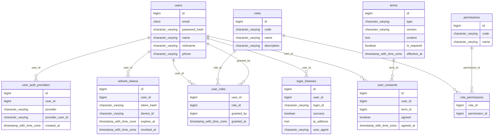
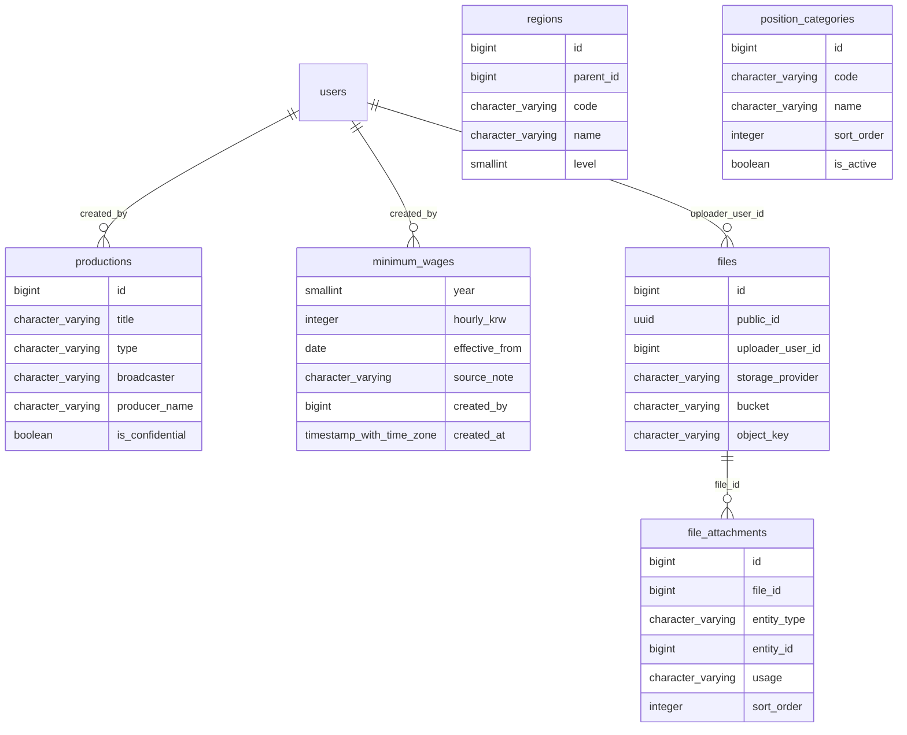
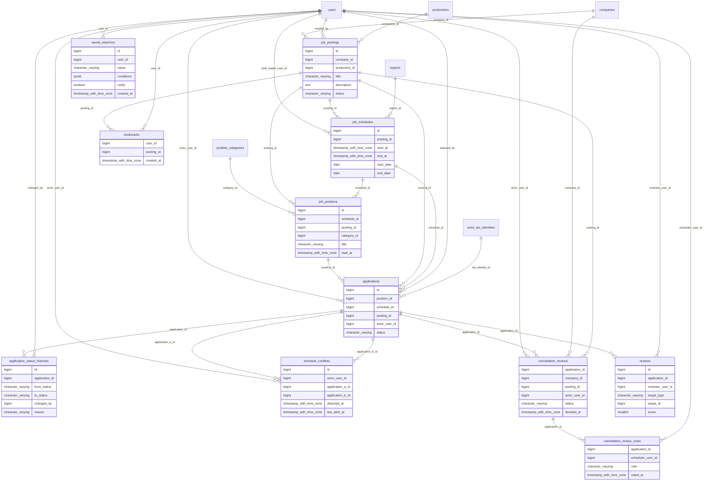
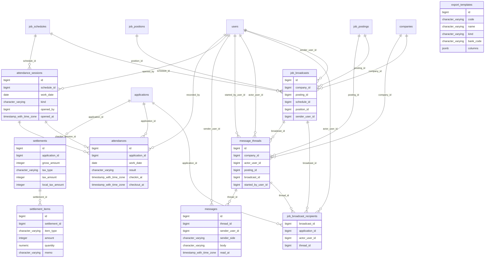

```mermaid
erDiagram
  regions ||--o{ actor_profiles : "region_id"
  users ||--o{ actor_profiles : "user_id"
  actor_profiles ||--o{ actor_payout_accounts : "user_id"
  terms ||--o{ actor_tax_identities : "consent_term_id"
  actor_profiles ||--o{ actor_tax_identities : "user_id"
  users ||--o{ actor_penalty_events : "decided_by"
  actor_profiles ||--o{ actor_penalty_events : "user_id"
  users ||--o{ actor_penalty_events : "voided_by"
  applications ||--o{ actor_penalty_events : "application_id"
  job_postings ||--o{ actor_penalty_events : "posting_id"
  applications ||--o{ guardian_consents : "application_id"
  actor_profiles ||--o{ guardian_consents : "actor_user_id"
  users ||--o{ guardian_consents : "verified_by"
  users ||--o{ companies : "approved_by"
  regions ||--o{ companies : "region_id"
  companies ||--o{ company_members : "company_id"
  users ||--o{ company_members : "user_id"
  companies ||--o{ company_verifications : "company_id"
  users ||--o{ company_verifications : "reviewed_by"
  users ||--o{ company_actor_blocks : "actor_user_id"
  companies ||--o{ company_actor_blocks : "company_id"
  users ||--o{ company_actor_blocks : "created_by"
  subscription_plans ||--o{ plan_features : "plan_id"
  companies ||--o{ company_subscriptions : "company_id"
  subscription_plans ||--o{ company_subscriptions : "plan_id"
  companies ||--o{ usage_counters : "company_id"
  actor_profiles {
    bigint user_id
    date birth_date
    character_varying gender
    smallint height_cm
    smallint weight_kg
    character_varying top_size
  }
  actor_payout_accounts {
    bigint user_id
    character_varying bank_code
    character_varying bank_name
    character_varying account_number_enc
    character_varying account_holder
    smallint key_version
  }
  actor_tax_identities {
    bigint id
    bigint user_id
    character_varying rrn_enc
    character rrn_hmac
    smallint key_version
    bigint consent_term_id
  }
  actor_penalty_events {
    bigint id
    bigint user_id
    bigint posting_id
    bigint application_id
    character_varying kind
    character_varying note
  }
  guardian_consents {
    bigint id
    bigint actor_user_id
    character_varying guardian_name
    character_varying guardian_phone
    character_varying relationship
    character_varying scope
  }
  companies {
    bigint id
    character_varying name
    character_varying biz_reg_no
    character_varying representative
    character_varying phone
    character_varying address
  }
  company_members {
    bigint company_id
    bigint user_id
    character_varying member_role
    character_varying department_name
    character_varying status
    timestamp_with_time_zone joined_at
  }
  company_verifications {
    bigint id
    bigint company_id
    character_varying status
    character_varying reject_reason
    bigint reviewed_by
    timestamp_with_time_zone submitted_at
  }
  company_actor_blocks {
    bigint company_id
    bigint actor_user_id
    character_varying reason
    bigint created_by
    timestamp_with_time_zone created_at
  }
  subscription_plans {
    bigint id
    character_varying code
    character_varying name
    integer monthly_price_krw
    boolean is_active
    timestamp_with_time_zone created_at
  }
  plan_features {
    bigint plan_id
    character_varying feature_code
    boolean enabled
    integer limit_value
  }
  company_subscriptions {
    bigint id
    bigint company_id
    bigint plan_id
    character_varying status
    timestamp_with_time_zone started_at
    timestamp_with_time_zone expires_at
  }
  usage_counters {
    bigint company_id
    character_varying feature_code
    character period_month
    integer used_count
    timestamp_with_time_zone updated_at
  }
```

# 07. ERD · 테이블 정의서
> 이 문서는 `tools/spec/*.py` 와 `db/schema.sql` 에서 `python3 tools/build_docs.py` 로 **자동 생성**된다. 직접 수정하지 말고 원천 데이터를 고칠 것.
> 버전 v1.0 · 기준일 2026-10-28

원천: `db/schema.sql` (PostgreSQL 16+). 테이블 **62**개, 뷰 **2**개 (`v_schedule_confirmed_roster`, `v_schedule_headcount_summary`).

## 0. 설계 원칙 · 명명 규칙
- 테이블: 복수형 snake_case, PK는 `id BIGINT IDENTITY`, 외부 노출용은 `public_id UUID`(파일).
- 상태값: `VARCHAR + CHECK`. 시간: `TIMESTAMPTZ`. 달력용 날짜(`start_date`, `end_date`)는 KST 기준 **생성 컬럼**.
- **삭제**: 업무 테이블은 hard delete 금지(FK 는 기본 RESTRICT). 순수 하위 상세만 CASCADE.
- **캐시 컬럼**(`applied_count`, `selected_count`, `confirmed_count`, 프로필 횟수)은 원천과 `PGM-J10` 배치로 대조.
- **민감 컬럼**(`account_number_enc`, `rrn_enc`)은 앱 계층 AES-256-GCM(`key_version`). 주민번호는 `rrn_hmac`(HMAC, 서버 비밀 pepper)로 **동일인 중복 가입 탐지**.
- **지원서 = 증빙**: 정보 스냅샷(JSONB)·전자서명 메타·무결성 해시·주민번호 버전 참조(`tax_identity_id`)를 한 행에 묶고, 서명 이미지·현재 사진은 `file_attachments`.
- **일정**: 한 번의 연속 근무 구간(`start_at`~`end_at`, 1시간~7일). 자정을 넘기는 심야와 숙박(2박3일·5박6일)도 하나의 일정. 출결은 날짜별(`attendances` 지원×근무일).
- **DB가 지키는 업무 규칙**:
  - 일정 길이 1시간~7일 (`ck_schedule_window`, `ck_position_window`)
  - 정원: 합격 통보 중 + 확정 ≤ 정원 (`ck_position_capacity`)
  - 활성 중복 지원 금지·취소 후 재지원 허용 (`uq_applications_active`)
  - **같은 사람의 확정 구간 겹침 금지**, 단 출연자가 경고를 확인하고 진행한 행(`conflict_override`)만 예외 (`ex_applications_no_overlap`)
  - 합격 통보/확정에는 예약 구간 필수 (`ck_selected_has_range`)
  - 공고당 패널티 1건 (`uq_penalty_per_posting`), 동일 주민번호 활성 1명 (`uq_tax_identity_active_hmac`)
  - 최저시급 선택 시 기준 연도 필수 (`ck_wage_mode`)
  - 출결 지원×날짜 유일, 열린 출퇴근 세션 1개 (`uq_attendance_session_open`)

## 1. 그룹별 ERD

### 계정·권한

### 마스터·파일

### 프로필·업체·구독

### 공고·지원

### 현장·메시지·정산

### 게시판·알림·운영

## 2. 테이블 정의서

### 계정·권한
#### `users`

| # | 컬럼 | 타입 | NULL | 기본값 | 키 | 설명 |
|---|---|---|---|---|---|---|
| 1 | id | bigint | N | IDENTITY | PK |  |
| 2 | email | citext | N |  |  |  |
| 3 | password_hash | varchar(100) | Y |  |  | 소셜 전용 계정이면 NULL |
| 4 | name | varchar(50) | N |  |  |  |
| 5 | nickname | varchar(50) | Y |  |  |  |
| 6 | phone | varchar(20) | Y |  |  | 출연자는 앱 규칙으로 필수·유일 |
| 7 | status | varchar(20) | N | 'ACTIVE'::character varying |  |  |
| 8 | email_verified_at | timestamptz | Y |  |  |  |
| 9 | phone_verified_at | timestamptz | Y |  |  |  |
| 10 | last_login_at | timestamptz | Y |  |  |  |
| 11 | created_at | timestamptz | N | now() |  |  |
| 12 | updated_at | timestamptz | N | now() |  |  |
| 13 | deleted_at | timestamptz | Y |  |  |  |

제약(CHECK/EXCLUDE):
- `users_status_check`: CHECK (((status)::text = ANY ((ARRAY['PENDING'::character varying, 'ACTIVE'::character varying, 'SUSPENDED'::character varying, 'WITHDRAWN'::character varying])::text[])))

인덱스:
- `uq_users_email`: btree (email) WHERE (deleted_at IS NULL)
- `uq_users_phone`: btree (phone) WHERE ((deleted_at IS NULL) AND (phone IS NOT NULL))

#### `user_auth_providers` — 소셜 로그인

| # | 컬럼 | 타입 | NULL | 기본값 | 키 | 설명 |
|---|---|---|---|---|---|---|
| 1 | id | bigint | N | IDENTITY | PK |  |
| 2 | user_id | bigint | N |  | FK→users |  |
| 3 | provider | varchar(20) | N |  |  |  |
| 4 | provider_user_id | varchar(100) | N |  |  |  |
| 5 | created_at | timestamptz | N | now() |  |  |

제약(CHECK/EXCLUDE):
- `user_auth_providers_provider_check`: CHECK (((provider)::text = ANY ((ARRAY['KAKAO'::character varying, 'GOOGLE'::character varying, 'NAVER'::character varying, 'APPLE'::character varying])::text[])))

인덱스:
- `user_auth_providers_provider_provider_user_id_key`: btree (provider, provider_user_id)

#### `roles`

| # | 컬럼 | 타입 | NULL | 기본값 | 키 | 설명 |
|---|---|---|---|---|---|---|
| 1 | id | bigint | N | IDENTITY | PK |  |
| 2 | code | varchar(30) | N |  | UQ |  |
| 3 | name | varchar(50) | N |  |  |  |
| 4 | description | varchar(200) | Y |  |  |  |

인덱스:
- `roles_code_key`: btree (code)

#### `permissions`

| # | 컬럼 | 타입 | NULL | 기본값 | 키 | 설명 |
|---|---|---|---|---|---|---|
| 1 | id | bigint | N | IDENTITY | PK |  |
| 2 | code | varchar(60) | N |  | UQ |  |
| 3 | name | varchar(100) | N |  |  |  |

인덱스:
- `permissions_code_key`: btree (code)

#### `role_permissions`

| # | 컬럼 | 타입 | NULL | 기본값 | 키 | 설명 |
|---|---|---|---|---|---|---|
| 1 | role_id | bigint | N |  | PK FK→roles |  |
| 2 | permission_id | bigint | N |  | PK FK→permissions |  |

#### `user_roles` — 한 사람이 ACTOR + COMPANY 동시 보유 가능

| # | 컬럼 | 타입 | NULL | 기본값 | 키 | 설명 |
|---|---|---|---|---|---|---|
| 1 | user_id | bigint | N |  | PK FK→users |  |
| 2 | role_id | bigint | N |  | PK FK→roles |  |
| 3 | granted_by | bigint | Y |  | FK→users |  |
| 4 | granted_at | timestamptz | N | now() |  |  |

#### `refresh_tokens`

| # | 컬럼 | 타입 | NULL | 기본값 | 키 | 설명 |
|---|---|---|---|---|---|---|
| 1 | id | bigint | N | IDENTITY | PK |  |
| 2 | user_id | bigint | N |  | FK→users |  |
| 3 | token_hash | varchar(100) | N |  | UQ |  |
| 4 | device_id | varchar(100) | Y |  |  |  |
| 5 | expires_at | timestamptz | N |  |  |  |
| 6 | revoked_at | timestamptz | Y |  |  |  |
| 7 | created_at | timestamptz | N | now() |  |  |

인덱스:
- `ix_refresh_tokens_user`: btree (user_id)
- `refresh_tokens_token_hash_key`: btree (token_hash)

#### `login_histories`

| # | 컬럼 | 타입 | NULL | 기본값 | 키 | 설명 |
|---|---|---|---|---|---|---|
| 1 | id | bigint | N | IDENTITY | PK |  |
| 2 | user_id | bigint | Y |  | FK→users |  |
| 3 | login_id | varchar(100) | Y |  |  |  |
| 4 | success | boolean | N |  |  |  |
| 5 | ip_address | inet | Y |  |  |  |
| 6 | user_agent | varchar(300) | Y |  |  |  |
| 7 | created_at | timestamptz | N | now() |  |  |

인덱스:
- `ix_login_histories_user`: btree (user_id, created_at DESC)

#### `terms` — 약관 버전 (고유식별정보·전자서명 동의 문구 포함)

| # | 컬럼 | 타입 | NULL | 기본값 | 키 | 설명 |
|---|---|---|---|---|---|---|
| 1 | id | bigint | N | IDENTITY | PK |  |
| 2 | type | varchar(30) | N |  |  |  |
| 3 | version | varchar(20) | N |  |  |  |
| 4 | content | text | N |  |  |  |
| 5 | is_required | boolean | N |  |  |  |
| 6 | effective_at | timestamptz | N |  |  |  |

제약(CHECK/EXCLUDE):
- `terms_type_check`: CHECK (((type)::text = ANY ((ARRAY['SERVICE'::character varying, 'PRIVACY'::character varying, 'MARKETING'::character varying, 'LOCATION'::character varying, 'YOUTH'::character varying, 'THIRD_PARTY_PROVISION'::charac…

인덱스:
- `terms_type_version_key`: btree (type, version)

#### `user_consents`

| # | 컬럼 | 타입 | NULL | 기본값 | 키 | 설명 |
|---|---|---|---|---|---|---|
| 1 | id | bigint | N | IDENTITY | PK |  |
| 2 | user_id | bigint | N |  | FK→users |  |
| 3 | term_id | bigint | N |  | FK→terms |  |
| 4 | agreed | boolean | N |  |  |  |
| 5 | agreed_at | timestamptz | N | now() |  |  |

인덱스:
- `user_consents_user_id_term_id_key`: btree (user_id, term_id)

### 마스터·파일
#### `regions` — 시/도(1) → 시/군/구(2). 전국 마스터 (시/군/구는 행정표준코드로 적재)

| # | 컬럼 | 타입 | NULL | 기본값 | 키 | 설명 |
|---|---|---|---|---|---|---|
| 1 | id | bigint | N | IDENTITY | PK |  |
| 2 | parent_id | bigint | Y |  | FK→regions |  |
| 3 | code | varchar(10) | N |  | UQ |  |
| 4 | name | varchar(50) | N |  |  |  |
| 5 | level | smallint | N |  |  |  |

제약(CHECK/EXCLUDE):
- `regions_level_check`: CHECK ((level = ANY (ARRAY[1, 2])))

인덱스:
- `regions_code_key`: btree (code)

#### `position_categories`

| # | 컬럼 | 타입 | NULL | 기본값 | 키 | 설명 |
|---|---|---|---|---|---|---|
| 1 | id | bigint | N | IDENTITY | PK |  |
| 2 | code | varchar(30) | N |  | UQ |  |
| 3 | name | varchar(50) | N |  |  |  |
| 4 | sort_order | integer | N | 0 |  |  |
| 5 | is_active | boolean | N | true |  |  |

인덱스:
- `position_categories_code_key`: btree (code)

#### `productions` — 작품 마스터 (공고는 대부분 가제로 올라가므로 선택 사항)

| # | 컬럼 | 타입 | NULL | 기본값 | 키 | 설명 |
|---|---|---|---|---|---|---|
| 1 | id | bigint | N | IDENTITY | PK |  |
| 2 | title | varchar(200) | N |  |  |  |
| 3 | type | varchar(20) | N | 'DRAMA'::character varying |  |  |
| 4 | broadcaster | varchar(100) | Y |  |  |  |
| 5 | producer_name | varchar(100) | Y |  |  |  |
| 6 | is_confidential | boolean | N | true |  |  |
| 7 | status | varchar(20) | N | 'ACTIVE'::character varying |  |  |
| 8 | merged_into_id | bigint | Y |  | FK→productions |  |
| 9 | created_by | bigint | Y |  | FK→users |  |
| 10 | created_at | timestamptz | N | now() |  |  |
| 11 | updated_at | timestamptz | N | now() |  |  |

제약(CHECK/EXCLUDE):
- `productions_status_check`: CHECK (((status)::text = ANY ((ARRAY['ACTIVE'::character varying, 'HIDDEN'::character varying, 'MERGED'::character varying])::text[])))
- `productions_type_check`: CHECK (((type)::text = ANY ((ARRAY['DRAMA'::character varying, 'MOVIE'::character varying, 'AD'::character varying, 'MV'::character varying, 'OTT'::character varying, 'VARIETY'::character varying, 'ETC'::character var…

인덱스:
- `ix_productions_title_trgm`: gin (title gin_trgm_ops)

#### `minimum_wages` — 연도별 최저시급. 관리자가 매년 갱신 (공고 작성 시 '최저시급' 선택의 원천)

| # | 컬럼 | 타입 | NULL | 기본값 | 키 | 설명 |
|---|---|---|---|---|---|---|
| 1 | year | smallint | N |  | PK |  |
| 2 | hourly_krw | integer | N |  |  |  |
| 3 | effective_from | date | N |  |  |  |
| 4 | source_note | varchar(200) | Y |  |  |  |
| 5 | created_by | bigint | Y |  | FK→users |  |
| 6 | created_at | timestamptz | N | now() |  |  |

제약(CHECK/EXCLUDE):
- `minimum_wages_hourly_krw_check`: CHECK ((hourly_krw > 0))

#### `files`

| # | 컬럼 | 타입 | NULL | 기본값 | 키 | 설명 |
|---|---|---|---|---|---|---|
| 1 | id | bigint | N | IDENTITY | PK |  |
| 2 | public_id | uuid | N | gen_random_uuid() | UQ |  |
| 3 | uploader_user_id | bigint | Y |  | FK→users |  |
| 4 | storage_provider | varchar(20) | N | 'R2'::character varying |  |  |
| 5 | bucket | varchar(100) | N |  |  |  |
| 6 | object_key | varchar(500) | N |  |  |  |
| 7 | original_name | varchar(255) | N |  |  |  |
| 8 | content_type | varchar(100) | N |  |  |  |
| 9 | size_bytes | bigint | N |  |  |  |
| 10 | checksum_sha256 | varchar(64) | Y |  |  |  |
| 11 | width | integer | Y |  |  |  |
| 12 | height | integer | Y |  |  |  |
| 13 | variants | jsonb | Y |  |  | {"thumb":"key","medium":"key"} |
| 14 | status | varchar(20) | N | 'PENDING'::character varying |  |  |
| 15 | is_private | boolean | N | true |  |  |
| 16 | created_at | timestamptz | N | now() |  |  |
| 17 | deleted_at | timestamptz | Y |  |  |  |

제약(CHECK/EXCLUDE):
- `files_size_bytes_check`: CHECK ((size_bytes >= 0))
- `files_status_check`: CHECK (((status)::text = ANY ((ARRAY['PENDING'::character varying, 'ACTIVE'::character varying, 'DELETED'::character varying])::text[])))
- `files_storage_provider_check`: CHECK (((storage_provider)::text = ANY ((ARRAY['R2'::character varying, 'GCS'::character varying, 'S3'::character varying, 'LOCAL'::character varying])::text[])))

인덱스:
- `files_bucket_object_key_key`: btree (bucket, object_key)
- `files_public_id_key`: btree (public_id)
- `ix_files_pending`: btree (created_at) WHERE ((status)::text = 'PENDING'::text)

#### `file_attachments`

| # | 컬럼 | 타입 | NULL | 기본값 | 키 | 설명 |
|---|---|---|---|---|---|---|
| 1 | id | bigint | N | IDENTITY | PK |  |
| 2 | file_id | bigint | N |  | FK→files |  |
| 3 | entity_type | varchar(30) | N |  |  |  |
| 4 | entity_id | bigint | N |  |  |  |
| 5 | usage | varchar(30) | N |  |  |  |
| 6 | sort_order | integer | N | 0 |  |  |
| 7 | created_at | timestamptz | N | now() |  |  |

제약(CHECK/EXCLUDE):
- `file_attachments_entity_type_check`: CHECK (((entity_type)::text = ANY ((ARRAY['ACTOR_PROFILE'::character varying, 'COMPANY'::character varying, 'COMPANY_VERIFICATION'::character varying, 'JOB_POSTING'::character varying, 'APPLICATION'::character varying…
- `file_attachments_usage_check`: CHECK (((usage)::text = ANY ((ARRAY['PROFILE_PHOTO'::character varying, 'FULL_BODY_PHOTO'::character varying, 'RESUME'::character varying, 'PARENTAL_CONSENT'::character varying, 'FAMILY_RELATION_PROOF'::character vary…

인덱스:
- `file_attachments_file_id_entity_type_entity_id_usage_key`: btree (file_id, entity_type, entity_id, usage)
- `ix_file_attachments_entity`: btree (entity_type, entity_id, usage, sort_order)

### 프로필·업체·구독
#### `actor_profiles` — 1:1 users

| # | 컬럼 | 타입 | NULL | 기본값 | 키 | 설명 |
|---|---|---|---|---|---|---|
| 1 | user_id | bigint | N |  | PK FK→users |  |
| 2 | birth_date | date | N |  |  |  |
| 3 | gender | varchar(10) | N |  |  |  |
| 4 | height_cm | smallint | N |  |  |  |
| 5 | weight_kg | smallint | N |  |  |  |
| 6 | top_size | varchar(10) | Y |  |  |  |
| 7 | bottom_size | varchar(10) | Y |  |  |  |
| 8 | shoe_size | smallint | Y |  |  | mm |
| 9 | hair_length | varchar(10) | Y |  |  |  |
| 10 | hair_style | varchar(100) | Y |  |  | 색·염색 등 자유 기재 |
| 11 | has_tattoo | boolean | N | false |  |  |
| 12 | can_drive | boolean | N | false |  |  |
| 13 | has_vehicle | boolean | N | false |  |  |
| 14 | region_id | bigint | Y |  | FK→regions | 거주 시/군/구 (필터·통계) |
| 15 | home_postal_code | varchar(10) | Y |  |  |  |
| 16 | home_address | varchar(200) | Y |  |  | 집 주소 (인원 정보표 필수 항목, 합격 전 업체에는 시/구 단위만) |
| 17 | home_address_detail | varchar(200) | Y |  |  |  |
| 18 | default_departure_location | varchar(200) | Y |  |  | 기본 집합지(탑승 희망지) |
| 19 | introduction | varchar(1000) | Y |  |  |  |
| 20 | experience_note | varchar(1000) | Y |  |  |  |
| 21 | tags | jsonb | N | '[]'::jsonb |  |  |
| 22 | is_searchable | boolean | N | true |  |  |
| 23 | history_disclosure_consented_at | timestamptz | Y |  |  | 역대 합격/지원 이력 업체 공개 동의 |
| 24 | confirmed_count | integer | N | 0 |  |  |
| 25 | attended_count | integer | N | 0 |  |  |
| 26 | noshow_count | integer | N | 0 |  |  |
| 27 | penalty_count | integer | N | 0 |  |  |
| 28 | created_at | timestamptz | N | now() |  |  |
| 29 | updated_at | timestamptz | N | now() |  |  |

제약(CHECK/EXCLUDE):
- `actor_profiles_gender_check`: CHECK (((gender)::text = ANY ((ARRAY['MALE'::character varying, 'FEMALE'::character varying, 'OTHER'::character varying])::text[])))
- `actor_profiles_hair_length_check`: CHECK (((hair_length)::text = ANY ((ARRAY['SHAVED'::character varying, 'SHORT'::character varying, 'MEDIUM'::character varying, 'LONG'::character varying])::text[])))
- `actor_profiles_height_cm_check`: CHECK (((height_cm >= 50) AND (height_cm <= 250)))
- `actor_profiles_weight_kg_check`: CHECK (((weight_kg >= 20) AND (weight_kg <= 300)))

인덱스:
- `ix_actor_spec`: btree (gender, birth_date, height_cm, weight_kg)
- `ix_actor_tags`: gin (tags jsonb_path_ops)

#### `actor_payout_accounts` — 프로필 기본 계좌 (지원 시 불러오기 / 다른 계좌 직접 입력도 가능)

| # | 컬럼 | 타입 | NULL | 기본값 | 키 | 설명 |
|---|---|---|---|---|---|---|
| 1 | user_id | bigint | N |  | PK FK→actor_profiles |  |
| 2 | bank_code | varchar(10) | N |  |  |  |
| 3 | bank_name | varchar(50) | N |  |  |  |
| 4 | account_number_enc | varchar(300) | N |  |  |  |
| 5 | account_holder | varchar(50) | N |  |  |  |
| 6 | key_version | smallint | N | 1 |  |  |
| 7 | consented_at | timestamptz | N | now() |  |  |
| 8 | updated_at | timestamptz | N | now() |  |  |

#### `actor_tax_identities` — 주민등록번호 (원천징수·지급명세서용, 첫 지원 전 필수). 버전 이력으로 보관 → 지원서가 당시 버전을 참조

| # | 컬럼 | 타입 | NULL | 기본값 | 키 | 설명 |
|---|---|---|---|---|---|---|
| 1 | id | bigint | N | IDENTITY | PK |  |
| 2 | user_id | bigint | N |  | FK→actor_profiles |  |
| 3 | rrn_enc | varchar(300) | N |  |  | AES-256-GCM |
| 4 | rrn_hmac | character(64) | N |  |  | HMAC-SHA256(서버 비밀 pepper) : 평문 복원 불가, 중복 가입(노쇼 이력 세탁) 탐지용 |
| 5 | key_version | smallint | N | 1 |  |  |
| 6 | consent_term_id | bigint | Y |  | FK→terms | 고유식별정보 처리 동의 약관 버전 |
| 7 | consented_at | timestamptz | N |  |  |  |
| 8 | is_active | boolean | N | true |  |  |
| 9 | superseded_at | timestamptz | Y |  |  |  |
| 10 | purge_after | date | Y |  |  | 보존기한 경과 후 파기 대상 |
| 11 | created_at | timestamptz | N | now() |  |  |

인덱스:
- `uq_tax_identity_active_hmac`: btree (rrn_hmac) WHERE is_active
- `uq_tax_identity_active_user`: btree (user_id) WHERE is_active

#### `actor_penalty_events` — 노쇼 횟수 / 취소 패널티 원장. 점수제 아님. 공고당 종류별 1건만 유효

| # | 컬럼 | 타입 | NULL | 기본값 | 키 | 설명 |
|---|---|---|---|---|---|---|
| 1 | id | bigint | N | IDENTITY | PK |  |
| 2 | user_id | bigint | N |  | FK→actor_profiles |  |
| 3 | posting_id | bigint | N |  | FK→job_postings | FK 는 아래 ALTER (job_postings 정의 이후) |
| 4 | application_id | bigint | Y |  | FK→applications |  |
| 5 | kind | varchar(20) | N |  |  |  |
| 6 | note | varchar(300) | Y |  |  |  |
| 7 | decided_by | bigint | Y |  | FK→users |  |
| 8 | created_at | timestamptz | N | now() |  |  |
| 9 | voided_at | timestamptz | Y |  |  | 오기록·소명 인정 시 무효화 |
| 10 | voided_by | bigint | Y |  | FK→users |  |

제약(CHECK/EXCLUDE):
- `actor_penalty_events_kind_check`: CHECK (((kind)::text = ANY ((ARRAY['NO_SHOW'::character varying, 'CANCEL_PENALTY'::character varying])::text[])))

인덱스:
- `ix_penalty_user`: btree (user_id, created_at DESC)
- `uq_penalty_per_posting`: btree (user_id, posting_id, kind) WHERE (voided_at IS NULL)

#### `guardian_consents` — 미성년 법정대리인 동의 (현재 미성년 지원 차단. 구조만 선반영, 설정 minor_apply_enabled)

| # | 컬럼 | 타입 | NULL | 기본값 | 키 | 설명 |
|---|---|---|---|---|---|---|
| 1 | id | bigint | N | IDENTITY | PK |  |
| 2 | actor_user_id | bigint | N |  | FK→actor_profiles |  |
| 3 | guardian_name | varchar(50) | N |  |  |  |
| 4 | guardian_phone | varchar(20) | N |  |  |  |
| 5 | relationship | varchar(20) | N | 'PARENT'::character varying |  |  |
| 6 | scope | varchar(20) | N | 'GENERAL'::character varying |  |  |
| 7 | application_id | bigint | Y |  | FK→applications |  |
| 8 | status | varchar(20) | N | 'SUBMITTED'::character varying |  |  |
| 9 | valid_until | date | Y |  |  |  |
| 10 | verified_by | bigint | Y |  | FK→users |  |
| 11 | verified_at | timestamptz | Y |  |  |  |
| 12 | reject_reason | varchar(300) | Y |  |  |  |
| 13 | created_at | timestamptz | N | now() |  |  |
| 14 | updated_at | timestamptz | N | now() |  |  |

제약(CHECK/EXCLUDE):
- `guardian_consents_relationship_check`: CHECK (((relationship)::text = ANY ((ARRAY['PARENT'::character varying, 'GUARDIAN'::character varying])::text[])))
- `guardian_consents_scope_check`: CHECK (((scope)::text = ANY ((ARRAY['GENERAL'::character varying, 'PER_APPLICATION'::character varying])::text[])))
- `guardian_consents_status_check`: CHECK (((status)::text = ANY ((ARRAY['SUBMITTED'::character varying, 'VERIFIED'::character varying, 'REJECTED'::character varying, 'EXPIRED'::character varying])::text[])))

인덱스:
- `ix_guardian_consents_actor`: btree (actor_user_id, status)

#### `companies` — 보출 업체

| # | 컬럼 | 타입 | NULL | 기본값 | 키 | 설명 |
|---|---|---|---|---|---|---|
| 1 | id | bigint | N | IDENTITY | PK |  |
| 2 | name | varchar(100) | N |  |  |  |
| 3 | biz_reg_no | varchar(12) | N |  |  |  |
| 4 | representative | varchar(50) | N |  |  |  |
| 5 | phone | varchar(20) | Y |  |  |  |
| 6 | address | varchar(200) | Y |  |  |  |
| 7 | region_id | bigint | Y |  | FK→regions |  |
| 8 | introduction | varchar(2000) | Y |  |  |  |
| 9 | status | varchar(20) | N | 'PENDING'::character varying |  |  |
| 10 | approved_by | bigint | Y |  | FK→users |  |
| 11 | approved_at | timestamptz | Y |  |  |  |
| 12 | created_at | timestamptz | N | now() |  |  |
| 13 | updated_at | timestamptz | N | now() |  |  |
| 14 | deleted_at | timestamptz | Y |  |  |  |

제약(CHECK/EXCLUDE):
- `companies_status_check`: CHECK (((status)::text = ANY ((ARRAY['PENDING'::character varying, 'APPROVED'::character varying, 'REJECTED'::character varying, 'SUSPENDED'::character varying])::text[])))

인덱스:
- `uq_companies_biz`: btree (biz_reg_no) WHERE (deleted_at IS NULL)

#### `company_members` — 한 사람이 여러 업체에 소속 가능 (프리랜서 반장)

| # | 컬럼 | 타입 | NULL | 기본값 | 키 | 설명 |
|---|---|---|---|---|---|---|
| 1 | company_id | bigint | N |  | PK FK→companies |  |
| 2 | user_id | bigint | N |  | PK FK→users |  |
| 3 | member_role | varchar(20) | N | 'STAFF'::character varying |  | OWNER 대표 / MANAGER 팀장 / SCHEDULER 스케줄러 담당(1~4명, 취소 패널티 판정) / FIELD_LEADER 현장반장 / STAFF |
| 4 | department_name | varchar(50) | Y |  |  |  |
| 5 | status | varchar(20) | N | 'ACTIVE'::character varying |  |  |
| 6 | joined_at | timestamptz | N | now() |  |  |

제약(CHECK/EXCLUDE):
- `company_members_member_role_check`: CHECK (((member_role)::text = ANY ((ARRAY['OWNER'::character varying, 'MANAGER'::character varying, 'SCHEDULER'::character varying, 'FIELD_LEADER'::character varying, 'STAFF'::character varying])::text[])))
- `company_members_status_check`: CHECK (((status)::text = ANY ((ARRAY['INVITED'::character varying, 'ACTIVE'::character varying, 'REMOVED'::character varying])::text[])))

인덱스:
- `ix_company_members_user`: btree (user_id)

#### `company_verifications`

| # | 컬럼 | 타입 | NULL | 기본값 | 키 | 설명 |
|---|---|---|---|---|---|---|
| 1 | id | bigint | N | IDENTITY | PK |  |
| 2 | company_id | bigint | N |  | FK→companies |  |
| 3 | status | varchar(20) | N | 'SUBMITTED'::character varying |  |  |
| 4 | reject_reason | varchar(500) | Y |  |  |  |
| 5 | reviewed_by | bigint | Y |  | FK→users |  |
| 6 | submitted_at | timestamptz | N | now() |  |  |
| 7 | reviewed_at | timestamptz | Y |  |  |  |

제약(CHECK/EXCLUDE):
- `company_verifications_status_check`: CHECK (((status)::text = ANY ((ARRAY['SUBMITTED'::character varying, 'APPROVED'::character varying, 'REJECTED'::character varying])::text[])))

#### `company_actor_blocks` — 업체 → 출연자 비공개 차단

| # | 컬럼 | 타입 | NULL | 기본값 | 키 | 설명 |
|---|---|---|---|---|---|---|
| 1 | company_id | bigint | N |  | PK FK→companies |  |
| 2 | actor_user_id | bigint | N |  | PK FK→users |  |
| 3 | reason | varchar(300) | Y |  |  |  |
| 4 | created_by | bigint | Y |  | FK→users |  |
| 5 | created_at | timestamptz | N | now() |  |  |

#### `subscription_plans`

| # | 컬럼 | 타입 | NULL | 기본값 | 키 | 설명 |
|---|---|---|---|---|---|---|
| 1 | id | bigint | N | IDENTITY | PK |  |
| 2 | code | varchar(30) | N |  | UQ |  |
| 3 | name | varchar(50) | N |  |  |  |
| 4 | monthly_price_krw | integer | N | 0 |  |  |
| 5 | is_active | boolean | N | true |  |  |
| 6 | created_at | timestamptz | N | now() |  |  |

인덱스:
- `subscription_plans_code_key`: btree (code)

#### `plan_features`

| # | 컬럼 | 타입 | NULL | 기본값 | 키 | 설명 |
|---|---|---|---|---|---|---|
| 1 | plan_id | bigint | N |  | PK FK→subscription_plans |  |
| 2 | feature_code | varchar(50) | N |  | PK | VIEW_ACTOR_APPLICATIONS, TALENT_SEARCH, URGENT_TOP, ... |
| 3 | enabled | boolean | N | true |  |  |
| 4 | limit_value | integer | Y |  |  |  |

#### `company_subscriptions`

| # | 컬럼 | 타입 | NULL | 기본값 | 키 | 설명 |
|---|---|---|---|---|---|---|
| 1 | id | bigint | N | IDENTITY | PK |  |
| 2 | company_id | bigint | N |  | FK→companies |  |
| 3 | plan_id | bigint | N |  | FK→subscription_plans |  |
| 4 | status | varchar(20) | N | 'ACTIVE'::character varying |  |  |
| 5 | started_at | timestamptz | N | now() |  |  |
| 6 | expires_at | timestamptz | Y |  |  |  |
| 7 | created_at | timestamptz | N | now() |  |  |
| 8 | updated_at | timestamptz | N | now() |  |  |

제약(CHECK/EXCLUDE):
- `company_subscriptions_status_check`: CHECK (((status)::text = ANY ((ARRAY['ACTIVE'::character varying, 'EXPIRED'::character varying, 'CANCELED'::character varying])::text[])))

인덱스:
- `uq_company_subscription_active`: btree (company_id) WHERE ((status)::text = 'ACTIVE'::text)

#### `usage_counters`

| # | 컬럼 | 타입 | NULL | 기본값 | 키 | 설명 |
|---|---|---|---|---|---|---|
| 1 | company_id | bigint | N |  | PK FK→companies |  |
| 2 | feature_code | varchar(50) | N |  | PK |  |
| 3 | period_month | character(7) | N |  | PK |  |
| 4 | used_count | integer | N | 0 |  |  |
| 5 | updated_at | timestamptz | N | now() |  |  |

제약(CHECK/EXCLUDE):
- `usage_counters_used_count_check`: CHECK ((used_count >= 0))

### 공고·지원
#### `job_postings`

| # | 컬럼 | 타입 | NULL | 기본값 | 키 | 설명 |
|---|---|---|---|---|---|---|
| 1 | id | bigint | N | IDENTITY | PK |  |
| 2 | company_id | bigint | N |  | FK→companies |  |
| 3 | production_id | bigint | Y |  | FK→productions | 실제 작품(내부용, 선택) |
| 4 | title | varchar(200) | N |  |  | 공개 제목 = 가제 (대부분 비공개 현장) |
| 5 | description | text | Y |  |  |  |
| 6 | status | varchar(20) | N | 'DRAFT'::character varying |  |  |
| 7 | is_urgent | boolean | N | false |  | (유료 상단 노출 후보. 현재는 무료) |
| 8 | conceal_details | boolean | N | true |  | 기본값 TRUE: 가제·지역·시간·역할만 공개, 상세는 합격자에게 |
| 9 | contact_phone | varchar(20) | Y |  |  |  |
| 10 | apply_deadline_at | timestamptz | Y |  |  |  |
| 11 | first_shoot_date | date | Y |  |  | 일정 중 최소/최대 날짜 (앱이 갱신, 목록 정렬용) |
| 12 | last_shoot_date | date | Y |  |  |  |
| 13 | view_count | integer | N | 0 |  |  |
| 14 | published_at | timestamptz | Y |  |  |  |
| 15 | closed_at | timestamptz | Y |  |  |  |
| 16 | created_by | bigint | N |  | FK→users |  |
| 17 | created_at | timestamptz | N | now() |  |  |
| 18 | updated_at | timestamptz | N | now() |  |  |
| 19 | deleted_at | timestamptz | Y |  |  |  |

제약(CHECK/EXCLUDE):
- `job_postings_status_check`: CHECK (((status)::text = ANY ((ARRAY['DRAFT'::character varying, 'OPEN'::character varying, 'CLOSED'::character varying, 'CANCELED'::character varying, 'COMPLETED'::character varying])::text[])))

인덱스:
- `ix_job_postings_company`: btree (company_id, status)
- `ix_job_postings_open_date`: btree (first_shoot_date) WHERE (((status)::text = 'OPEN'::text) AND (deleted_at IS NULL))
- `ix_job_postings_title_trgm`: gin (title gin_trgm_ops)

#### `job_schedules` — 연속 근무 구간. 1시간 ~ 7일(숙박·심야·자정 넘김 포함)

| # | 컬럼 | 타입 | NULL | 기본값 | 키 | 설명 |
|---|---|---|---|---|---|---|
| 1 | id | bigint | N | IDENTITY | PK |  |
| 2 | posting_id | bigint | N |  | FK→job_postings |  |
| 3 | start_at | timestamptz | N |  |  | 집합 시각 |
| 4 | end_at | timestamptz | N |  |  | 종료 예정 |
| 5 | start_date | date | Y | ((start_at AT TIME ZONE 'Asia/Seoul'::text))::date |  |  |
| 6 | end_date | date | Y | (((end_at AT TIME ZONE 'Asia/Seoul'::text) - '00:00:01'::interval))::date |  | 종료 정각(00:00)이 다음 날로 잡히지 않게 KST 로컬 시각에서 1초 감산(immutable) |
| 7 | is_lodging | boolean | N | false |  | 숙박 일정 (2박3일, 5박6일 …) |
| 8 | region_id | bigint | Y |  | FK→regions |  |
| 9 | shooting_location | varchar(255) | Y |  |  | 실제 촬영지 (비공개 현장이면 합격자에게만) |
| 10 | meeting_place | varchar(200) | Y |  |  | 집합지 |
| 11 | meeting_address | varchar(300) | Y |  |  |  |
| 12 | latitude | numeric(9,6) | Y |  |  |  |
| 13 | longitude | numeric(9,6) | Y |  |  |  |
| 14 | field_leader_user_id | bigint | Y |  | FK→users | 담당 현장반장/팀장 |
| 15 | note | varchar(1000) | Y |  |  |  |
| 16 | status | varchar(20) | N | 'OPEN'::character varying |  |  |
| 17 | postponed_from_schedule_id | bigint | Y |  | FK→job_schedules | 연기로 새로 만들어진 일정이면 원본 |
| 18 | created_at | timestamptz | N | now() |  |  |
| 19 | updated_at | timestamptz | N | now() |  |  |

제약(CHECK/EXCLUDE):
- `ck_schedule_window`: CHECK (((end_at >= (start_at + '01:00:00'::interval)) AND (end_at <= (start_at + '7 days'::interval))))
- `job_schedules_status_check`: CHECK (((status)::text = ANY ((ARRAY['OPEN'::character varying, 'CLOSED'::character varying, 'CANCELED'::character varying, 'POSTPONED'::character varying, 'COMPLETED'::character varying])::text[])))

인덱스:
- `ix_job_schedules_dates`: btree (start_date, end_date) WHERE ((status)::text = ANY ((ARRAY['OPEN'::character varying, 'CLOSED'::character varying])::text[]))
- `ix_job_schedules_posting`: btree (posting_id)
- `ix_job_schedules_range`: gist (tstzrange(start_at, end_at))

#### `job_positions` — 일정 내 모집 단위(역할). 예비·선착순 없음 (업체가 보고 선발)

| # | 컬럼 | 타입 | NULL | 기본값 | 키 | 설명 |
|---|---|---|---|---|---|---|
| 1 | id | bigint | N | IDENTITY | PK |  |
| 2 | schedule_id | bigint | N |  | FK→job_schedules |  |
| 3 | posting_id | bigint | N |  | FK→job_postings |  |
| 4 | category_id | bigint | Y |  | FK→position_categories |  |
| 5 | title | varchar(100) | N |  |  | "클럽 20대 남녀", "정장 형사", "행인" |
| 6 | start_at | timestamptz | Y |  |  |  |
| 7 | end_at | timestamptz | Y |  |  |  |
| 8 | meeting_place | varchar(200) | Y |  |  |  |
| 9 | meeting_address | varchar(300) | Y |  |  |  |
| 10 | headcount | integer | N |  |  |  |
| 11 | selected_count | integer | N | 0 |  | SELECTED(합격 통보, 출연자 확정 대기) |
| 12 | confirmed_count | integer | N | 0 |  | CONFIRMED(출연자 확정 완료) |
| 13 | applied_count | integer | N | 0 |  | 지원자 수 캐시 |
| 14 | gender_req | varchar(10) | N | 'ANY'::character varying |  |  |
| 15 | birth_year_min | smallint | Y |  |  |  |
| 16 | birth_year_max | smallint | Y |  |  |  |
| 17 | height_min | smallint | Y |  |  |  |
| 18 | height_max | smallint | Y |  |  |  |
| 19 | weight_min | smallint | Y |  |  | 체형 조건(몸무게 범위) |
| 20 | weight_max | smallint | Y |  |  |  |
| 21 | hair_lengths | jsonb | Y |  |  | 허용 머리 길이 ["SHORT","MEDIUM"] / NULL = 무관 |
| 22 | tattoo_req | varchar(10) | N | 'ANY'::character varying |  | NONE = 문신 없는 사람만 |
| 23 | allow_minor | boolean | N | false |  |  |
| 24 | wage_mode | varchar(10) | N | 'MIN_WAGE'::character varying |  |  |
| 25 | hourly_wage_krw | integer | N |  |  |  |
| 26 | min_wage_year | smallint | Y |  |  |  |
| 27 | pay_note | varchar(1000) | Y |  |  | 비고: 식대(아침/점심/저녁)·교통·연장 안내 등 자유 기재 |
| 28 | dress_code | varchar(300) | Y |  |  |  |
| 29 | requirements | varchar(1000) | Y |  |  |  |
| 30 | status | varchar(20) | N | 'OPEN'::character varying |  |  |
| 31 | cloned_from_position_id | bigint | Y |  | FK→job_positions | 일정 연기 시 원본 역할 매핑 |
| 32 | version | bigint | N | 0 |  |  |
| 33 | created_at | timestamptz | N | now() |  |  |
| 34 | updated_at | timestamptz | N | now() |  |  |

제약(CHECK/EXCLUDE):
- `ck_position_capacity`: CHECK (((selected_count + confirmed_count) <= headcount))
- `ck_position_window`: CHECK ((((start_at IS NULL) AND (end_at IS NULL)) OR ((start_at IS NOT NULL) AND (end_at IS NOT NULL) AND (end_at >= (start_at + '01:00:00'::interval)) AND (end_at <= (start_at + '7 days'::interval)))))
- `ck_wage_mode`: CHECK ((((wage_mode)::text <> 'MIN_WAGE'::text) OR (min_wage_year IS NOT NULL)))
- `job_positions_check`: CHECK (((birth_year_min IS NULL) OR (birth_year_max IS NULL) OR (birth_year_min <= birth_year_max)))
- `job_positions_check1`: CHECK (((height_min IS NULL) OR (height_max IS NULL) OR (height_min <= height_max)))
- `job_positions_check2`: CHECK (((weight_min IS NULL) OR (weight_max IS NULL) OR (weight_min <= weight_max)))
- `job_positions_confirmed_count_check`: CHECK ((confirmed_count >= 0))
- `job_positions_gender_req_check`: CHECK (((gender_req)::text = ANY ((ARRAY['ANY'::character varying, 'MALE'::character varying, 'FEMALE'::character varying])::text[])))
- `job_positions_headcount_check`: CHECK ((headcount > 0))
- `job_positions_hourly_wage_krw_check`: CHECK ((hourly_wage_krw > 0))
- `job_positions_selected_count_check`: CHECK ((selected_count >= 0))
- `job_positions_status_check`: CHECK (((status)::text = ANY ((ARRAY['OPEN'::character varying, 'CLOSED'::character varying, 'CANCELED'::character varying])::text[])))
- `job_positions_tattoo_req_check`: CHECK (((tattoo_req)::text = ANY ((ARRAY['ANY'::character varying, 'NONE'::character varying])::text[])))
- `job_positions_wage_mode_check`: CHECK (((wage_mode)::text = ANY ((ARRAY['MIN_WAGE'::character varying, 'CUSTOM'::character varying])::text[])))

인덱스:
- `ix_job_positions_posting`: btree (posting_id)
- `ix_job_positions_schedule`: btree (schedule_id)

#### `applications` — 지원서 = 증빙 문서 (정보 스냅샷 + 전자서명 + 현재 사진 + 주민번호 버전 참조)

| # | 컬럼 | 타입 | NULL | 기본값 | 키 | 설명 |
|---|---|---|---|---|---|---|
| 1 | id | bigint | N | IDENTITY | PK |  |
| 2 | position_id | bigint | N |  | FK→job_positions |  |
| 3 | schedule_id | bigint | N |  | FK→job_schedules |  |
| 4 | posting_id | bigint | N |  | FK→job_postings |  |
| 5 | actor_user_id | bigint | N |  | FK→users |  |
| 6 | status | varchar(20) | N | 'APPLIED'::character varying |  | APPLIED 지원 → SELECTED 업체 합격 통보 → CONFIRMED 출연자 확정. AUTO_REJECTED: 통보 없이 마감 (마감 후에도 업체가 가용 확인 뒤 SELECTED 로 재선발 가능) EXPIRED: 합격 통보 후 출연자가 기한 내 응답하지 않음 / 일정 종료 |
| 7 | work_start_at | timestamptz | N |  |  |  |
| 8 | work_end_at | timestamptz | N |  |  |  |
| 9 | start_date | date | Y | ((work_start_at AT TIME ZONE 'Asia/Seoul'::text))::date |  |  |
| 10 | reserved_range | tstzrange | Y |  |  | SELECTED/CONFIRMED 시 [시작-버퍼, 종료+버퍼) : 겹침 판정·가용 판단 기준 |
| 11 | applicant_name | varchar(50) | N |  |  |  |
| 12 | applicant_phone | varchar(20) | N |  |  | 업체는 지원 단계부터 열람 가능 |
| 13 | departure_location | varchar(200) | Y |  |  | 집합지(탑승 희망지) |
| 14 | profile_snapshot | jsonb | N |  |  | 성별·출생일·키·몸무게·사이즈·머리·문신·집주소 등 지원 당시 값 |
| 15 | tax_identity_id | bigint | Y |  | FK→actor_tax_identities |  |
| 16 | bank_code | varchar(10) | Y |  |  |  |
| 17 | bank_name | varchar(50) | Y |  |  |  |
| 18 | account_number_enc | varchar(300) | Y |  |  | 프로필 계좌 불러오기 또는 직접 입력한 계좌 |
| 19 | account_holder | varchar(50) | Y |  |  |  |
| 20 | message | varchar(1000) | Y |  |  |  |
| 21 | signed_at | timestamptz | Y |  |  |  |
| 22 | signed_ip | inet | Y |  |  |  |
| 23 | signed_user_agent | varchar(300) | Y |  |  |  |
| 24 | signed_terms_version | varchar(20) | Y |  |  |  |
| 25 | snapshot_hash | character(64) | Y |  |  | SHA-256(지원서 정규화 JSON + 서명 해시): 사후 변조 탐지 |
| 26 | selected_by | bigint | Y |  | FK→users |  |
| 27 | selected_at | timestamptz | Y |  |  |  |
| 28 | response_due_at | timestamptz | Y |  |  | 합격 통보 후 출연자 확정 기한 (경과 시 EXPIRED) |
| 29 | confirmed_at | timestamptz | Y |  |  |  |
| 30 | conflict_override | boolean | N | false |  | 출연자가 경고를 보고 겹치는 일정을 알면서 확정한 경우 (EXCLUDE 대상에서 제외, 충돌 추적) |
| 31 | condition_snapshot | jsonb | Y |  |  | 합격 통보 시점 조건(시급·집합·의상) 스냅샷 |
| 32 | moved_from_application_id | bigint | Y |  | FK→applications | 일정 연기로 이동된 지원이면 원본 |
| 33 | penalty_exempt | boolean | N | false |  | 연기·업체 사정 취소 등 패널티 면제 |
| 34 | departure_requested_at | timestamptz | Y |  |  | 집합 2시간 전 '참석 확인' 요청 |
| 35 | departure_confirmed_at | timestamptz | Y |  |  | 출연자가 참석 확인 |
| 36 | canceled_at | timestamptz | Y |  |  |  |
| 37 | cancel_reason | varchar(500) | Y |  |  | 확정 후 출연자 취소 사유 (스케줄러 판정에 사용) |
| 38 | applied_at | timestamptz | N | now() |  |  |
| 39 | updated_at | timestamptz | N | now() |  |  |

제약(CHECK/EXCLUDE):
- `applications_status_check`: CHECK (((status)::text = ANY ((ARRAY['APPLIED'::character varying, 'SELECTED'::character varying, 'CONFIRMED'::character varying, 'REJECTED'::character varying, 'AUTO_REJECTED'::character varying, 'CANCELED_BY_ACTOR':…
- `ck_selected_has_range`: CHECK ((((status)::text <> ALL ((ARRAY['SELECTED'::character varying, 'CONFIRMED'::character varying])::text[])) OR (reserved_range IS NOT NULL)))
- `ck_work_window`: CHECK ((work_end_at > work_start_at))
- `ex_applications_no_overlap`: EXCLUDE USING gist (actor_user_id WITH =, reserved_range WITH &&) WHERE ((((status)::text = 'CONFIRMED'::text) AND (NOT conflict_override)))

인덱스:
- `ex_applications_no_overlap`: gist (actor_user_id, reserved_range) WHERE (((status)::text = 'CONFIRMED'::text) AND (NOT conflict_override))
- `ix_applications_actor_history`: btree (actor_user_id, status, start_date DESC)
- `ix_applications_departure`: btree (work_start_at) WHERE (((status)::text = 'CONFIRMED'::text) AND (departure_confirmed_at IS NULL))
- `ix_applications_position`: btree (position_id, status)
- `ix_applications_posting`: btree (posting_id, status)
- `ix_applications_reserved`: gist (actor_user_id, reserved_range) WHERE ((status)::text = ANY ((ARRAY['SELECTED'::character varying, 'CONFIRMED'::character varying])::text[]))
- `ix_applications_response_due`: btree (response_due_at) WHERE ((status)::text = 'SELECTED'::text)
- `uq_applications_active`: btree (position_id, actor_user_id) WHERE ((status)::text = ANY ((ARRAY['APPLIED'::character varying, 'SELECTED'::character varying, 'CONFIRMED'::character varying])::text[]))

#### `application_status_histories`

| # | 컬럼 | 타입 | NULL | 기본값 | 키 | 설명 |
|---|---|---|---|---|---|---|
| 1 | id | bigint | N | IDENTITY | PK |  |
| 2 | application_id | bigint | N |  | FK→applications |  |
| 3 | from_status | varchar(20) | Y |  |  |  |
| 4 | to_status | varchar(20) | N |  |  |  |
| 5 | changed_by | bigint | Y |  | FK→users |  |
| 6 | reason | varchar(500) | Y |  |  |  |
| 7 | created_at | timestamptz | N | now() |  |  |

인덱스:
- `ix_app_hist_app`: btree (application_id, created_at)

#### `schedule_conflicts` — 출연자가 겹치는 일정을 알고 둘 다 확정한 경우: 양쪽 업체 알림 + 출연자에게 확인할 때까지 매시간 경고

| # | 컬럼 | 타입 | NULL | 기본값 | 키 | 설명 |
|---|---|---|---|---|---|---|
| 1 | id | bigint | N | IDENTITY | PK |  |
| 2 | actor_user_id | bigint | N |  | FK→users |  |
| 3 | application_a_id | bigint | N |  | FK→applications | 먼저 확정된 건 |
| 4 | application_b_id | bigint | N |  | FK→applications | 겹침을 감수하고 확정한 건 |
| 5 | detected_at | timestamptz | N | now() |  |  |
| 6 | last_alert_at | timestamptz | Y |  |  |  |
| 7 | alert_count | integer | N | 0 |  |  |
| 8 | acknowledged_at | timestamptz | Y |  |  | 출연자가 '확인'을 누르면 반복 경고 중지 |
| 9 | resolved_at | timestamptz | Y |  |  |  |
| 10 | resolution | varchar(20) | Y |  |  |  |

제약(CHECK/EXCLUDE):
- `schedule_conflicts_check`: CHECK ((application_a_id <> application_b_id))
- `schedule_conflicts_resolution_check`: CHECK (((resolution)::text = ANY ((ARRAY['ACK_ONLY'::character varying, 'CANCELED_A'::character varying, 'CANCELED_B'::character varying])::text[])))

인덱스:
- `ix_conflicts_open`: btree (last_alert_at) WHERE ((acknowledged_at IS NULL) AND (resolved_at IS NULL))
- `schedule_conflicts_application_a_id_application_b_id_key`: btree (application_a_id, application_b_id)

#### `cancellation_reviews` — 확정 후 출연자 취소 → 업체 스케줄러 담당(1~4명)에게 알림 → 패널티 판정

| # | 컬럼 | 타입 | NULL | 기본값 | 키 | 설명 |
|---|---|---|---|---|---|---|
| 1 | application_id | bigint | N |  | PK FK→applications |  |
| 2 | company_id | bigint | N |  | FK→companies |  |
| 3 | posting_id | bigint | N |  | FK→job_postings |  |
| 4 | actor_user_id | bigint | N |  | FK→users |  |
| 5 | status | varchar(20) | N | 'PENDING'::character varying |  |  |
| 6 | decided_at | timestamptz | Y |  |  |  |
| 7 | created_at | timestamptz | N | now() |  |  |

제약(CHECK/EXCLUDE):
- `cancellation_reviews_status_check`: CHECK (((status)::text = ANY ((ARRAY['PENDING'::character varying, 'PENALIZED'::character varying, 'CLEARED'::character varying])::text[])))

인덱스:
- `ix_cancel_reviews_pending`: btree (company_id, created_at) WHERE ((status)::text = 'PENDING'::text)

#### `cancellation_review_votes` — 한 명이라도 PENALTY 면 패널티 1건(공고당 1회, uq_penalty_per_posting 이 보장)

| # | 컬럼 | 타입 | NULL | 기본값 | 키 | 설명 |
|---|---|---|---|---|---|---|
| 1 | application_id | bigint | N |  | PK FK→cancellation_reviews |  |
| 2 | scheduler_user_id | bigint | N |  | PK FK→users |  |
| 3 | vote | varchar(12) | N |  |  |  |
| 4 | voted_at | timestamptz | N | now() |  |  |

제약(CHECK/EXCLUDE):
- `cancellation_review_votes_vote_check`: CHECK (((vote)::text = ANY ((ARRAY['PENALTY'::character varying, 'NO_PENALTY'::character varying])::text[])))

#### `bookmarks`

| # | 컬럼 | 타입 | NULL | 기본값 | 키 | 설명 |
|---|---|---|---|---|---|---|
| 1 | user_id | bigint | N |  | PK FK→users |  |
| 2 | posting_id | bigint | N |  | PK FK→job_postings |  |
| 3 | created_at | timestamptz | N | now() |  |  |

#### `saved_searches`

| # | 컬럼 | 타입 | NULL | 기본값 | 키 | 설명 |
|---|---|---|---|---|---|---|
| 1 | id | bigint | N | IDENTITY | PK |  |
| 2 | user_id | bigint | N |  | FK→users |  |
| 3 | name | varchar(50) | N |  |  |  |
| 4 | conditions | jsonb | N |  |  |  |
| 5 | notify | boolean | N | true |  |  |
| 6 | created_at | timestamptz | N | now() |  |  |

#### `reviews` — 상호 평가 (P3)

| # | 컬럼 | 타입 | NULL | 기본값 | 키 | 설명 |
|---|---|---|---|---|---|---|
| 1 | id | bigint | N | IDENTITY | PK |  |
| 2 | application_id | bigint | N |  | FK→applications |  |
| 3 | reviewer_user_id | bigint | N |  | FK→users |  |
| 4 | target_type | varchar(10) | N |  |  |  |
| 5 | target_id | bigint | N |  |  |  |
| 6 | score | smallint | N |  |  |  |
| 7 | comment | varchar(1000) | Y |  |  |  |
| 8 | is_visible | boolean | N | false |  |  |
| 9 | created_at | timestamptz | N | now() |  |  |

제약(CHECK/EXCLUDE):
- `reviews_score_check`: CHECK (((score >= 1) AND (score <= 5)))
- `reviews_target_type_check`: CHECK (((target_type)::text = ANY ((ARRAY['ACTOR'::character varying, 'COMPANY'::character varying])::text[])))

인덱스:
- `reviews_application_id_reviewer_user_id_key`: btree (application_id, reviewer_user_id)

### 현장·메시지·정산
#### `job_broadcasts` — 단체 알림/메시지 발송 원장 (합격자 전체, 미확인자, 마감 후 가용 지원자, 임의 선택)

| # | 컬럼 | 타입 | NULL | 기본값 | 키 | 설명 |
|---|---|---|---|---|---|---|
| 1 | id | bigint | N | IDENTITY | PK |  |
| 2 | company_id | bigint | N |  | FK→companies |  |
| 3 | posting_id | bigint | N |  | FK→job_postings |  |
| 4 | schedule_id | bigint | Y |  | FK→job_schedules |  |
| 5 | position_id | bigint | Y |  | FK→job_positions |  |
| 6 | sender_user_id | bigint | N |  | FK→users |  |
| 7 | target_filter | varchar(30) | N | 'ALL_CONFIRMED'::character varying |  |  |
| 8 | title | varchar(200) | N |  |  |  |
| 9 | message_body | varchar(2000) | N |  |  |  |
| 10 | channels | jsonb | N | '["INAPP", "PUSH"]'::jsonb |  |  |
| 11 | recipient_count | integer | N | 0 |  |  |
| 12 | created_at | timestamptz | N | now() |  |  |

제약(CHECK/EXCLUDE):
- `job_broadcasts_target_filter_check`: CHECK (((target_filter)::text = ANY ((ARRAY['ALL_SELECTED'::character varying, 'ALL_CONFIRMED'::character varying, 'DEPARTURE_UNCONFIRMED'::character varying, 'CLOSED_AVAILABLE'::character varying, 'CUSTOM'::character…

인덱스:
- `ix_job_broadcasts_posting`: btree (posting_id, created_at DESC)

#### `job_broadcast_recipients`

| # | 컬럼 | 타입 | NULL | 기본값 | 키 | 설명 |
|---|---|---|---|---|---|---|
| 1 | broadcast_id | bigint | N |  | PK FK→job_broadcasts |  |
| 2 | application_id | bigint | N |  | PK FK→applications |  |
| 3 | actor_user_id | bigint | N |  | FK→users |  |
| 4 | thread_id | bigint | Y |  | FK→message_threads |  |

#### `message_threads` — 업체 ↔ 출연자 대화. 시작은 업체만 가능, 출연자는 답장만 (출연자 선발송 불가)

| # | 컬럼 | 타입 | NULL | 기본값 | 키 | 설명 |
|---|---|---|---|---|---|---|
| 1 | id | bigint | N | IDENTITY | PK |  |
| 2 | company_id | bigint | N |  | FK→companies |  |
| 3 | actor_user_id | bigint | N |  | FK→users |  |
| 4 | posting_id | bigint | Y |  | FK→job_postings |  |
| 5 | broadcast_id | bigint | Y |  | FK→job_broadcasts |  |
| 6 | started_by_user_id | bigint | N |  | FK→users | 반드시 업체 구성원 |
| 7 | subject | varchar(200) | Y |  |  |  |
| 8 | last_message_at | timestamptz | N | now() |  |  |
| 9 | created_at | timestamptz | N | now() |  |  |

인덱스:
- `ix_threads_actor`: btree (actor_user_id, last_message_at DESC)
- `ix_threads_company`: btree (company_id, posting_id, last_message_at DESC)

#### `messages`

| # | 컬럼 | 타입 | NULL | 기본값 | 키 | 설명 |
|---|---|---|---|---|---|---|
| 1 | id | bigint | N | IDENTITY | PK |  |
| 2 | thread_id | bigint | N |  | FK→message_threads |  |
| 3 | sender_user_id | bigint | N |  | FK→users |  |
| 4 | sender_side | varchar(8) | N |  |  |  |
| 5 | body | varchar(2000) | N |  |  |  |
| 6 | read_at | timestamptz | Y |  |  |  |
| 7 | created_at | timestamptz | N | now() |  |  |

제약(CHECK/EXCLUDE):
- `messages_sender_side_check`: CHECK (((sender_side)::text = ANY ((ARRAY['COMPANY'::character varying, 'ACTOR'::character varying])::text[])))

인덱스:
- `ix_messages_thread`: btree (thread_id, created_at)

#### `attendance_sessions` — 팀장/담당 반장이 '출근 열기/퇴근 열기'를 눌러야 출연자 앱에 개인 QR 이 나타남 (대리 출석 방지)

| # | 컬럼 | 타입 | NULL | 기본값 | 키 | 설명 |
|---|---|---|---|---|---|---|
| 1 | id | bigint | N | IDENTITY | PK |  |
| 2 | schedule_id | bigint | N |  | FK→job_schedules |  |
| 3 | work_date | date | N |  |  | 숙박 등 다일 일정은 날짜별 세션 |
| 4 | kind | varchar(8) | N |  |  |  |
| 5 | opened_by | bigint | N |  | FK→users |  |
| 6 | opened_at | timestamptz | N | now() |  |  |
| 7 | closed_at | timestamptz | Y |  |  |  |
| 8 | nonce | varchar(64) | N |  |  | QR 토큰 HMAC 입력(세션별 비밀). 토큰은 인원별·수초 단위 회전 |

제약(CHECK/EXCLUDE):
- `attendance_sessions_kind_check`: CHECK (((kind)::text = ANY ((ARRAY['CHECKIN'::character varying, 'CHECKOUT'::character varying])::text[])))

인덱스:
- `uq_attendance_session_open`: btree (schedule_id, work_date, kind) WHERE (closed_at IS NULL)

#### `attendances` — 지원(확정) × 근무일 1행

| # | 컬럼 | 타입 | NULL | 기본값 | 키 | 설명 |
|---|---|---|---|---|---|---|
| 1 | id | bigint | N | IDENTITY | PK |  |
| 2 | application_id | bigint | N |  | FK→applications |  |
| 3 | work_date | date | N |  |  |  |
| 4 | result | varchar(20) | N | 'PENDING'::character varying |  |  |
| 5 | checkin_at | timestamptz | Y |  |  |  |
| 6 | checkout_at | timestamptz | Y |  |  |  |
| 7 | checkin_session_id | bigint | Y |  | FK→attendance_sessions |  |
| 8 | checkout_session_id | bigint | Y |  | FK→attendance_sessions |  |
| 9 | method_in | varchar(8) | Y |  |  |  |
| 10 | method_out | varchar(8) | Y |  |  |  |
| 11 | worked_minutes | integer | N | 0 |  |  |
| 12 | recorded_by | bigint | Y |  | FK→users |  |
| 13 | note | varchar(500) | Y |  |  |  |
| 14 | created_at | timestamptz | N | now() |  |  |
| 15 | updated_at | timestamptz | N | now() |  |  |

제약(CHECK/EXCLUDE):
- `attendances_method_in_check`: CHECK (((method_in)::text = ANY ((ARRAY['QR'::character varying, 'MANUAL'::character varying])::text[])))
- `attendances_method_out_check`: CHECK (((method_out)::text = ANY ((ARRAY['QR'::character varying, 'MANUAL'::character varying])::text[])))
- `attendances_result_check`: CHECK (((result)::text = ANY ((ARRAY['PENDING'::character varying, 'ATTENDED'::character varying, 'LATE'::character varying, 'EARLY_LEAVE'::character varying, 'NO_SHOW'::character varying, 'EXCUSED'::character varying…
- `attendances_worked_minutes_check`: CHECK ((worked_minutes >= 0))

인덱스:
- `attendances_application_id_work_date_key`: btree (application_id, work_date)

#### `settlements` — 정산 기록 (송금은 업체가 직접). 세금 유형은 세무 확인 후 선택

| # | 컬럼 | 타입 | NULL | 기본값 | 키 | 설명 |
|---|---|---|---|---|---|---|
| 1 | id | bigint | N | IDENTITY | PK |  |
| 2 | application_id | bigint | N |  | FK→applications UQ |  |
| 3 | gross_amount | integer | N | 0 |  |  |
| 4 | tax_type | varchar(20) | N | 'BUSINESS_3_3'::character varying |  |  |
| 5 | tax_amount | integer | N | 0 |  | 소득세 |
| 6 | local_tax_amount | integer | N | 0 |  | 지방소득세 |
| 7 | net_amount | integer | N | 0 |  |  |
| 8 | status | varchar(20) | N | 'PENDING'::character varying |  |  |
| 9 | due_date | date | Y |  |  |  |
| 10 | paid_at | timestamptz | Y |  |  |  |
| 11 | memo | varchar(500) | Y |  |  |  |
| 12 | created_at | timestamptz | N | now() |  |  |
| 13 | updated_at | timestamptz | N | now() |  |  |

제약(CHECK/EXCLUDE):
- `settlements_gross_amount_check`: CHECK ((gross_amount >= 0))
- `settlements_local_tax_amount_check`: CHECK ((local_tax_amount >= 0))
- `settlements_net_amount_check`: CHECK ((net_amount >= 0))
- `settlements_status_check`: CHECK (((status)::text = ANY ((ARRAY['PENDING'::character varying, 'PAID'::character varying, 'DISPUTED'::character varying])::text[])))
- `settlements_tax_amount_check`: CHECK ((tax_amount >= 0))
- `settlements_tax_type_check`: CHECK (((tax_type)::text = ANY ((ARRAY['BUSINESS_3_3'::character varying, 'DAILY_WAGE'::character varying, 'NONE'::character varying])::text[])))

인덱스:
- `settlements_application_id_key`: btree (application_id)

#### `settlement_items`

| # | 컬럼 | 타입 | NULL | 기본값 | 키 | 설명 |
|---|---|---|---|---|---|---|
| 1 | id | bigint | N | IDENTITY | PK |  |
| 2 | settlement_id | bigint | N |  | FK→settlements |  |
| 3 | item_type | varchar(20) | N |  |  |  |
| 4 | amount | integer | N |  |  |  |
| 5 | quantity | numeric(6,2) | Y |  |  |  |
| 6 | memo | varchar(200) | Y |  |  |  |

제약(CHECK/EXCLUDE):
- `settlement_items_item_type_check`: CHECK (((item_type)::text = ANY ((ARRAY['BASE'::character varying, 'OVERTIME'::character varying, 'NIGHT'::character varying, 'MEAL'::character varying, 'TRANSPORT'::character varying, 'BONUS'::character varying, 'DED…

인덱스:
- `ix_settlement_items`: btree (settlement_id)

#### `export_templates` — 엑셀 양식: 인원 정보표 / 은행 대량이체(은행별) / 원천징수 자료

| # | 컬럼 | 타입 | NULL | 기본값 | 키 | 설명 |
|---|---|---|---|---|---|---|
| 1 | id | bigint | N | IDENTITY | PK |  |
| 2 | code | varchar(40) | N |  | UQ |  |
| 3 | name | varchar(100) | N |  |  |  |
| 4 | kind | varchar(20) | N |  |  |  |
| 5 | bank_code | varchar(10) | Y |  |  |  |
| 6 | columns | jsonb | N |  |  | [{header, source, format}] 컬럼 정의 (은행 양식은 실제 양식 확인 후 추가) |
| 7 | is_active | boolean | N | true |  |  |

제약(CHECK/EXCLUDE):
- `export_templates_kind_check`: CHECK (((kind)::text = ANY ((ARRAY['ROSTER'::character varying, 'BANK_TRANSFER'::character varying, 'WITHHOLDING'::character varying])::text[])))

인덱스:
- `export_templates_code_key`: btree (code)

### 게시판·알림·운영
#### `boards`

| # | 컬럼 | 타입 | NULL | 기본값 | 키 | 설명 |
|---|---|---|---|---|---|---|
| 1 | id | bigint | N | IDENTITY | PK |  |
| 2 | code | varchar(30) | N |  | UQ |  |
| 3 | name | varchar(50) | N |  |  |  |
| 4 | type | varchar(20) | N |  |  |  |
| 5 | allow_comment | boolean | N | true |  |  |
| 6 | allow_attachment | boolean | N | true |  |  |
| 7 | allow_secret | boolean | N | false |  |  |
| 8 | sort_order | integer | N | 0 |  |  |
| 9 | is_active | boolean | N | true |  |  |

제약(CHECK/EXCLUDE):
- `boards_type_check`: CHECK (((type)::text = ANY ((ARRAY['NOTICE'::character varying, 'FAQ'::character varying, 'GENERAL'::character varying, 'QNA'::character varying, 'INQUIRY'::character varying])::text[])))

인덱스:
- `boards_code_key`: btree (code)

#### `board_permissions`

| # | 컬럼 | 타입 | NULL | 기본값 | 키 | 설명 |
|---|---|---|---|---|---|---|
| 1 | board_id | bigint | N |  | PK FK→boards |  |
| 2 | role_id | bigint | N |  | PK FK→roles |  |
| 3 | can_read | boolean | N | true |  |  |
| 4 | can_write | boolean | N | false |  |  |
| 5 | can_comment | boolean | N | false |  |  |

#### `posts`

| # | 컬럼 | 타입 | NULL | 기본값 | 키 | 설명 |
|---|---|---|---|---|---|---|
| 1 | id | bigint | N | IDENTITY | PK |  |
| 2 | board_id | bigint | N |  | FK→boards |  |
| 3 | author_id | bigint | N |  | FK→users |  |
| 4 | title | varchar(200) | N |  |  |  |
| 5 | content | text | N |  |  |  |
| 6 | is_pinned | boolean | N | false |  |  |
| 7 | is_secret | boolean | N | false |  |  |
| 8 | status | varchar(20) | N | 'PUBLISHED'::character varying |  |  |
| 9 | view_count | integer | N | 0 |  |  |
| 10 | comment_count | integer | N | 0 |  |  |
| 11 | created_at | timestamptz | N | now() |  |  |
| 12 | updated_at | timestamptz | N | now() |  |  |
| 13 | deleted_at | timestamptz | Y |  |  |  |

제약(CHECK/EXCLUDE):
- `posts_status_check`: CHECK (((status)::text = ANY ((ARRAY['DRAFT'::character varying, 'PUBLISHED'::character varying, 'HIDDEN'::character varying, 'DELETED'::character varying])::text[])))

인덱스:
- `ix_posts_board`: btree (board_id, is_pinned DESC, created_at DESC) WHERE (deleted_at IS NULL)
- `ix_posts_title_trgm`: gin (title gin_trgm_ops)

#### `comments`

| # | 컬럼 | 타입 | NULL | 기본값 | 키 | 설명 |
|---|---|---|---|---|---|---|
| 1 | id | bigint | N | IDENTITY | PK |  |
| 2 | post_id | bigint | N |  | FK→posts |  |
| 3 | parent_id | bigint | Y |  | FK→comments |  |
| 4 | author_id | bigint | N |  | FK→users |  |
| 5 | content | varchar(2000) | N |  |  |  |
| 6 | status | varchar(20) | N | 'PUBLISHED'::character varying |  |  |
| 7 | created_at | timestamptz | N | now() |  |  |
| 8 | updated_at | timestamptz | N | now() |  |  |
| 9 | deleted_at | timestamptz | Y |  |  |  |

제약(CHECK/EXCLUDE):
- `comments_status_check`: CHECK (((status)::text = ANY ((ARRAY['PUBLISHED'::character varying, 'HIDDEN'::character varying, 'DELETED'::character varying])::text[])))

인덱스:
- `ix_comments_post`: btree (post_id, created_at)

#### `notification_templates`

| # | 컬럼 | 타입 | NULL | 기본값 | 키 | 설명 |
|---|---|---|---|---|---|---|
| 1 | id | bigint | N | IDENTITY | PK |  |
| 2 | code | varchar(50) | N |  |  |  |
| 3 | channel | varchar(10) | N |  |  |  |
| 4 | title_tpl | varchar(200) | N |  |  |  |
| 5 | body_tpl | varchar(1000) | N |  |  |  |
| 6 | is_active | boolean | N | true |  |  |

제약(CHECK/EXCLUDE):
- `notification_templates_channel_check`: CHECK (((channel)::text = ANY ((ARRAY['INAPP'::character varying, 'PUSH'::character varying, 'EMAIL'::character varying, 'SMS'::character varying, 'KAKAO'::character varying])::text[])))

인덱스:
- `notification_templates_code_channel_key`: btree (code, channel)

#### `notifications`

| # | 컬럼 | 타입 | NULL | 기본값 | 키 | 설명 |
|---|---|---|---|---|---|---|
| 1 | id | bigint | N | IDENTITY | PK |  |
| 2 | user_id | bigint | N |  | FK→users |  |
| 3 | broadcast_id | bigint | Y |  | FK→job_broadcasts |  |
| 4 | type | varchar(50) | N |  |  |  |
| 5 | title | varchar(200) | N |  |  |  |
| 6 | body | varchar(1000) | Y |  |  |  |
| 7 | link_path | varchar(300) | Y |  |  |  |
| 8 | payload | jsonb | Y |  |  |  |
| 9 | requires_ack | boolean | N | false |  | TRUE: 사용자가 '확인'을 누를 때까지 재알림 (일정 충돌 경고) |
| 10 | acked_at | timestamptz | Y |  |  |  |
| 11 | read_at | timestamptz | Y |  |  |  |
| 12 | created_at | timestamptz | N | now() |  |  |

인덱스:
- `ix_notifications_unread`: btree (user_id) WHERE (read_at IS NULL)
- `ix_notifications_user`: btree (user_id, created_at DESC)

#### `notification_deliveries`

| # | 컬럼 | 타입 | NULL | 기본값 | 키 | 설명 |
|---|---|---|---|---|---|---|
| 1 | id | bigint | N | IDENTITY | PK |  |
| 2 | notification_id | bigint | N |  | FK→notifications |  |
| 3 | channel | varchar(10) | N |  |  |  |
| 4 | status | varchar(10) | N | 'PENDING'::character varying |  |  |
| 5 | attempt_count | smallint | N | 0 |  |  |
| 6 | provider_msg_id | varchar(100) | Y |  |  |  |
| 7 | error_message | varchar(500) | Y |  |  |  |
| 8 | sent_at | timestamptz | Y |  |  |  |
| 9 | created_at | timestamptz | N | now() |  |  |

제약(CHECK/EXCLUDE):
- `notification_deliveries_channel_check`: CHECK (((channel)::text = ANY ((ARRAY['PUSH'::character varying, 'EMAIL'::character varying, 'SMS'::character varying, 'KAKAO'::character varying])::text[])))
- `notification_deliveries_status_check`: CHECK (((status)::text = ANY ((ARRAY['PENDING'::character varying, 'SENT'::character varying, 'FAILED'::character varying, 'SKIPPED'::character varying])::text[])))

인덱스:
- `ix_deliveries_pending`: btree (created_at) WHERE ((status)::text = 'PENDING'::text)

#### `notification_settings`

| # | 컬럼 | 타입 | NULL | 기본값 | 키 | 설명 |
|---|---|---|---|---|---|---|
| 1 | user_id | bigint | N |  | PK FK→users |  |
| 2 | type | varchar(50) | N |  | PK |  |
| 3 | channel | varchar(10) | N |  | PK |  |
| 4 | enabled | boolean | N | true |  |  |

#### `device_tokens` — FCM(안드로이드·웹). iPhone 웹은 홈 화면 추가(PWA) 시에만 웹푸시 가능 → 없으면 폴백 채널

| # | 컬럼 | 타입 | NULL | 기본값 | 키 | 설명 |
|---|---|---|---|---|---|---|
| 1 | id | bigint | N | IDENTITY | PK |  |
| 2 | user_id | bigint | N |  | FK→users |  |
| 3 | platform | varchar(10) | N |  |  |  |
| 4 | token | varchar(500) | N |  | UQ |  |
| 5 | last_seen_at | timestamptz | N | now() |  |  |
| 6 | revoked_at | timestamptz | Y |  |  |  |

제약(CHECK/EXCLUDE):
- `device_tokens_platform_check`: CHECK (((platform)::text = ANY ((ARRAY['ANDROID'::character varying, 'IOS'::character varying, 'WEB'::character varying])::text[])))

인덱스:
- `device_tokens_token_key`: btree (token)
- `ix_device_tokens_user`: btree (user_id) WHERE (revoked_at IS NULL)

#### `outbox_events`

| # | 컬럼 | 타입 | NULL | 기본값 | 키 | 설명 |
|---|---|---|---|---|---|---|
| 1 | id | bigint | N | IDENTITY | PK |  |
| 2 | aggregate_type | varchar(30) | N |  |  |  |
| 3 | aggregate_id | bigint | N |  |  |  |
| 4 | event_type | varchar(50) | N |  |  |  |
| 5 | payload | jsonb | N |  |  |  |
| 6 | status | varchar(10) | N | 'NEW'::character varying |  |  |
| 7 | created_at | timestamptz | N | now() |  |  |
| 8 | processed_at | timestamptz | Y |  |  |  |

제약(CHECK/EXCLUDE):
- `outbox_events_status_check`: CHECK (((status)::text = ANY ((ARRAY['NEW'::character varying, 'DONE'::character varying, 'FAILED'::character varying])::text[])))

인덱스:
- `ix_outbox_new`: btree (id) WHERE ((status)::text = 'NEW'::text)

#### `reports`

| # | 컬럼 | 타입 | NULL | 기본값 | 키 | 설명 |
|---|---|---|---|---|---|---|
| 1 | id | bigint | N | IDENTITY | PK |  |
| 2 | reporter_id | bigint | N |  | FK→users |  |
| 3 | target_type | varchar(20) | N |  |  |  |
| 4 | target_id | bigint | N |  |  |  |
| 5 | reason_code | varchar(30) | N |  |  |  |
| 6 | detail | varchar(1000) | Y |  |  |  |
| 7 | status | varchar(20) | N | 'RECEIVED'::character varying |  |  |
| 8 | handled_by | bigint | Y |  | FK→users |  |
| 9 | handled_at | timestamptz | Y |  |  |  |
| 10 | created_at | timestamptz | N | now() |  |  |

제약(CHECK/EXCLUDE):
- `reports_status_check`: CHECK (((status)::text = ANY ((ARRAY['RECEIVED'::character varying, 'IN_REVIEW'::character varying, 'RESOLVED'::character varying, 'DISMISSED'::character varying])::text[])))
- `reports_target_type_check`: CHECK (((target_type)::text = ANY ((ARRAY['POST'::character varying, 'COMMENT'::character varying, 'JOB_POSTING'::character varying, 'USER'::character varying, 'COMPANY'::character varying])::text[])))

#### `audit_logs`

| # | 컬럼 | 타입 | NULL | 기본값 | 키 | 설명 |
|---|---|---|---|---|---|---|
| 1 | id | bigint | N | IDENTITY | PK |  |
| 2 | actor_user_id | bigint | Y |  | FK→users |  |
| 3 | action | varchar(50) | N |  |  |  |
| 4 | entity_type | varchar(30) | N |  |  |  |
| 5 | entity_id | bigint | Y |  |  |  |
| 6 | before_data | jsonb | Y |  |  |  |
| 7 | after_data | jsonb | Y |  |  |  |
| 8 | ip_address | inet | Y |  |  |  |
| 9 | created_at | timestamptz | N | now() |  |  |

인덱스:
- `ix_audit_entity`: btree (entity_type, entity_id, created_at DESC)

#### `app_settings`

| # | 컬럼 | 타입 | NULL | 기본값 | 키 | 설명 |
|---|---|---|---|---|---|---|
| 1 | key | varchar(80) | N |  | PK |  |
| 2 | value | varchar(1000) | N |  |  |  |
| 3 | description | varchar(200) | Y |  |  |  |
| 4 | updated_at | timestamptz | N | now() |  |  |

## 3. 뷰

- `v_schedule_confirmed_roster` — [인원 정보표] 합격자 상세(백엔드 전용: 마스킹·복호화는 앱 계층)
- `v_schedule_headcount_summary` — [인원표] 일자·역할별 정원/지원/합격/참석확인/출석/노쇼
