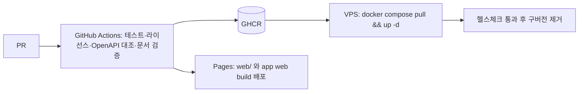

# 10. 시스템 아키텍처 (v1.2)

> 2026-10-28 · 사용자 확정 + **웹 검색으로 확인한 외부 사실**(16번 문서) 반영. 확인하지 못한 항목은 16번에 '미확인'으로 표시했다.

## 1. 목표와 제약
| 항목 | 값 | 설계 대응 |
|---|---|---|
| 규모 | 업체 10~50곳, 출연자 약 1만 명, 업체당 하루 약 3건 공고(하루 30~150건) | 단일 VPS + 모놀리스로 충분 |
| 초기 사용자 | 보출 업체 1곳의 스태프(폐쇄 베타) | 점진 오픈 |
| 개발 인력/기간 | 1인(+AI), **6개월 계획**(12주 폐쇄 베타 → 24주 전체) | 단계별 로드맵(§9), 코드 재사용 극대화 |
| 클라이언트 | Android 앱 우선, iPhone 은 모바일 웹(설계는 iOS 앱 대비), 업체 PC/모바일 웹 | 출연자 Flutter 1벌 → 앱+웹(PWA) |
| 비용 | 적정가(무료 우선, 월 2~4만원 선) | 무료 티어 + 한국 리전 VPS 1대 |
| 데이터 | 주민번호·계좌·서명 등 민감정보 보관 | 앱 암호화·마스킹·감사·분리 저장 |

## 2. 논리 구성

- **출연자 클라이언트는 Flutter 한 코드베이스**: Android 앱과 `flutter build web`(PWA)을 동시에 제공한다. iPhone 사용자는 Safari 에서 접속(홈 화면에 추가하면 웹푸시 가능, iOS 16.4+). 설계는 iOS 앱 출시(애플 계정 준비 후)를 그대로 추가할 수 있게 유지.
- **업체/관리자는 React SPA**: 표·엑셀·마법사 등 데이터 중심 화면은 웹 도구가 유리. 반장의 현장 기능(QR 스캔·출석·메시지)은 **앱의 현장 모드**.
- API 와 워커는 같은 JAR(프로필로 역할 구분)로 시작해 부하가 늘면 분리.
- 파일 트래픽은 서버를 거치지 않는다(presigned URL).

## 3. 기술 스택 (2026-10-28 웹 검색 확인값, 착수 시 재확인)
| 영역 | 선택 | 근거 / 확인 결과 |
|---|---|---|
| 언어/런타임 | **Java 25 LTS**, 가상 스레드 | Java 25 가 현재 LTS(다음 LTS 는 29 예정). Java 21 의 Oracle 무료 업데이트는 2026-09 로 종료(OpenJDK 배포판은 별개) |
| 프레임워크 | **Spring Boot 4.1.x**(Spring Boot 3.5 는 2026-06-30 OSS 지원 종료), Security, Data JPA, Validation, Actuator | 4.0 은 2026-12 경 OSS 종료로 보도됨 → 4.1 선택. **정확한 최신 패치는 spring.io 에서 확인** |
| 쿼리 | Spring Data JPA(단순 CRUD) + `JdbcClient`(동적 검색·달력·가용 판단·뷰는 네이티브 SQL) | QueryDSL 5.1.0 은 Boot BOM 이 관리하지만 사실상 비유지보수 상태라 Hibernate 7.4 와의 호환이 불확실 → 보류(23번 §3) |
| DB | **PostgreSQL 18**(18.6, 2026-08, 지원 ~2030-11). 17/16 도 지원 중(PG 14 는 2026-11-12 종료) | EXCLUDE·생성 컬럼·부분 인덱스·JSONB·pg_trgm·SKIP LOCKED. PG19 출시 여부는 미확인 → 안정판 18 |
| 마이그레이션 | Flyway | |
| 보안 | JJWT, Argon2, Bucket4j, AES-256-GCM + HMAC | |
| 스케줄 | `@Scheduled` + PostgreSQL advisory lock | ShedLock 은 Spring 7 호환 미확인이라 제외 |
| 엑셀 | Apache POI (파일 암호화) | |
| 출연자 앱/웹 | **Flutter 3.47+ (Dart 3.13)**, Riverpod, GoRouter, Dio, table_calendar, firebase_messaging, flutter_image_compress, signature, qr_flutter, mobile_scanner. **UI 는 `material_ui`/`cupertino_ui` 패키지 사용** | Flutter 3.44 부터 SDK 내 Material/Cupertino 가 동결되고 별도 패키지로 분리, 2026-11 stable 에서 SDK 쪽 공식 deprecate 예정 → 처음부터 패키지로 시작 |
| **Flutter 웹 빌드** | **기본(CanvasKit) 빌드**. Wasm(`--wasm`)은 **iOS 의 모든 브라우저에서 동작하지 않음**(공식 문서) | iPhone 은 JS 빌드 폴백 → 초기 로딩 크기·성능 **실기기 검증 게이트(§9 W2)** 필수 |
| 업체/관리자 웹 | React 19 + TS + Vite, TanStack Query/Table, Zustand, Tailwind + shadcn/ui, FullCalendar(MIT 코어만) | Node 는 현재 Active LTS(버전 확인) |
| 스토리지 | Cloudflare R2 (AWS SDK v2) | 무료 10GB-월·Class A 100만·Class B 1,000만, 초과 GB당 $0.015, **egress 무료**(공식 가격 페이지 2026-10-01 갱신본 확인) |
| 푸시 | FCM | |
| 인증 수단 | **문자 OTP(국내 문자 대행) 기본** + 카카오 전화번호 동의항목(심사 통과 시 병행) | 아래 §5 |
| 메일 | Resend 무료(월 3,000·일 100) → 필요 시 SES | |
| CI/컨테이너 | GitHub Actions, Docker | |
| 관측 | Actuator, Sentry, UptimeRobot | |
| 캐시 | (필요 시) Valkey | |

### 채택하지 않음
Kafka·RabbitMQ·Hadoop·Elasticsearch·MSA·K8s·JSP·Next.js(SSR)·상용 UI 컴포넌트. 재검토 조건은 알림 폭증(일 수십만 건)·팀 확대·검색 품질 요구 등.

## 4. 배포

도메인 구성(서비스명 확정 후): `app.`(출연자 웹/PWA), `biz.`(업체), `admin.`(관리자, Cloudflare Access/IP 제한 권장), `api.`, `files.`(R2 공개 자산 도메인).

## 5. 사용자 질문에 대한 결정 (G·H 구간) — 검증 결과 반영
| 질문 | 결정 | 근거 · 확인 결과 |
|---|---|---|
| **휴대폰 인증** (가장 싸고 쉽고 Android·iPhone·웹 모두) | **문자 OTP + 국내 문자 대행(예: 솔라피 단문 건당 18원 공시)을 기본**. 카카오 전화번호 동의항목은 **심사 통과 후 병행**(선택) | 카카오: 비즈앱 → 비즈니스 정보 심사 → 개인정보 항목 검수가 필요하고 필수 동의는 추가 심사, 처리방침과 일치해야 함(포럼 답변 기반, **공식 문서로 재확인**). Firebase Phone Auth 는 Blaze(유료) 필수·국가별 단가(한국 단가 미확인) → 제외. 가입자 1만 명 × 18원 ≈ 18만원 |
| **이메일 발송** | **Resend 무료**(월 3,000·일 100)로 시작 → 초과 시 Amazon SES(서울) | 메일은 비밀번호 재설정·승인·중요 알림 폴백 정도. SPF·DKIM·DMARC 필수 |
| **서버/VPS** | **AWS Lightsail 서울 2GB: 월 US$12**(2 vCPU, 60GB, 전송 3TB, IPv4 포함) | 이전 추정 US$10 은 IPv6 전용/구가격이라 정정. 4GB 는 더 상향. 단일 서버 → 백업 필수 |
| **도메인** | 서비스명 **"보조출연 헬프"**. 후보(가용 여부 **미확인**): `bojohelp.com`, `bojohelp.kr`, `bochulhelp.com`, `bojo-help.com` | 도메인 조회(RDAP)는 이 환경에서 차단되어 확인 못함 → 가비아/Cloudflare 에서 직접 조회. 상표는 KIPRIS 에서 사전 검색 권장 |
| **스토어 계정** | **Google Play 먼저**(1회 US$25). 신규 **개인** 계정(2023-11-13 이후 생성)은 **12명 테스터 14일 연속** 비공개 테스트 후 프로덕션 신청. **조직** 계정은 이 요건 대상이 아니라는 설명이 Google 도움말 기준으로 보도되나 D-U-N-S 필요·검증 최대 30일 | 보출 업체 스태프를 테스터로 쓰면 개인 계정도 가능. 어느 쪽이든 일정에 반영 |
| **Apple** | iOS 앱 출시 시 Apple Developer Program 연 US$99 | 지금은 iPhone 웹(PWA) |
| **월 비용** | VPS US$12(약 1.7만원대) + 도메인 연 1~2만원 + 문자 인증 가입·재로그인(90일)당 18원 + 나머지 무료 티어 → **월 약 2~3만원대** | 스토어 연회비 제외 |

## 6. 비용 추정 (검증된 값 + 추정, 변동 가능)
| 항목 | 초기 | 근거 |
|---|---:|---|
| Lightsail 서울 2GB | US$12/월 | AWS 가격 페이지(확인) |
| 도메인 | 연 1~2만원 | 추정 |
| Cloudflare Pages·CDN·DNS·Turnstile | 0원 | |
| R2 | 월 0~수백원 | 공식: 10GB-월 무료 후 $0.015/GB, egress 무료 |
| FCM | 0원 | |
| 메일 | 0원 | Resend 무료(월 3,000/일 100) |
| 문자 OTP | 가입·재로그인 1건 약 18원(90일 유지로 빈도 낮춤) | 솔라피 공시 |
| 알림톡(P3) | 건당 약 13원 | 솔라피 공시 (이전 추정 8~9원 정정) |
| Sentry·UptimeRobot | 0원 | |
| Google Play | 1회 US$25 | |
| Apple(추후) | 연 US$99 | |
| **합계(스토어 제외)** | **월 약 2~3만원대** | |

## 7. 보안·데이터 아키텍처
| 영역 | 통제 |
|---|---|
| 엣지 | WAF, Turnstile, TLS, 관리자 포털 접근 제한 |
| 인증 | JWT access 15분 + refresh 회전(해시, 재사용 감지), 관리자 2단계 |
| 인가 | 플랫폼 RBAC + 업체 직책(OWNER/MANAGER/SCHEDULER/FIELD_LEADER/STAFF) + 담당 일정 + 소유 검사. 기본 거부 |
| **주민번호** | 입력 즉시 AES-256-GCM 암호화(`key_version`)+HMAC 해시(pepper, 중복 가입 탐지), 별도 테이블·버전 이력, 화면 항상 마스킹, 전체 열람/엑셀은 OWNER/MANAGER·사유·감사, **엑셀은 암호화 파일** |
| 계좌 | AES-256-GCM, 권한자만 전체 |
| 지원서 증빙 | 정보 스냅샷 + 서명 이미지(비공개 파일) + `snapshot_hash`, 보존기간 후 파기 |
| 파일 | 비공개 기본·서명 URL·업로드 검증·이미지 재인코딩(EXIF 제거) |
| 키 관리 | 암호화 키는 DB 밖(서버 시크릿), 분기 회전 + 재암호화 배치, 키 백업은 별도 보관 |
| 감사 | 민감 열람/다운로드/설정 변경/수기 보정 `audit_logs` |
| 백업 | 일 1회 `pg_dump` → age 암호화 → R2(별도 버킷), 분기 복구 리허설. **VPS 단일 장애 대비 필수** |

## 8. 성능·확장 경로
| 대상 | 목표 | 방법 |
|---|---|---|
| 달력 월 집계 | p95 300ms | `ix_job_schedules_dates`(시작/종료 날짜), 30~60초 캐시 |
| 공고 목록 | p95 300ms | 커서 페이징, 필요한 컬럼만, pg_trgm |
| 합격 통보/확정 | p95 500ms | 단일 트랜잭션, 원자적 정원 증가, 낙관적 락 |
| 단체 메시지 | 수백 명 < 1분 | 대상 산정 1쿼리 + 배치 INSERT + 워커 |
| 엑셀 | 1,000행 < 5초 | SXSSF 스트리밍 + 암호화 |
| 가용 판단 | < 500ms | `ix_applications_reserved` (gist 복합) |
| 트리거 | 조치 | |
| CPU/메모리 70%↑ | VPS 상향 → 워커 분리 | |
| 사용자·공고 급증 | 읽기 복제본/매니지드 DB | |
| 로그인·OTP 남용 | Valkey 도입 | |
| iPhone 사용자 증가 | iOS 앱 출시(애플 계정) | |

## 9. 6개월 로드맵 (1인 + AI) — 확정
전체 109개 요구사항을 한 번에 만들 수 없으므로 **12주 폐쇄 베타(보출 업체 1곳 스태프)** 후 **24주까지 확장**한다.

| 주차 | 범위 | 게이트 |
|---|---|---|
| 1~2 | 저장소·CI·Flyway V1·인증(이메일/문자 OTP)·프로필(신체/사진/계좌/주민번호)·파일 업로드 | **W2: iPhone 실기기에서 Flutter 웹(CanvasKit) 검증** — 초기 로딩, 입력, 카메라, 서명, QR 표시. 미달이면 출연자 웹을 React 로 전환 검토 |
| 3~4 | 업체 등록/승인·직원/직책·공고 작성(일정≤21일·역할·시급·최저시급 검증)·게시/마감 | |
| 5~6 | 출연자 앱/웹: 홈 달력(다일 막대)·목록/필터·상세·지원(현재 사진·서명)·내 일정 | 서명/사진 UX 사용성 |
| 7~8 | 업체 웹 지원자 그리드/상세·합격 통보→출연자 확정·마감 자동 불합격·인앱/FCM 알림·중요 알림 폴백(이메일) | |
| 9~10 | 메시지(단체·개별·답장)·인원표/정보표·엑셀(암호화)·참석 확인·QR 출퇴근 | |
| 11 | 취소 패널티 판정·복수 확정 충돌·마감 후 추가 합격·일정 취소/연기·관리자 최소(업체 승인·회원·설정·최저시급) | |
| 12 | 보안/성능 점검·백업·모니터링·**폐쇄 베타 시작** | 법무 1차 확인(주민번호 구조) |
| 13~16 | 정산 기록·근무시간 계산·세액(일용/3.3%)·정산 엑셀 틀 | 세무 확인 |
| 17~20 | 은행 대량이체·원천징수 양식(양식 확보 후)·저장 검색·자유게시판·통계·알림톡 폴백 | |
| 21~24 | 성능·보안 하드닝, Play 출시 준비(비공개 테스트 14일 포함), 부하 테스트, 오픈 | 법무 최종 확인 |
**P3(오픈 이후)**: 평가, 인재 검색·긴급 상단·결제(유료화), 미성년 동의서, iOS 앱.

## 10. 아키텍처 결정 기록
| ID | 결정 | 이유 |
|---|---|---|
| ADR-01 | 모듈러 모놀리스 | 1인 운영, 트랜잭션 정합성 |
| ADR-02 | PostgreSQL | EXCLUDE·생성 컬럼·부분 유니크·JSONB |
| ADR-03 | 시간 겹침 확정을 DB EXCLUDE, 의도적 중복은 `conflict_override` 로 명시 | 경쟁 조건에서도 이중 확정 방지 + 업체 요구(경고 후 허용) |
| ADR-04 | 아웃박스 + SKIP LOCKED | 외부 브로커 없이 원자성. `outbox_events.available_at` 으로 지연 발송(⭐ 출연자 우선 알림: ⭐ 먼저, 일반은 우선 시간(기본 1분) 뒤). 워커 조회 `WHERE status='NEW' AND available_at<=now() … FOR UPDATE SKIP LOCKED` |
| ADR-05 | R2 + presigned URL | egress 무료·서버 부하 0 |
| ADR-06 | 다형성 첨부 | 스키마 변경 없이 확장 |
| ADR-07 | 출연자 Flutter 1벌로 Android 앱+PWA | 1인 개발 비용, iPhone 우선 웹 요구 |
| ADR-08 | 2단계 확정(SELECTED→CONFIRMED) | 연기 재확정·충돌 경고·정원 정확성 |
| ADR-09 | 점수제 대신 횟수+판정 원장 | 사용자 요구, 분쟁·명예훼손 리스크 감소 |
| ADR-10 | 주민번호: 암호화+HMAC 해시+버전 참조, 지원서에 복제 안 함 | 노출면 최소화와 증빙·중복 탐지 동시 달성 |
| ADR-11 | 플랜 기능을 행(`plan_features`)으로 | 유료 기능 추가가 배포만으로 |
