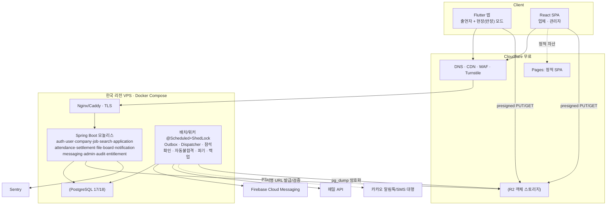
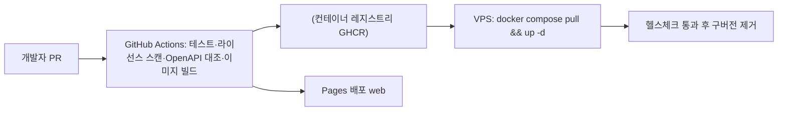

# 10. 시스템 아키텍처

> v1.0 · 2026-10-28 · 가격·무료 한도·버전은 **착수 시 공식 페이지로 재확인**(작성자 지식 기준일 2026-06).

## 1. 목표와 제약
| 목표 | 설계 대응 |
|---|---|
| 초기 비용 최소(월 3만원 이하 목표, REQ-NFR05) | 단일 VPS + 정적 호스팅 + 무료 티어(FCM·R2·Pages·Sentry) |
| 가볍고 단순한 운영(1~2인) | 모듈러 모놀리스, Docker Compose, DB 기반 큐 |
| 선착순·확정의 정합성 | PostgreSQL 제약(CHECK/부분 유니크/EXCLUDE) + 원자적 UPDATE |
| 토스·당근 수준의 모바일 UX | Flutter 네이티브 앱 + 디자인 토큰 |
| 확장성(구독·결제·채널 추가) | 모듈 경계, 다형성 첨부, plan_features, 채널 어댑터, Flyway |

## 2. 논리 구성

- **API 와 워커는 같은 JAR**(프로필로 역할 구분)로 시작해 부하가 늘면 워커 인스턴스를 분리한다.
- 파일 트래픽은 **서버를 통과하지 않는다**(presigned URL) → 서버 대역폭·메모리 절약, R2 egress 무료.

## 3. 기술 스택 최종 (버전은 착수 시 최신 안정/LTS 확인)
| 영역 | 선택 | 근거 / 비고 |
|---|---|---|
| 언어/런타임 | **Java 25 LTS** (불가 시 21), 가상 스레드 | 2025-09 LTS. 동기 코드로 높은 동시성 |
| 프레임워크 | Spring Boot 최신 GA(지원 정책 확인), Spring Security, Spring Data JPA, Validation, Actuator | 3.x 지원 종료 시점 확인 후 4.x 여부 결정 |
| 쿼리 | JPA + QueryDSL(동적 검색), 달력/뷰는 네이티브 SQL | QueryDSL 유지보수 상태 확인(OpenFeign 포크 or jOOQ OSS 대안) |
| DB | **PostgreSQL 17 또는 18** (≥16 호환) | EXCLUDE·부분 인덱스·JSONB·pg_trgm·SKIP LOCKED |
| 마이그레이션 | Flyway | V1 MVP → V2 → V3 단계 |
| 보안 | JJWT, Argon2(spring-security-crypto), Bucket4j(rate limit, 인메모리→추후 Valkey) | |
| 스케줄 | `@Scheduled` + ShedLock(JDBC) | 다중 인스턴스 안전 |
| 엑셀 | Apache POI (Apache-2.0) | SXSSF 스트리밍 |
| API 문서 | springdoc-openapi | 클라이언트 자동 생성 |
| 업체/관리자 웹 | React 19 + TypeScript + Vite, TanStack Query/Table, Zustand, Tailwind + shadcn/ui, FullCalendar(MIT 코어만), react-hook-form + zod | Cloudflare Pages |
| 출연자 앱 | Flutter 최신 stable, Riverpod, GoRouter, Dio, freezed/json_serializable, table_calendar, firebase_messaging, flutter_local_notifications, image_picker, flutter_image_compress, geolocator, mobile_scanner, url_launcher, flutter_secure_storage | 모두 MIT/BSD/Apache 계열 |
| 스토리지 | Cloudflare R2 (AWS SDK v2 S3 호환) | 개발: MinIO(로컬만) |
| 푸시 | FCM | 무료 |
| 메일 | Resend/Brevo/SES 중 택1(무료·저가 구간) | 어댑터로 교체 가능 |
| 컨테이너/CI | Docker, GitHub Actions | 라이선스 스캔·테스트·이미지 빌드 |
| 관측 | Micrometer+Actuator, Sentry, UptimeRobot, (선택) Grafana Cloud | |
| 캐시 | (P2) Valkey | Redis 라이선스 변경 이력 때문에 Valkey(BSD) |

### 채택하지 않음
| 기술 | 이유 | 재검토 조건 |
|---|---|---|
| Kafka · RabbitMQ | 이벤트 처리량이 작고 운영 부담 큼. outbox+SKIP LOCKED 로 충분 | 일 수십만 건 알림, 서비스 분리 |
| Hadoop · Elasticsearch | 데이터 수 GB 미만, pg_trgm 으로 충분 | 검색 품질 요구가 FTS 한계를 넘을 때 |
| MSA · Kubernetes | 인력/트래픽 대비 과함 | 팀 5인↑·독립 배포 필요 |
| Next.js(SSR) | 업체/관리자 포털은 SEO 불필요 → 정적 SPA 가 더 가볍고 무료 | 공개 공고 SEO 유입이 중요해질 때 마케팅 사이트에 한정 도입 |
| Syncfusion 등 상용 컴포넌트 | 라이선스 조건 불확실 | — |

## 4. 배포 구성

| 환경 | 구성 | 비고 |
|---|---|---|
| local | Docker Compose(PostgreSQL, MinIO, Mailpit) + 로컬 API/웹/앱 | 12번 문서 |
| staging | 소형 VPS 또는 운영 VPS 의 별도 compose 프로젝트, 별도 DB/버킷 | 운영 데이터 복사 금지 |
| prod | 한국 리전 VPS(2vCPU/2~4GB) + R2 + Pages | 백업 필수 |

VPS 선택: **한국 리전이 있는 사업자**(AWS Lightsail 서울, Vultr 서울, GCP 서울 등)를 1순위로 한다. 해외 리전(Hetzner 등)은 가격은 낮으나 지연과 개인정보 국외이전 고지 부담이 있다. Oracle Always Free 는 개발/스테이징에만 쓰고 운영에는 쓰지 않는다(계정 정책·용량 리스크).

## 5. 비용 추정 (참고용 · 변동 가능)
| 항목 | 초기(MVP) | 비고 |
|---|---:|---|
| VPS 2GB~4GB (한국 리전) | 월 약 1.5~3만원 | 2GB 로 시작해 필요 시 4GB |
| 도메인 | 연 약 1~2만원 | |
| Cloudflare(DNS·CDN·Pages·Turnstile) | 0원 | |
| R2 스토리지 | 월 0~수백원 | 10GB 무료 후 GB당 US$0.015(확인 필요). 300KB×5장×1만 명 ≈ 15GB |
| FCM | 0원 | |
| 메일 | 0원~소액 | 무료 구간 확인 |
| Sentry/UptimeRobot | 0원 | 무료 플랜 |
| 휴대폰 인증 | 가입 1건당 수 원~수십 원 | 수단 미정(§9). 소셜 로그인 병행으로 비중 축소 |
| **Apple Developer / Google Play** | 연 US$99 / 1회 US$25 | 스토어 출시 시 불가피 |
| 카카오 알림톡 | 건당 약 8~9원 | P3, 미응답자 폴백만 |
| **합계(스토어 제외)** | **월 약 2~4만원** | 목표 3만원은 2GB 구성에서 달성 가능 |

> REQ-NFR05 의 "월 3만원 이하"는 스토어 고정비를 제외한 운영비 기준이다.

## 6. 보안 아키텍처
| 계층 | 통제 |
|---|---|
| 엣지 | Cloudflare WAF 기본 규칙, Turnstile(가입·로그인·인증번호), TLS 1.2+ |
| 인증 | JWT access 15분 + refresh 회전(해시 저장, 재사용 감지), 관리자 2단계(TOTP) 권장 |
| 인가 | 플랫폼 RBAC(`permissions`) + 업체 직책 + 소유/담당 검사. 모든 컨트롤러에 명시적 권한 선언, 기본 거부 |
| 데이터 | 민감 컬럼 AES-256-GCM(키는 환경/시크릿에서, `key_version` 회전), 응답 마스킹 단일 정책 클래스 |
| 파일 | 비공개 기본, 서명 URL(짧은 만료), 업로드 MIME/확장자/용량 검증, 이미지 재인코딩(EXIF 제거) |
| 감사 | 열람·다운로드·승인·제재·설정 변경 `audit_logs` |
| 시크릿 | `.env`/CI 시크릿, 저장소에 커밋 금지, 분기 회전 |
| 네트워크 | DB 포트 외부 비공개, SSH 키 전용, 방화벽 80/443/SSH(제한) |

## 7. 성능 설계
| 대상 | 목표 | 방법 |
|---|---|---|
| 달력 월 집계 | p95 300ms | `ix_job_schedules_date` + 상태 필터, 30~60초 캐시 |
| 공고 목록 | p95 300ms | 커서 페이징, 필요한 컬럼만, 부분 인덱스, `pg_trgm` |
| 지원/확정 | p95 500ms | 단일 트랜잭션, 원자적 증가, 낙관적 락 `version` |
| 동시 지원 | 100 req/s 급 | 가상 스레드 + Hikari 풀(20), 정원 행 잠금 시간 최소화 |
| 단체 메시지 | 수백 명 < 1분 | 대상 산정 1회 쿼리 + 배치 INSERT + 워커 병렬 발송 |
| 엑셀 | 1,000행 < 5초 | SXSSF 스트리밍 |
부하 테스트(k6/Gatling)로 확인한다: 선착순 동시 100건에서 정원 초과 0, 중복 지원 0.

## 8. 확장 경로 (단계별)
| 트리거 | 조치 |
|---|---|
| CPU/메모리 70%↑ 지속 | VPS 상향 → 워커 분리 인스턴스 |
| DB 부하/용량 | 읽기 복제본 또는 매니지드 DB, 인덱스·쿼리 점검, 아카이빙 테이블 |
| 로그인/요청 제한 필요 | Valkey 도입(rate limit·OTP·세션 캐시) |
| 알림 폭증 | 워커 수평 확장, 그다음에야 RabbitMQ 검토 |
| 공개 SEO 필요 | 공개 공고 페이지만 SSR/정적 생성 사이트 추가 |
| 유료화 | `subscription_enforcement=true`, 결제 모듈(14번) |
| 해외/다국어 | i18n 문자열 분리(앱·웹 처음부터 ARB/JSON 사용) |

## 9. 미결정 / 착수 전 확정 항목
| # | 항목 | 후보 | 기한 |
|---|---|---|---|
| 1 | 휴대폰 인증 수단 | Firebase Phone Auth(무료 구간 확인) / 문자 대행(건당) / 카카오 동의항목 | 개발 2주차 |
| 2 | 이메일 발송사 | Resend / Brevo / SES | 개발 3주차 |
| 3 | VPS 사업자·플랜 | Lightsail 서울 / Vultr 서울 / GCP 서울 | 스테이징 전 |
| 4 | Spring Boot 메이저 버전 | 최신 GA 지원 정책 기준 | 프로젝트 생성 시 |
| 5 | 법무 항목 | 13번 문서 §5 | 오픈 전 |

## 10. 아키텍처 결정 기록 (ADR 요약)
| ID | 결정 | 이유 | 대안 |
|---|---|---|---|
| ADR-01 | 모듈러 모놀리스 | 1~2인 운영, 트랜잭션 정합성 | MSA |
| ADR-02 | PostgreSQL | EXCLUDE·부분 유니크·JSONB | MySQL |
| ADR-03 | 시간 겹침 확정 차단을 DB EXCLUDE 로 | 동시 확정에서도 깨지지 않음 | 앱 레벨 검사(경쟁 조건 위험) |
| ADR-04 | 아웃박스 + SKIP LOCKED | 외부 브로커 없이 원자성 | Kafka/RabbitMQ |
| ADR-05 | R2 + presigned URL | egress 무료·서버 부하 0 | S3 |
| ADR-06 | 다형성 첨부 | 스키마 변경 없이 확장 | file_groups |
| ADR-07 | 앱(Flutter) 우선, 웹은 업체/관리자 | 푸시 신뢰도·UX | PWA 단독 |
| ADR-08 | 플랜 기능을 행(`plan_features`)으로 | 유료 기능 추가가 코드 배포만으로 | boolean 컬럼 |
| ADR-09 | 지원서에 정보표 스냅샷 + 파기 배치 | 공고별 계좌 변경 요구 + 최소 보관 | 프로필 직접 참조 |
