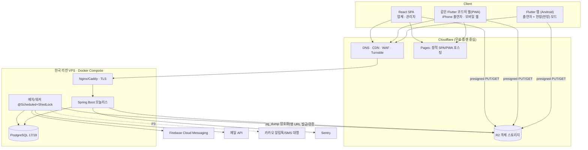
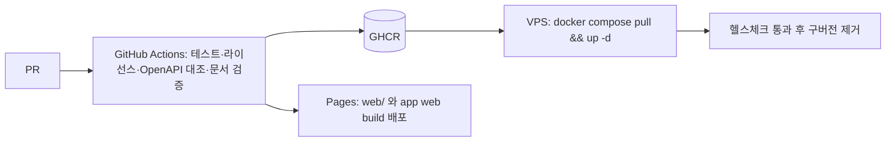

# 10. 시스템 아키텍처 (v1.1)

> 2026-10-28 · 사용자 답변(규모·예산·일정·플랫폼) 반영. 가격·무료 한도·버전은 **착수 시 공식 페이지로 재확인**(작성자 지식 기준일 2026-06).

## 1. 목표와 제약
| 항목 | 값 | 설계 대응 |
|---|---|---|
| 규모 | 업체 10~50곳, 출연자 약 1만 명, 업체당 하루 약 3건 공고(하루 30~150건) | 단일 VPS + 모놀리스로 충분 |
| 초기 사용자 | 보출 업체 1곳의 스태프(폐쇄 베타) | 점진 오픈 |
| 개발 인력/기간 | 1인(+AI), 약 3개월 | MVP 컷(§9), 코드 재사용 극대화 |
| 클라이언트 | Android 앱 우선, iPhone 은 모바일 웹(설계는 iOS 앱 대비), 업체 PC/모바일 웹 | 출연자 Flutter 1벌 → 앱+웹(PWA) |
| 비용 | 적정가(무료 우선, 월 2~4만원 선) | 무료 티어 + 한국 리전 VPS 1대 |
| 데이터 | 주민번호·계좌·서명 등 민감정보 보관 | 앱 암호화·마스킹·감사·분리 저장 |

## 2. 논리 구성

- **출연자 클라이언트는 Flutter 한 코드베이스**: Android 앱과 `flutter build web`(PWA)을 동시에 제공한다. iPhone 사용자는 Safari 에서 접속(홈 화면에 추가하면 웹푸시 가능, iOS 16.4+). 설계는 iOS 앱 출시(애플 계정 준비 후)를 그대로 추가할 수 있게 유지.
- **업체/관리자는 React SPA**: 표·엑셀·마법사 등 데이터 중심 화면은 웹 도구가 유리. 반장의 현장 기능(QR 스캔·출석·메시지)은 **앱의 현장 모드**.
- API 와 워커는 같은 JAR(프로필로 역할 구분)로 시작해 부하가 늘면 분리.
- 파일 트래픽은 서버를 거치지 않는다(presigned URL).

## 3. 기술 스택 (버전은 착수 시 최신 안정/LTS)
| 영역 | 선택 | 근거 |
|---|---|---|
| 언어/런타임 | Java 25 LTS(불가 시 21), 가상 스레드 | 보유 기술 |
| 프레임워크 | Spring Boot 최신 GA(지원 정책 확인), Security, Data JPA, Validation, Actuator | |
| 쿼리 | JPA + QueryDSL(동적 검색), 달력·가용 판단·뷰는 네이티브 SQL | QueryDSL 유지보수 확인(대안 jOOQ OSS) |
| DB | PostgreSQL 17/18 (≥16) | EXCLUDE·생성 컬럼·부분 인덱스·JSONB·pg_trgm·SKIP LOCKED |
| 마이그레이션 | Flyway | V1 MVP → V2 → V3 |
| 보안 | JJWT, Argon2, Bucket4j, **AES-256-GCM + HMAC** (민감정보) | |
| 스케줄 | `@Scheduled` + ShedLock(JDBC) | |
| 엑셀 | Apache POI (**파일 암호화** 지원) | 주민번호 포함 파일 보호 |
| QR | 서버: HMAC 토큰, 앱: `qr_flutter`(표시)·`mobile_scanner`(스캔) | |
| 출연자 앱/웹 | **Flutter** (Riverpod, GoRouter, Dio, table_calendar, firebase_messaging, flutter_image_compress, signature, image_picker) | Android+PWA 1벌 |
| 업체/관리자 웹 | React 19 + TS + Vite, TanStack Query/Table, Zustand, Tailwind + shadcn/ui, FullCalendar(MIT 코어만) | 정적 배포·무료 |
| 스토리지 | Cloudflare R2 (AWS SDK v2) | egress 무료 |
| 푸시 | FCM(Android·웹푸시) | 무료 |
| 인증 수단 | 카카오 로그인(+전화번호 동의항목) 우선, 문자 OTP 폴백(국내 문자 대행) | 아래 §5 |
| 메일 | Resend(무료 구간) → 필요 시 SES | 어댑터 교체 |
| CI/컨테이너 | GitHub Actions, Docker | |
| 관측 | Actuator, Sentry, UptimeRobot | |
| 캐시 | (필요 시) Valkey | |

### 채택하지 않음
Kafka·RabbitMQ·Hadoop·Elasticsearch·MSA·K8s·JSP·Next.js(SSR)·상용 UI 컴포넌트. 재검토 조건은 알림 폭증(일 수십만 건)·팀 확대·검색 품질 요구 등.

## 4. 배포

도메인 구성(서비스명 확정 후): `app.`(출연자 웹/PWA), `biz.`(업체), `admin.`(관리자, Cloudflare Access/IP 제한 권장), `api.`, `files.`(R2 공개 자산 도메인).

## 5. 사용자 질문에 대한 결정 (G·H 구간)
| 질문 | 결정 | 이유 · 확인할 점 |
|---|---|---|
| **휴대폰 인증** (가장 싸고 쉽고 Android·iPhone·웹 모두) | **1순위 카카오 로그인의 전화번호 동의항목**(카카오가 이미 인증한 번호, 추가 비용 없음), **2순위 자체 문자 OTP + 국내 문자 대행사**(건당 소액, 발신번호 사전 등록) | Firebase Phone Auth 는 SMS 단가·무료 한도·reCAPTCHA 때문에 후순위. 카카오 동의항목은 **비즈앱 심사** 필요(사업자 보유 → 가능성 높음, 확인). 출연자 1만 명 × 1회 인증이어도 OTP 비용은 총 수십만 원 이내 추정 |
| **이메일 발송** | **Resend 무료 구간으로 시작**, 한도 초과·비용 절감 시 **Amazon SES(서울)** 로 어댑터 교체 | 메일은 비밀번호 재설정·승인 등 소량. SPF·DKIM·DMARC 설정 필수(네이버·다음 수신율) |
| **서버/VPS** | **AWS Lightsail 서울 2GB(약 월 US$10)** 로 시작, 부족하면 4GB(약 US$20). 대안: Vultr 서울 | 정액·트래픽 포함·고정 IP·서울. 1만 명/하루 100건 공고 규모에 2GB 충분(JVM 힙 ~640MB, PG 버퍼 256MB, 스왑 2GB). 단일 서버이므로 **백업이 생명**(§7). Oracle Free 는 개발/스테이징만 |
| **도메인** | 서비스명 확정 후 `.com` + `.kr` 확보. `.com` 은 Cloudflare Registrar(원가), `.kr`/`.co.kr` 은 가비아 등 국내 등록처 | `.co.kr` 은 사업자 필요, 신뢰도에 유리 |
| **스토어 계정** | **Google Play Console 먼저**(1회 US$25). Apple Developer(연 US$99)는 iOS 앱을 낼 때 | iPhone 은 우선 웹(PWA). Play 개인 계정은 신규 생성 시 **프로덕션 전 비공개 테스트 요건**(테스터 수·기간)이 있으므로 **사업자(조직) 계정** 검토 — 최신 정책 확인 |
| **월 비용** | 적정가: VPS ≈ 1.5~3만원 + 도메인 연 1~2만원 + 문자 OTP 가입당 수 원~수십 원 | 나머지는 무료 티어 |

## 6. 비용 추정 (참고용 · 변동)
| 항목 | 초기 | 비고 |
|---|---:|---|
| VPS 서울 2GB | 월 약 1.5만원 | 4GB 로 올리면 약 3만원 |
| 도메인 | 연 1~2만원 | |
| Cloudflare Pages·CDN·DNS·Turnstile | 0원 | |
| R2 | 월 0~수백원 | 무료 10GB 후 GB당 약 US$0.015(확인). 현재 사진 1장 300KB × 지원서 수 + 서명 이미지 |
| FCM | 0원 | |
| 메일 | 0원~소액 | |
| 휴대폰 인증 | 카카오 0원 / OTP 건당 소액 | |
| Sentry·UptimeRobot | 0원 | |
| Google Play | 1회 US$25 | iOS 앱 시 Apple 연 US$99 |
| 카카오 알림톡(P3) | 건당 약 8~9원 | iPhone 웹 푸시 불가 사용자 폴백 |
| **합계(스토어 제외)** | **월 약 2~4만원** | |

## 7. 보안·데이터 아키텍처
| 영역 | 통제 |
|---|---|
| 엣지 | WAF, Turnstile, TLS, 관리자 포털 접근 제한 |
| 인증 | JWT access 15분 + refresh 회전(해시, 재사용 감지), 관리자 2단계 |
| 인가 | 플랫폼 RBAC + 업체 직책(OWNER/MANAGER/SCHEDULER/FIELD_LEADER/STAFF) + 담당 일정 + 소유 검사. 기본 거부 |
| **주민번호** | 입력 즉시 AES-256-GCM 암호화(`key_version`)+HMAC 해시(pepper, 중복 가입 탐지), 별도 테이블·버전 이력, 화면 항상 마스킹, 전체 열람/엑셀은 OWNER/MANAGER·사유·감사, **엑셀은 암호화 파일** |
| 계좌 | AES-256-GCM, 권한자만 전체 |
| 지원서 증빙 | 정보 스냅샷 + 서명 이미지(비공개 파일) + `snapshot_hash`, 보존기간 후 파기 |
| 파일 | 비공개 기본·서명 URL·업로드 검증·이미지 재인코딩(EXIF 제거) |
| 키 관리 | 암호화 키는 DB 밖(서버 시크릿), 분기 회전 + 재암호화 배치, 키 백업은 별도 보관 |
| 감사 | 민감 열람/다운로드/설정 변경/수기 보정 `audit_logs` |
| 백업 | 일 1회 `pg_dump` → age 암호화 → R2(별도 버킷), 분기 복구 리허설. **VPS 단일 장애 대비 필수** |

## 8. 성능·확장 경로
| 대상 | 목표 | 방법 |
|---|---|---|
| 달력 월 집계 | p95 300ms | `ix_job_schedules_dates`(시작/종료 날짜), 30~60초 캐시 |
| 공고 목록 | p95 300ms | 커서 페이징, 필요한 컬럼만, pg_trgm |
| 합격 통보/확정 | p95 500ms | 단일 트랜잭션, 원자적 정원 증가, 낙관적 락 |
| 단체 메시지 | 수백 명 < 1분 | 대상 산정 1쿼리 + 배치 INSERT + 워커 |
| 엑셀 | 1,000행 < 5초 | SXSSF 스트리밍 + 암호화 |
| 가용 판단 | < 500ms | `ix_applications_reserved` (gist 복합) |
| 트리거 | 조치 | |
| CPU/메모리 70%↑ | VPS 상향 → 워커 분리 | |
| 사용자·공고 급증 | 읽기 복제본/매니지드 DB | |
| 로그인·OTP 남용 | Valkey 도입 | |
| iPhone 사용자 증가 | iOS 앱 출시(애플 계정) | |

## 9. 3개월 로드맵 (1인 + AI) — 현실성 점검
전체 106개 요구사항·106개 기능을 3개월에 모두 구현하는 것은 **현실적이지 않다.** 아래 컷으로 12주에 폐쇄 베타(보출 업체 1곳 스태프)를 목표로 한다.

| 주차 | 범위 |
|---|---|
| 1~2 | 저장소·CI·Flyway V1·인증(이메일/카카오)·프로필(신체/사진/계좌/주민번호)·파일 업로드 |
| 3~4 | 업체 등록/승인·직원/직책·공고 작성(일정·역할·시급·최저시급)·게시/마감 |
| 5~6 | 출연자 앱/웹: 홈 달력·목록/필터·상세·지원(현재 사진·서명)·내 일정 |
| 7~8 | 업체 웹 지원자 그리드/상세·합격 통보→출연자 확정·마감 자동 불합격·FCM/인앱 알림 |
| 9~10 | 메시지(단체·개별·답장)·인원표/정보표·엑셀(암호화)·참석 확인·QR 출퇴근 |
| 11 | 취소 패널티 판정·복수 확정 충돌·마감 후 추가 합격·일정 취소/연기·관리자 최소(업체 승인·회원·설정·최저시급) |
| 12 | 보안/성능 점검·백업·모니터링·폐쇄 베타 운영 |
**오픈 이후(P2)**: 정산 기록·은행 대량이체/원천징수 엑셀, 저장 검색, 자유게시판, 통계. **P3**: 평가, 알림톡, 인재 검색·긴급 상단(유료), 결제, 미성년 동의서.

## 10. 아키텍처 결정 기록
| ID | 결정 | 이유 |
|---|---|---|
| ADR-01 | 모듈러 모놀리스 | 1인 운영, 트랜잭션 정합성 |
| ADR-02 | PostgreSQL | EXCLUDE·생성 컬럼·부분 유니크·JSONB |
| ADR-03 | 시간 겹침 확정을 DB EXCLUDE, 의도적 중복은 `conflict_override` 로 명시 | 경쟁 조건에서도 이중 확정 방지 + 업체 요구(경고 후 허용) |
| ADR-04 | 아웃박스 + SKIP LOCKED | 외부 브로커 없이 원자성 |
| ADR-05 | R2 + presigned URL | egress 무료·서버 부하 0 |
| ADR-06 | 다형성 첨부 | 스키마 변경 없이 확장 |
| ADR-07 | 출연자 Flutter 1벌로 Android 앱+PWA | 1인 개발 비용, iPhone 우선 웹 요구 |
| ADR-08 | 2단계 확정(SELECTED→CONFIRMED) | 연기 재확정·충돌 경고·정원 정확성 |
| ADR-09 | 점수제 대신 횟수+판정 원장 | 사용자 요구, 분쟁·명예훼손 리스크 감소 |
| ADR-10 | 주민번호: 암호화+HMAC 해시+버전 참조, 지원서에 복제 안 함 | 노출면 최소화와 증빙·중복 탐지 동시 달성 |
| ADR-11 | 플랜 기능을 행(`plan_features`)으로 | 유료 기능 추가가 배포만으로 |
