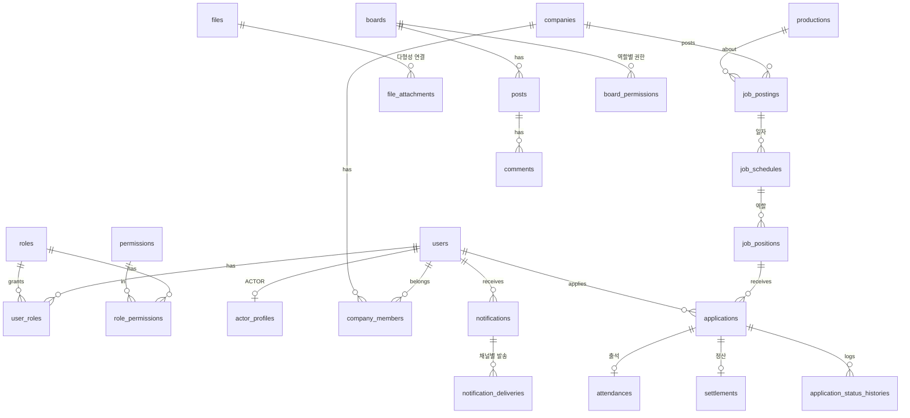

> ⚠️ **보관용(폐기된 초안)** — 최신 설계는 `docs/00_README.md` 와 루트 `CLAUDE.md` 를 따른다.

# 보조출연 매칭 플랫폼 — 전체 정의서 · 구조 · DB · 기능 설계 (v0.1)

> ⚠️ **v0.2 보정 안내**: 사용자 검토 반영 결과는 [`REVIEW_COMPARISON.md`](./REVIEW_COMPARISON_v0.2.md)와 루트 `CLAUDE.md`가 우선한다. 이 문서에서 달라진 점: 웹은 Next.js → **React+Vite SPA**, 출연자는 **Flutter 앱 우선**, 호스팅은 **한국 리전 VPS 권장**(Oracle Free는 개발용), 파일은 **R2 확정**, `actor_attributes`(EAV) 제거 → 전용 컬럼+`tags JSONB`, 테이블 44→**47개**, 전날 참석확인·성실도 원장·정산 항목·조건 스냅샷 추가.

> 상태: 초안 / 작성일: 2026-10-28
> DDL: [`db/schema.sql`](../../db/schema.sql) — PostgreSQL 16에서 오류 없이 실행되는 것을 확인함 (44개 테이블).
> ⚠️ 무료 한도·요금·법령은 자주 바뀐다. 이 문서의 해당 수치/조항은 **착수 전에 공식 문서로 재확인**할 것.

---

## 0. 한 장 요약

| 항목 | 결정 |
|---|---|
| 서비스 | 보출 업체가 **날짜별 당일/단기 보조출연 공고**를 올리고, 출연자가 **달력·검색으로 찾아 지원(첨부 포함)** 하는 매칭 플랫폼 (사람인/잡코리아 + 달력 + 당일 인력시장) |
| 핵심 단위 | 공고(posting) → **촬영 일자(schedule)** → **모집 역할(position)** → 지원(application) → 출석(attendance) → 정산기록(settlement) |
| 아키텍처 | **모듈러 모놀리스** (Spring Boot 단일 배포) + PostgreSQL + 객체 스토리지. 마이크로서비스 ✗ |
| 비동기 | **Kafka / RabbitMQ / Hadoop 사용 안 함.** DB 트랜잭션 아웃박스 + 워커로 충분 (근거 §5) |
| 프론트 | 1단계 **Next.js(TSX) 반응형 PWA**, 2단계 필요 시 **Flutter** 앱. JSP ✗ |
| 비용 | 초기 월 0원~소액 가능 (FCM·R2/GCS·GitHub Actions·Sentry 등 무료 티어 중심) |

---

## 1. 용어 정의서

| 용어 | 정의 | 시스템 대응 |
|---|---|---|
| 보출 업체 | 제작사로부터 계약·인원 요청을 받아 보조출연자를 섭외하는 업체 (소장팀/인력사무소 성격) | `companies` |
| 출연자 | 보조출연을 희망하는 개인 | `users` + `actor_profiles` |
| 제작사 / 작품 | 드라마·영화·광고 등. 업체와 계약하는 쪽 | `productions` (공용 마스터) |
| 공고 | 업체가 올리는 모집 글 한 건. 여러 촬영일을 포함할 수 있음 | `job_postings` |
| 촬영 일자 | 공고 안의 하루. **달력의 최소 단위** (날짜·집합시간·집합장소) | `job_schedules` |
| 모집 역할 | 일자 내 모집 단위 (예: 교복 학생 남 10명, 일당 X원) | `job_positions` |
| 지원 | 출연자가 특정 역할에 신청한 건 (첨부 가능) | `applications` |
| 확정 | 업체가 지원을 수락한 상태 (CONFIRMED) | `applications.status` |
| 출석 | 촬영 당일 참석 결과 (참석/지각/노쇼) | `attendances` |
| 노쇼 | 확정 후 무단 불참 | `attendances.result = NO_SHOW` |
| 정산 기록 | 일당·세금·지급 여부 기록 (실제 송금은 범위 밖) | `settlements` |
| 반장/팀장 | (확장) 출연자를 모아오는 현장 리더. 1차는 `company_members` 하위 역할/태그로 대응 | 3단계 |
| 비공개 현장 | 작품명/정확한 장소를 확정자에게만 공개하는 공고 | `conceal_details` |

---

## 2. 사용자 · 권한 설계

### 2.1 원칙
1. **인증(users)과 역할(roles)과 프로필(actor/company)을 분리**한다. 한 사람이 출연자이면서 업체 직원일 수 있으므로 `user_roles`는 다대다.
2. 업체는 **조직(companies)** 이고 로그인 주체가 아니다. 사람(users)이 `company_members`로 소속된다 → 직원 여러 명이 한 업체 공고를 관리 가능.
3. 권한은 두 겹: **역할 권한(RBAC: roles↔permissions)** + **소유 권한(내 업체의 공고만, 내 지원만)**. 소유 검사는 서비스 계층에서 강제.
4. 게시판 권한은 코드가 아니라 **`board_permissions` (게시판×역할)** 데이터로 관리 → 새 역할/게시판이 생겨도 코드·스키마 변경 없음.

### 2.2 역할
| 역할 코드 | 설명 |
|---|---|
| `ACTOR` | 출연자 |
| `COMPANY` | 보출 업체 구성원 (세부는 `company_members.member_role`: OWNER / MANAGER / STAFF) |
| `OPERATOR` | 운영자(CS): 문의 응대, 게시글·신고 처리 |
| `ADMIN` | 관리자: 업체 승인, 회원 제재, 코드/마스터 관리 |
| `SUPER_ADMIN` | 전체 권한, 관리자 부여 |

### 2.3 권한 매트릭스 (핵심)
| 기능 | 비로그인 | ACTOR | COMPANY(STAFF) | COMPANY(MANAGER/OWNER) | OPERATOR | ADMIN |
|---|:-:|:-:|:-:|:-:|:-:|:-:|
| 공고 목록/달력 조회 | ○ (일부 마스킹) | ○ | ○ | ○ | ○ | ○ |
| 공고 상세(비공개 현장 포함) | ✕ | 확정자만 | 자기 업체 | 자기 업체 | ○ | ○ |
| 공고 작성/수정 | ✕ | ✕ | ○ | ○ | ✕ | ○ |
| 공고 삭제/마감 | ✕ | ✕ | ✕ | ○ | ✕ | ○ |
| 지원/취소 | ✕ | ○ | ✕ | ✕ | ✕ | ✕ |
| 지원자 열람·확정·거절 | ✕ | ✕ | ○ | ○ | ✕ | ○ |
| 출석 체크 | ✕ | 본인(QR/GPS) | ○ | ○ | ✕ | ○ |
| 정산 기록 | 본인 열람 | 본인 열람 | ○ | ○ | ✕ | ○ |
| 업체 직원 초대/제거 | ✕ | ✕ | ✕ | OWNER만 | ✕ | ○ |
| 업체 승인 | ✕ | ✕ | ✕ | ✕ | ✕ | ○ |
| 회원 제재 | ✕ | ✕ | ✕ | ✕ | 임시 | ○ |
| 게시글 숨김/삭제 | ✕ | 본인 | 본인 | 본인 | ○ | ○ |

---

## 3. 기능 정의서 (우선순위: **P1=MVP**, P2=오픈 후 1~2달, P3=성장기)

### 3.1 계정 / 인증
| ID | 기능 | 우선 | 설명 |
|---|---|:-:|---|
| A-01 | 이메일 가입/로그인 | P1 | BCrypt/Argon2, 이메일 인증 |
| A-02 | 소셜 로그인 | P1 | 카카오(필수급), 구글, 애플(iOS 앱 출시 시 필수), 네이버 |
| A-03 | 가입 시 유형 선택 | P1 | 출연자 / 업체 → 역할 부여 |
| A-04 | 약관·개인정보 동의 이력 | P1 | `terms`, `user_consents` 버전별 |
| A-05 | 비밀번호 재설정 | P1 | 이메일 토큰 |
| A-06 | 토큰 갱신/로그아웃/전체 기기 로그아웃 | P1 | refresh 토큰 회전, 해시 저장 |
| A-07 | 회원 탈퇴 | P1 | soft delete + 보관기간 후 파기 배치, 진행 중 확정 건 있으면 제한 |
| A-08 | 로그인 이력·이상 징후 | P2 | 실패 횟수 제한 |
| A-09 | 휴대폰 본인확인 | P3 | 유료(통신사 인증 등). 1차는 **이메일+업체는 사업자 승인**으로 대체 |

### 3.2 출연자 프로필
| ID | 기능 | 우선 |
|---|---|:-:|
| P-01 | 기본 프로필 (성별·생년월일·키·몸무게·지역·소개) | P1 |
| P-02 | 사진 업로드 (프로필/전신) | P1 |
| P-03 | 확장 속성 (사이즈, 특기, 어학, 보유 의상, 차량 유무) — `actor_attributes` | P1 |
| P-04 | 이력서/경력 파일 첨부 | P2 |
| P-05 | 프로필 공개 설정 (업체 인재검색 노출 여부) | P2 |
| P-06 | 활동 통계 (출석 횟수, 노쇼 횟수, 평점) | P1 (표시), P2 (평점) |
| P-07 | 미성년자 처리 (생년월일로 판정, 법정대리인 동의·야간 제한 §10) | P1 |

### 3.3 업체
| ID | 기능 | 우선 |
|---|---|:-:|
| C-01 | 업체 등록 + 사업자등록증 업로드 → 관리자 승인 전까지 공고 불가 | P1 |
| C-02 | 업체 프로필/로고/소개 | P1 |
| C-03 | 직원 초대·권한(OWNER/MANAGER/STAFF) | P2 (MVP는 OWNER 1인) |
| C-04 | 업체 평점·후기 공개 | P2 |
| C-05 | 출연자 블랙리스트 | P2 |
| C-06 | 인재 검색 (조건별 출연자 풀 조회, 제안 발송) | P3 |

### 3.4 공고 (핵심)
| ID | 기능 | 우선 | 비고 |
|---|---|:-:|---|
| J-01 | 공고 작성: 작품 선택/신규, 제목, 설명, 이미지 | P1 | 임시저장(DRAFT) |
| J-02 | **일자 여러 개 추가** (날짜·집합시간·종료·집합장소·지도) | P1 | |
| J-03 | **일자별 역할 여러 개 추가** (인원·성별·나이·일당·식사·교통·의상·요건) | P1 | |
| J-04 | 공고 복사(어제 공고 → 새 날짜) | P1 | 현장 업무 효율 핵심 |
| J-05 | 선착순 / 승인제 모집 방식 | P1 | `apply_mode` |
| J-06 | 긴급(당일) 공고 표시·상단 노출 | P1 | `is_urgent` |
| J-07 | 비공개 현장 (작품명·상세장소는 확정자만) | P1 | `conceal_details` |
| J-08 | 마감/취소/일정 변경(우천 취소·연기) → 지원자 자동 알림 | P1 | |
| J-09 | 지원 시 첨부 필수 여부, 업체별 추가 질문 | P1(첨부)/P2(질문) | |
| J-10 | 공고 조회수, 지원자 수 | P1 | |
| J-11 | 공고 재게시/끌어올리기 | P3 | |

### 3.5 탐색 / 달력 (출연자 측 핵심)
| ID | 기능 | 우선 |
|---|---|:-:|
| S-01 | **월/주/일 달력 뷰**: 날짜별 공고 수·총 모집 인원 표시, 날짜 탭 시 해당일 목록 | P1 |
| S-02 | 목록 뷰 + 필터(날짜범위·지역·역할유형·성별·나이·일당 최소·긴급·식사/교통) | P1 |
| S-03 | 키워드 검색(작품명·제목) — PostgreSQL `pg_trgm` | P1 |
| S-04 | 내가 지원 가능한 공고만 보기 (프로필 조건 자동 매칭) | P1 |
| S-05 | 관심 공고(북마크) | P1 |
| S-06 | 저장된 검색조건 + 새 공고 알림 | P2 |
| S-07 | 내 일정 달력 (확정/지원중/대기 색 구분) | P1 |
| S-08 | 지도 뷰 / 내 위치 근처 | P3 |

### 3.6 지원 · 선정
| ID | 기능 | 우선 |
|---|---|:-:|
| AP-01 | 지원(메시지 + 첨부) / 취소 | P1 |
| AP-02 | **같은 날 이중 확정 방지** (DB 부분 유니크) | P1 |
| AP-03 | 업체 지원자 목록: 프로필·사진·출석이력 보며 확정/보류/거절/대기자 | P1 |
| AP-04 | 선착순 자동 확정 (원자적 증가로 초과 불가) | P1 |
| AP-05 | 정원 마감 시 대기자 자동 승격 (취소 발생 시) | P2 |
| AP-06 | 상태 이력(`application_status_histories`) | P1 |
| AP-07 | 확정 후 취소 시 사유·패널티 정책 | P2 |
| AP-08 | 확정자 단체 공지(집합 변경 등) | P2 |

### 3.7 출석 · 정산 · 평가
| ID | 기능 | 우선 |
|---|---|:-:|
| AT-01 | 업체가 현장 체크(수기 일괄 체크 화면) | P1 |
| AT-02 | 출연자 QR/GPS 체크인 (업체가 일자별 QR 표시) | P2 |
| AT-03 | 노쇼 자동 집계 → 프로필 통계 | P2 |
| ST-01 | 일당·세금·지급예정일 **기록** + 출연자 열람 | P2 |
| ST-02 | 실제 송금/에스크로 | 범위 밖 (법·PG 이슈) |
| RV-01 | 상호 평가 (출석 완료 건만, 양쪽 작성 후 공개 = 블라인드) | P2 |

### 3.8 알림
| ID | 기능 | 우선 |
|---|---|:-:|
| N-01 | 인앱 알림함 + 읽음 | P1 |
| N-02 | 푸시(FCM): 지원결과, 확정, 일정변경/취소, 집합 D-1/당일 리마인더 | P1 |
| N-03 | 이메일 | P1 |
| N-04 | 알림 수신 설정 (유형×채널) | P1 |
| N-05 | 조건 맞는 신규/긴급 공고 알림 | P2 |
| N-06 | 카카오 알림톡/SMS | P3 (유료) |
| N-07 | 야간(21~08시) 광고성 알림 차단 | P1 |

### 3.9 게시판 · 고객센터
| ID | 기능 | 우선 |
|---|---|:-:|
| B-01 | 공지사항 (관리자 작성, 상단고정) | P1 |
| B-02 | FAQ | P1 |
| B-03 | 1:1 문의 (비밀글, 관리자 답변=댓글, 첨부) | P1 |
| B-04 | 자유게시판/후기 (댓글·대댓글) | P2 |
| B-05 | 신고 | P1 |

### 3.10 관리자
| ID | 기능 | 우선 |
|---|---|:-:|
| M-01 | 업체 승인/반려 (사업자등록증 확인) | P1 |
| M-02 | 회원 조회·정지·복구 | P1 |
| M-03 | 공고 모니터링·강제 숨김 | P1 |
| M-04 | 신고 처리 | P1 |
| M-05 | 게시판·권한·약관·코드(역할유형/지역) 관리 | P1 |
| M-06 | 통계 대시보드 (일별 공고·지원·확정률·노쇼율) | P2 |
| M-07 | 감사 로그 조회 (`audit_logs`) | P1 |

---

## 4. 핵심 업무 흐름 · 상태 머신

### 4.1 흐름
```
[업체 가입] → 사업자등록증 업로드 → 관리자 승인 ─▶ 공고 작성 권한
공고(DRAFT) → OPEN ─▶ 출연자 탐색(달력/검색/알림) ─▶ 지원(+첨부)
        ├ 선착순: 지원 즉시 CONFIRMED (정원 내)
        └ 승인제: APPLIED → 업체 검토 → CONFIRMED / REJECTED / WAITLISTED
CONFIRMED ─▶ D-1·당일 리마인더 ─▶ 촬영일 출석 체크 ─▶ 정산 기록 ─▶ 상호 평가
```

### 4.2 지원 상태 (applications.status)
```
APPLIED ─▶ SHORTLISTED ─▶ CONFIRMED
   │           │              ├─▶ CANCELED_BY_ACTOR / CANCELED_BY_COMPANY
   ├─▶ WAITLISTED ─(결원)─▶ CONFIRMED
   ├─▶ REJECTED
   └─▶ EXPIRED (마감·일정 취소로 자동 종료)
```
### 4.3 공고 / 일자 / 역할
- `job_postings`: DRAFT → OPEN → CLOSED / CANCELED → COMPLETED
- `job_schedules`: OPEN / CLOSED / CANCELED / POSTPONED (우천·일정 변경은 **일자 단위**로 처리 → 하위 지원자에게 일괄 알림)
- `job_positions`: OPEN → FULL → CLOSED / CANCELED

### 4.4 동시성 규칙 (가장 중요한 정합성)
- 정원 초과 방지: `UPDATE job_positions SET confirmed_count = confirmed_count + 1 WHERE id = ? AND confirmed_count < headcount` → 갱신 행 0이면 마감. (+ `CHECK (confirmed_count <= headcount)` 이중 안전장치, `@Version` 낙관적 락)
- 이중 확정 방지: `uq_applications_confirmed_day` (출연자×촬영일 CONFIRMED 1건) + 중복 지원 방지 `uq_applications_active`.
- 확정/취소와 알림 생성은 **같은 트랜잭션**에서 `outbox_events` 기록 → 워커가 발송 (§5.4).

---

## 5. 기술 스택 선정 (2026 기준, 가볍고·검증되고·가성비)

### 5.1 선정 요약
| 영역 | 채택 | 이유 |
|---|---|---|
| 언어/런타임 | **Java 21 LTS** (가상 스레드) | 보유 기술, 단순 동기 코드로 높은 동시성 |
| 프레임워크 | **Spring Boot 3.x** + Spring Security + Spring Data JPA | 성숙. 비동기 이벤트는 `ApplicationEventPublisher` |
| DB | **PostgreSQL 16+** | 부분 유니크 인덱스(핵심 정합성), JSONB, `pg_trgm` 검색, `SKIP LOCKED` 큐. MySQL보다 이 도메인에 유리 |
| 마이그레이션 | **Flyway** | 스키마 버전관리 |
| 쿼리 | JPA + 동적 검색은 QueryDSL(또는 Specification), 달력 집계는 네이티브 SQL | |
| 인증 | JWT(access 15분) + refresh 회전, 웹은 HttpOnly 쿠키 | |
| 파일 | **S3 호환 스토리지 + 서명 URL 직접 업로드** (Cloudflare R2 또는 GCS) | 서버 대역폭·메모리 절약, 구현체 교체 가능(`storage_provider`) |
| 푸시 | **FCM** (안드로이드·iOS·웹 모두, 무료) | |
| 이메일 | Resend / Brevo / SES 중 무료 티어 | |
| 검색 | PostgreSQL FTS + `pg_trgm` | Elasticsearch 불필요 |
| 지도/주소 | 카카오맵 JS API + 카카오 우편번호 | 국내 정확도, 무료 쿼터 |
| 프론트(웹) | **Next.js(TSX) + TanStack Query**, PWA, 달력은 FullCalendar(MIT 코어) 또는 직접 구현 | 공고 페이지 **SEO 필요**(검색 유입) → SSR 이점 |
| 앱 | 1단계 PWA(홈 화면 추가 + 웹푸시) → 2단계 **Flutter** (같은 REST API, OpenAPI로 클라이언트 생성) | iOS 웹푸시 제약·스토어 노출 필요 시 앱 |
| API 문서 | springdoc-openapi | 웹/앱 타입 공유 |
| 컨테이너/CI | Docker, GitHub Actions | |
| 관측 | Actuator + Micrometer, Sentry(무료), Grafana Cloud(무료) | |

### 5.2 **쓰지 않는 것**과 이유 (검토 결과)
| 기술 | 판단 | 이유 / 도입 조건 |
|---|---|---|
| **Kafka** | ✕ | 이벤트 처리량이 초당 수천 건이 될 일이 없음. 운영 부담·비용 큼. → DB outbox로 충분 |
| **RabbitMQ** | ✕ (보류) | 알림 발송 큐는 `FOR UPDATE SKIP LOCKED` 워커로 가능. 발송량이 하루 수십만 건을 넘거나 서비스 분리 시 재검토 |
| **Hadoop** | ✕ | 데이터가 수 GB 미만. 통계는 PostgreSQL(+ 필요 시 BigQuery 무료 쿼터) |
| **Elasticsearch** | ✕ | pg_trgm로 충분 |
| **MSA / Kubernetes** | ✕ | 1~2인 개발·초기 트래픽에 과함. 모듈 경계만 패키지로 분리 |
| **Redis** | 선택 | 초기엔 불필요. 로그인 시도 제한/세션 캐시/분산 락이 필요해질 때 추가 |
| **JSP** | ✕ | SEO·앱 공용 API·모바일 UX 모두 불리 |
| **React Native / Capacitor** | ✕ | Flutter 보유 → 중복 |

### 5.3 호스팅 후보 (무료/저비용)
| 선택지 | 장점 | 주의 |
|---|---|---|
| A. **Oracle Cloud Always Free VM**(ARM) + Docker Compose(앱+PG) | 사양 넉넉, 사실상 0원 | 가용성·정책 변경 리스크, 백업 직접 관리 |
| B. **GCP Cloud Run** + 외부 무료 Postgres(Neon/Supabase) + R2/GCS | 서버리스, 자동 스케일, CI 연동 쉬움 | Java 콜드스타트(최소 인스턴스 1이면 과금), 무료 DB 용량 제한 |
| C. 저가 VPS(월 수천 원대) + Docker Compose | 예측 가능, 단순 | 완전 무료는 아님 |
**권장:** 개발/검증 = A 또는 B, 실사용자 생기면 C 또는 Cloud SQL로 안정화. **DB 백업(주기적 덤프→스토리지)은 어떤 경우든 필수.**

### 5.4 알림 처리 방식 (큐 없이 신뢰성 확보)
1. 도메인 트랜잭션 안에서 `applications` 변경 + `outbox_events` INSERT (원자적)
2. 워커(`@Scheduled` + `SELECT … FOR UPDATE SKIP LOCKED`, 다중 인스턴스 안전)가 outbox를 읽어 `notifications` 생성 + `notification_deliveries` PENDING 생성
3. 채널 발송기(FCM/이메일)가 PENDING을 처리, 실패 시 재시도(`attempt_count`) → FAILED
4. 리마인더(D-1, 당일)는 스케줄러가 `applications(CONFIRMED)` + `job_schedules.shoot_date` 로 생성 (ShedLock 또는 DB 락으로 중복 실행 방지)

---

## 6. 시스템 구조

### 6.1 논리 구조 (모듈러 모놀리스)
```
[Next.js PWA] [Flutter 앱] [관리자 웹]
        └──────────── HTTPS / REST (OpenAPI) ───────────┘
                           │
                 ┌──── Spring Boot ────┐
                 │ auth │ user │ company │ production │
                 │ job  │ application │ attendance │ settlement
                 │ file │ board │ notification │ admin │ audit │
                 └─────────────────────┘
                   │              │              │
              PostgreSQL     객체 스토리지     FCM / 이메일
```
- 모듈 간 호출은 인터페이스/도메인 이벤트로. 모듈별 패키지 `com.xxx.{module}.{api,application,domain,infra}`.
- 모듈 간 DB 조인은 읽기 쿼리에 한해 허용, 쓰기는 소유 모듈만.

### 6.2 DB ERD (요약)


### 6.3 테이블 그룹 (총 47개 (v0.2))
| 그룹 | 테이블 |
|---|---|
| 계정/권한 | users, user_auth_providers, roles, permissions, role_permissions, user_roles, refresh_tokens, login_histories, terms, user_consents |
| 마스터 | regions, position_categories, productions |
| 파일 | **files**, **file_attachments** |
| 프로필 | actor_profiles, actor_attributes, companies, company_members, company_verifications |
| 공고 | job_postings, job_schedules, job_positions |
| 지원/운영 | applications, application_status_histories, attendances, settlements, reviews, company_actor_blocks, bookmarks, saved_searches |
| 게시판 | **boards, board_permissions, posts, comments** |
| 알림 | notification_templates, notifications, notification_deliveries, notification_settings, device_tokens, outbox_events |
| 운영 | reports, audit_logs, app_settings |

### 6.4 “나중에 기능이 늘어도 문제없게” 만든 장치
| 장치 | 효과 |
|---|---|
| `user_roles` 다대다 + `permissions` | 새 역할(예: 팀장, 현장매니저) = INSERT 한 줄 |
| 프로필 분리 (`actor_profiles`, `companies`) | 사용자 유형별 컬럼이 users를 오염시키지 않음 |
| `files` + `file_attachments(entity_type, entity_id, usage)` | 어떤 엔티티에도 첨부 추가 가능. 새 용도는 CHECK 값만 확장 |
| `board_permissions` | 게시판·권한을 데이터로 관리 |
| `actor_attributes` (EAV) | 사이즈·특기 등 새 속성 컬럼 추가 없이 |
| 상태값 VARCHAR+CHECK | enum 타입 변경 마이그레이션 회피 |
| `notification_templates/deliveries` | 카카오·SMS 채널 추가 시 발송기만 추가 |
| `audit_logs`, `*_status_histories` | 분쟁·운영 추적 |
| `public_id UUID` (files) | 순차 ID 노출/열거 공격 방지 |
| 비정규화 컬럼 명시 (`applications.shoot_date`, `job_positions.posting_id`, 카운트 캐시) | 조회·제약 성능. 갱신 책임이 코드에 있음을 명시 |

### 6.5 달력 쿼리 예시
```sql
-- 월 달력: 날짜별 공고 수 / 남은 인원
SELECT s.shoot_date,
       count(DISTINCT s.posting_id)             AS postings,
       sum(p.headcount - p.confirmed_count)     AS open_slots
FROM job_schedules s
JOIN job_postings j ON j.id = s.posting_id AND j.status = 'OPEN' AND j.deleted_at IS NULL
JOIN job_positions p ON p.schedule_id = s.id AND p.status = 'OPEN'
WHERE s.shoot_date BETWEEN :from AND :to AND s.status = 'OPEN'
GROUP BY s.shoot_date ORDER BY s.shoot_date;
```
날짜 탭 시에는 `shoot_date = :date`로 목록 조회(+필터). 공개 달력 응답은 **짧은 TTL 캐시(30~60초)** 가능.

---

## 7. API 설계 개요 (REST, `/api/v1`)
| 영역 | 엔드포인트 예 |
|---|---|
| 인증 | `POST /auth/signup`, `/auth/login`, `/auth/refresh`, `/auth/logout`, `/auth/social/{provider}` |
| 내 정보 | `GET/PATCH /me`, `GET/PUT /me/actor-profile`, `PUT /me/notification-settings`, `POST /me/devices` |
| 업체 | `POST /companies`, `GET/PATCH /companies/{id}`, `POST /companies/{id}/members` |
| 공고(공개) | `GET /jobs?date=&region=&category=…`, `GET /jobs/{id}`, `GET /jobs/calendar?month=2026-11` |
| 공고(업체) | `POST /company/jobs`, `PUT /company/jobs/{id}`, `POST /company/jobs/{id}/publish`, `POST /company/jobs/{id}/copy`, `PATCH /company/schedules/{id}/status` |
| 지원 | `POST /positions/{id}/applications`, `DELETE /applications/{id}`, `GET /me/applications` |
| 선정 | `GET /company/positions/{id}/applications`, `PATCH /company/applications/{id}/status` |
| 출석/정산 | `PUT /company/schedules/{id}/attendances`, `POST /me/checkin`, `GET /me/settlements` |
| 파일 | `POST /files/presign` → 클라이언트가 스토리지에 직접 PUT → `POST /files/{id}/complete` → 엔티티 저장 시 attachment 연결 |
| 게시판 | `GET /boards/{code}/posts`, `POST …`, `GET/POST /posts/{id}/comments` |
| 알림 | `GET /notifications`, `PATCH /notifications/{id}/read` |
| 관리자 | `/admin/companies/{id}/approve`, `/admin/users/{id}/suspend`, `/admin/reports` … |

공통: 페이지네이션(커서 권장), 표준 에러 포맷(RFC 7807), 멱등성 키(지원/확정), Rate limit.

### 파일 업로드 흐름
1. 클라: `presign`(파일명·타입·크기) → 서버가 `files`(PENDING) 생성 + 서명 PUT URL 반환 (허용 타입·최대 크기 검증)
2. 클라: 스토리지로 직접 업로드
3. 클라: `complete` → 서버가 존재/크기/타입 확인 후 ACTIVE
4. 엔티티 저장 시 `file_attachments` 연결. 미연결 PENDING은 배치로 정리.
5. 조회: 비공개 파일은 짧은 만료의 서명 GET URL (사업자등록증·지원 첨부는 권한 검사 후 발급)

---

## 8. 화면 목록
**출연자(모바일 우선):** 홈(오늘/내일 긴급 + 추천) · 달력 · 목록/필터 · 공고 상세 · 지원 작성(첨부) · 내 일정 · 내 지원 현황 · 관심 공고 · 알림함 · 프로필 편집 · 후기 · 게시판 · 설정
**업체:** 대시보드(오늘 현장·미처리 지원) · 공고 작성 마법사(작품→일자→역할→확인) · 공고 복사 · 지원자 관리(카드/표) · 현장 출석 체크 · 정산 기록 · 업체/직원 관리 · 후기
**관리자:** 업체 승인 · 회원 · 공고 모니터링 · 신고 · 게시판/공지/FAQ/문의 · 약관/코드 관리 · 통계 · 감사로그

---

## 9. 비기능 요구
| 구분 | 내용 |
|---|---|
| 보안 | 비밀번호 Argon2/BCrypt, JWT 키 회전, CORS/CSRF, 입력 검증, 업로드 확장자·MIME·크기 제한 및 (가능 시) 악성코드 스캔, 비공개 파일 서명 URL, 관리자 행위 `audit_logs` |
| 개인정보 | **주민등록번호 수집·저장 금지**, 최소 수집, 연락처 등 민감 컬럼 접근 제한, 탈퇴 시 보관기간 후 파기 배치, 로그에 개인정보 마스킹 |
| 성능 | 목록·달력 p95 < 300ms 목표, 필요 인덱스는 DDL에 반영(부분 인덱스 활용), N+1 방지 |
| 가용성 | 일 1회 이상 DB 백업 + 복구 리허설, 헬스체크 |
| 관측 | 구조화 로그, 에러(Sentry), 지표(지원 성공률, 알림 실패율) |
| 접근성/UX | 모바일 우선, 한 손 조작, 느린 네트워크 대응(이미지 리사이즈) |
| 시간대 | 서버 저장 UTC(`TIMESTAMPTZ`), 촬영일·집합시간은 KST 업무 값(`DATE`/`TIME`) |

---

## 10. 법·운영 이슈 (사업 전 반드시 전문가 확인)
- **직업안정법**: 구인광고 게시 vs 직업소개 해당 여부, 수수료 구조(출연자에게 소개비 수취 금지 등). 플랫폼은 “게시·연결”만 하고 수수료를 어디서 받는지 설계에 영향.
- **근로 관련**: 일용직의 근로계약서·4대보험/일용근로내용확인신고는 **업체 책임**으로 약관에 명시. 앱은 기록 보조만.
- **연소자**: 만 15세 미만 취업 제한, 18세 미만 야간·시간 제한, 법정대리인 동의 — 가입/지원 단계에서 차단 또는 추가 서류 흐름 필요.
- **개인정보보호법 / 정보통신망법**: 동의 이력, 국외 이전(클라우드 리전), 광고성 정보 야간 전송 금지(21~08시), 위치정보(GPS 출석 시 위치정보법).
- **분쟁**: 노쇼·미지급 분쟁 → 이력/로그가 증거. 신고·제재 정책을 약관에 명시.
- 초상·사진 사용 동의, 비공개 현장 **촬영 보안(작품 유출 방지) 서약** 옵션.

---

## 11. 로드맵
| 단계 | 기간(1~2인 기준 가늠) | 범위 |
|---|---|---|
| 0. 준비 | 1~2주 | 요구 확정, 스키마 확정, 디자인 와이어, 인프라/CI, 법 체크 |
| 1. MVP | 6~8주 | A-01~07, P-01~03, C-01~02, J-01~10, S-01~05, S-07, AP-01~04·06, AT-01, N-01~04·07, B-01~03·05, M-01~05·07 |
| 2. 안정화/성장 | 4~6주 | 대기자 승격, QR 출석, 정산 기록, 후기, 저장검색 알림, 직원 권한, 통계 |
| 3. 확장 | 이후 | Flutter 앱, 인재검색/제안, 지도, 알림톡, 반장/팀장 구조, 채팅 |

**MVP 성공 지표:** 공고 등록→확정까지 걸리는 시간, 공고당 지원자 수, 확정 후 노쇼율, 업체 재방문율.

---

## 12. 설계 검토 기록 (10회)
| # | 관점 | 발견한 문제 | 반영 |
|---|---|---|---|
| 1 | 도메인 모델 | 공고 1건이 여러 날짜·역할을 가짐 → 단일 테이블이면 달력/정원 관리 불가 | posting→schedule→position 3단 분리 |
| 2 | 권한 | 한 사람이 출연자이자 업체 직원일 수 있음, 업체는 다인 운영 | `user_roles` 다대다 + `companies/company_members` |
| 3 | 동시성 | 선착순에서 정원 초과 확정 위험 | 조건부 UPDATE + CHECK + `@Version` |
| 4 | 정합성 | 같은 날 이중 확정, 중복 지원 | 부분 유니크 인덱스 2개 (취소 후 재지원은 허용) |
| 5 | 개인정보/보안 | 사업자등록증·지원 첨부 노출, 주민번호, 작품 유출 | 비공개 파일+서명 URL, 주민번호 미수집, `conceal_details` |
| 6 | 확장성 | 첨부·게시판·속성이 계속 늘어날 것 | 다형성 첨부, `board_permissions`, EAV, 템플릿화 알림 |
| 7 | 알림 신뢰성 | 커밋은 됐는데 알림 유실 / 반대 | 트랜잭션 아웃박스 + 재시도 상태 |
| 8 | 조회 성능 | 달력·목록 집계가 무거워질 수 있음 | 날짜 인덱스, 부분 인덱스, 카운트 캐시 컬럼, 짧은 TTL 캐시 |
| 9 | 인프라/비용 | Kafka·Hadoop·MSA는 규모 대비 과함 | 제외, 도입 조건만 문서화 (§5.2) |
| 10 | 법/운영 | 업체 신뢰·노쇼·분쟁·연소자 | 업체 승인 심사, 상태/감사 이력, 평가·블랙리스트, 연소자 규칙 |

스키마 작성 중 추가 보정: 상태에 `EXPIRED`(일정 취소 시 자동 종료), 일자 상태 `POSTPONED`, 익일 종료 `is_overnight`, 업체 → 출연자 블랙리스트 방향 명확화, 고아 파일 정리용 부분 인덱스.

---

## 13. 확정이 필요한 질문 (답에 따라 스키마가 조금 바뀜)
1. **결제/수수료**: 플랫폼이 수수료를 받나? (업체 구독 / 건당 / 무료) — 받으면 `plans/subscriptions/invoices` 추가
2. **업체가 제작사 정보를 가지나**, 아니면 작품명 입력만으로 충분? (지금은 공용 `productions` 마스터 + 별칭 표시)
3. **한 일자에 시간대가 다른 역할**이 있나? (있으면 `job_positions`에 개별 call_time 추가)
4. **같은 날 시간이 겹치지 않으면 두 건 확정 허용**할 건가? (현재는 하루 1건 엄격)
5. **미성년자** 허용 여부
6. **출연자 간 연락/채팅** 필요 여부 (현재 제외)
7. 앱 스토어 출시 시점 (PWA로 얼마나 버틸지)
8. 운영 지역 범위 (수도권 위주면 지역 마스터 단순화)
